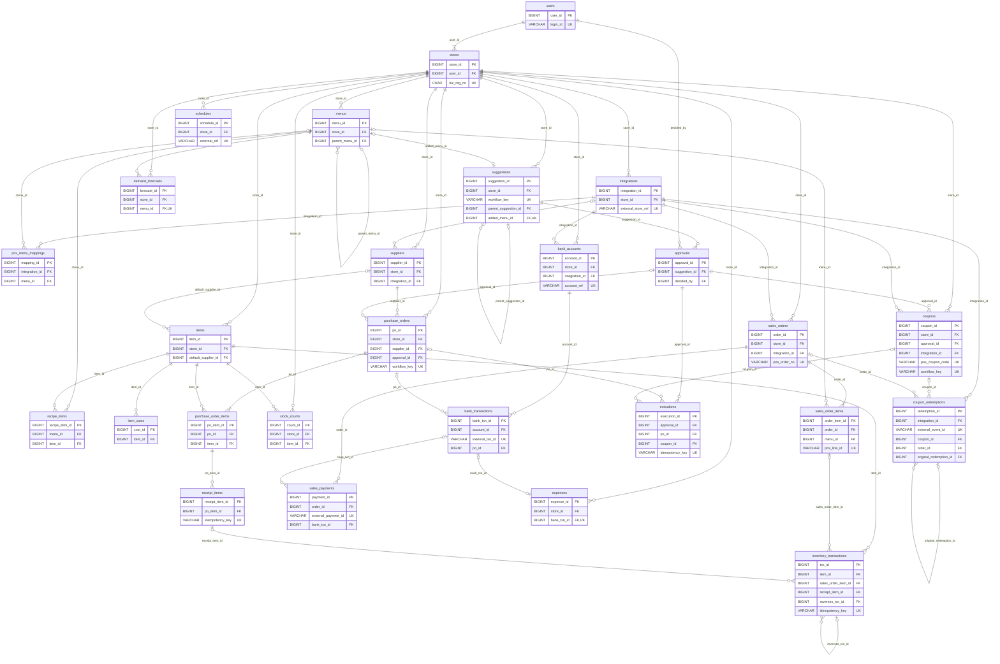

# 매장 운영 에이전트 DB 설계 v1.1

2026-11-24 · 9개 도메인 · 27개 테이블 · MySQL 8 기준

- DDL: [store-agent-db-v1.1-mysql.sql](store-agent-db-v1.1-mysql.sql)
- 화면용 문서(ERD 뷰어): [store-agent-db-v1.1.html](store-agent-db-v1.1.html)

## 표기

- 키: `PK` 기본키, `FK→테이블` 참조, `UQ` 유일, `UQ*` 설명에 적힌 컬럼과 묶어 유일
- NULL: `N` 필수, `Y` 허용
- 공통 컬럼: 모든 테이블에 `created_at`이 있고, 수정하는 테이블에는 `updated_at`도 있습니다. 표에서는 생략하고 각 테이블 아래에 적었습니다.
- 날짜는 Asia/Seoul 기준으로 해석합니다.

## ERD

키 컬럼(PK·FK·UQ)만 표시했습니다. 전체 컬럼은 아래 테이블 명세를 보세요.

## 테이블 목록

| 도메인 | 테이블 | 설명 |
| --- | --- | --- |
| 계정·매장·연동 | [`users`](#users) | 사장님 계정 |
| 계정·매장·연동 | [`stores`](#stores) | 매장 (사업자등록 1건 = 매장 1개) |
| 계정·매장·연동 | [`integrations`](#integrations) | POS·공급처·금융(오픈뱅킹) 연결 |
| 메뉴·레시피 | [`menus`](#menus) | 메뉴와 해당 메뉴의 옵션 |
| 메뉴·레시피 | [`recipe_items`](#recipe_items) | 메뉴·옵션별 레시피와 적용 기간 |
| 메뉴·레시피 | [`pos_menu_mappings`](#pos_menu_mappings) | POS 메뉴·옵션 ↔ 앱 메뉴·옵션 연결 |
| 재고·원가 | [`items`](#items) | 재고 품목 (원재료·포장재) |
| 재고·원가 | [`item_costs`](#item_costs) | 품목 단가 이력 (적용 시점 관리) |
| 재고·원가 | [`inventory_transactions`](#inventory_transactions) | 재료별 재고 변동과 판매 원가 사본 |
| 재고·원가 | [`stock_counts`](#stock_counts) | 실사 기록 (품목당 1행, 초기 재고 포함) |
| 판매·매출 | [`sales_orders`](#sales_orders) | POS 주문 |
| 판매·매출 | [`sales_order_items`](#sales_order_items) | 주문 항목 |
| 판매·매출 | [`sales_payments`](#sales_payments) | POS 결제 내역과 통장 입금 대사 |
| 입출금·비용 | [`bank_accounts`](#bank_accounts) | 금융 연동 계좌 (사장님이 등록·관리) |
| 입출금·비용 | [`bank_transactions`](#bank_transactions) | 입출금 거래 (금융 거래일 기준) |
| 입출금·비용 | [`expenses`](#expenses) | 운영 비용 (수동 입력·금융 거래 연결) |
| 거래처·발주·입고 | [`suppliers`](#suppliers) | 공급처 |
| 거래처·발주·입고 | [`purchase_orders`](#purchase_orders) | 발주 (연동 전송·직접 주문) |
| 거래처·발주·입고 | [`purchase_order_items`](#purchase_order_items) | 발주 품목 |
| 거래처·발주·입고 | [`receipt_items`](#receipt_items) | 입고 확인 (도착분을 정상·파손·오배송으로 구분) |
| 제안·승인·실행 | [`suggestions`](#suggestions) | 발주·쿠폰·메뉴·재고 제안의 버전별 결과 |
| 제안·승인·실행 | [`approvals`](#approvals) | 사용자의 승인·보류·반려 결정 |
| 제안·승인·실행 | [`executions`](#executions) | 승인된 발주·쿠폰 요청의 외부 처리 상태 |
| 쿠폰 | [`coupons`](#coupons) | 승인된 쿠폰과 POS 반영 상태 |
| 쿠폰 | [`coupon_redemptions`](#coupon_redemptions) | POS 쿠폰 사용 내역 (사용·취소·환불 이벤트) |
| 일정·수요 예측 | [`schedules`](#schedules) | 운영 일정 (행사 API 수집·사장님 직접 입력) |
| 일정·수요 예측 | [`demand_forecasts`](#demand_forecasts) | 메뉴별 일 판매량 예측 |

## 계정·매장·연동

### `users` — 사장님 계정

관계: stores 1:N · approvals 1:N

| 컬럼 | 타입 | 키 | NULL | 설명 |
| --- | --- | --- | --- | --- |
| `user_id` | BIGINT | PK | N | 사용자 ID |
| `login_id` | VARCHAR(50) | UQ | N | 로그인 아이디 |
| `password_hash` | VARCHAR(255) |  | N | 암호화된 비밀번호 (단방향 해시) |
| `name` | VARCHAR(50) |  | N | 이름 |
| `phone` | VARCHAR(20) |  | N | 인증한 휴대전화. 가입·비밀번호 찾기에 사용 |
| `lock_settings` | JSON |  | Y | 민감 정보 잠금 옵션: 사용 여부, 잠글 화면(매출·입출금 등), 해제 유지 시간 |
| `status` | VARCHAR(20) |  | N | 활성/잠김/탈퇴 |
| `phone_verified_at` | TIMESTAMP |  | N | 현재 전화번호의 인증 완료 시각 |

제약: 공통 컬럼: created_at, updated_at

### `stores` — 매장 (사업자등록 1건 = 매장 1개)

관계: users N:1 · integrations 1:N · menus 1:N · items 1:N · stock_counts 1:N · sales_orders 1:N · bank_accounts 1:N · expenses 1:N · suppliers 1:N · purchase_orders 1:N · suggestions 1:N · coupons 1:N · schedules 1:N · demand_forecasts 1:N

| 컬럼 | 타입 | 키 | NULL | 설명 |
| --- | --- | --- | --- | --- |
| `store_id` | BIGINT | PK | N | 매장 ID |
| `user_id` | BIGINT | FK→users | N | 소유 계정 |
| `biz_reg_no` | CHAR(10) | UQ* | N | 사업자등록번호 숫자 10자리 (*user_id와 묶어서 UQ). 사업자등록 1건 = 매장 1개 |
| `biz_name` | VARCHAR(100) |  | Y | 상호 (사업자등록상). 매장명을 정하기 전 기본 표시명 |
| `owner_name` | VARCHAR(50) |  | N | 대표자명 (공백만 입력 불가) |
| `business_opened_on` | DATE |  | N | 사업자등록상 개업일자 |
| `verify_status` | VARCHAR(20) |  | N | 미확인/정상사업자/휴·폐업/확인실패. 국세청 사업자 상태조회 결과 |
| `verified_at` | TIMESTAMP |  | Y | 진위·상태 확인 시각 |
| `name` | VARCHAR(100) |  | Y | 매장명. 가입 때 상호가 있으면 미리 채우고 첫 매장 설정(UF-02)에서 확정 |
| `category` | VARCHAR(50) |  | Y | 업종 (카페, 분식 등). 첫 매장 설정(UF-02)에서 입력 |
| `address` | VARCHAR(255) |  | Y | 주소. 첫 매장 설정(UF-02)에서 입력. 날씨 좌표 계산에 사용 |
| `open_hours` | JSON |  | Y | 요일별 영업시간. 예: {"mon":["09:00","21:00"]} |
| `closed_days` | JSON |  | Y | 정기 휴무 요일. 예: ["sun"] |
| `coupon_settings` | JSON |  | Y | 쿠폰 운영 설정: 목표, 월 예산, 제외 메뉴, 제외 시간대, 재조정 한도 (UF-07 1단계) |
| `onboarding_status` | JSON |  | Y | 초기 설정 단계별 완료 여부: 연동, 품목, 초기 재고, 레시피, 메뉴 연결. 로그인 후 다음 화면 안내에 사용 |

제약: UQ(user_id, biz_reg_no) · 공통 컬럼: created_at, updated_at

### `integrations` — POS·공급처·금융(오픈뱅킹) 연결

관계: stores N:1 · pos_menu_mappings 1:N · sales_orders 1:N · bank_accounts 1:N · suppliers 1:N · coupons 1:N · coupon_redemptions 1:N

| 컬럼 | 타입 | 키 | NULL | 설명 |
| --- | --- | --- | --- | --- |
| `integration_id` | BIGINT | PK | N | 연동 ID |
| `store_id` | BIGINT | FK→stores | N | 매장 |
| `provider_type` | VARCHAR(20) |  | N | POS/공급처/금융 |
| `provider_name` | VARCHAR(50) |  | N | 서비스명. 예: 토스플레이스, 금융결제원 오픈뱅킹 |
| `external_store_ref` | VARCHAR(100) | UQ* | Y | 외부 서비스의 매장 식별자. 토스플레이스 merchantId (*provider_name과 묶어서 UQ) |
| `external_user_ref` | VARCHAR(100) |  | Y | 외부 서비스의 사용자 식별자. 오픈뱅킹 사용자 일련번호 |
| `auth_ref` | VARCHAR(255) |  | N | 인증 정보 참조값. 원문(키·토큰)은 별도 암호화 저장소에 보관 |
| `token_expires_at` | TIMESTAMP |  | Y | 접근 토큰 만료 시각. 만료 전 갱신·연동 만료 안내(41-2)에 사용 |
| `data_scope` | JSON |  | Y | 제공 데이터 종류. 예: ["주문","결제","메뉴","옵션","쿠폰사용"] |
| `capabilities` | JSON |  | Y | 지원 기능. 예: {"coupon_sync":false,"order_send":false,"correction_send":false}. 화면 표시와 실행 가능 여부 판단에 사용 |
| `status` | VARCHAR(20) |  | N | 연결됨/오류/만료/해제 |
| `connected_at` | TIMESTAMP |  | N | 연결 시각 |
| `disconnected_at` | TIMESTAMP |  | Y | 연결 해제 시각. 해제 후 데이터 보존 범위는 미정 |
| `last_synced_at` | TIMESTAMP |  | Y | 최근 동기화 성공 시각 |
| `last_error` | TEXT |  | Y | 최근 실패 사유 |
| `sync_state` | JSON |  | N | 데이터 종류별 현재 동기화 상태. 기본 {}. 각 값은 cursor, complete_through, requested_from/to, status, last_attempt_at, error_code/message |

제약: UQ(provider_name, external_store_ref) · 공통 컬럼: created_at, updated_at

## 메뉴·레시피

### `menus` — 메뉴와 해당 메뉴의 옵션

관계: stores N:1 · menus N:1 · recipe_items 1:N · pos_menu_mappings 1:N · sales_order_items 1:N · suggestions 1:N · demand_forecasts 1:N

| 컬럼 | 타입 | 키 | NULL | 설명 |
| --- | --- | --- | --- | --- |
| `menu_id` | BIGINT | PK | N | 메뉴 ID |
| `store_id` | BIGINT | FK→stores | N | 매장 |
| `name` | VARCHAR(100) |  | N | 메뉴명 |
| `category` | VARCHAR(50) |  | Y | 카테고리 |
| `price` | INT |  | N | 판매가 (원) |
| `spec` | VARCHAR(50) |  | Y | 규격. 예: 톨, 1인분 |
| `sale_status` | VARCHAR(20) |  | N | 판매중/품절/비활성 |
| `source` | VARCHAR(20) |  | N | POS수집/직접등록/AI추천추가 |
| `menu_type` | VARCHAR(10) |  | N | 메뉴/옵션. 기본 메뉴 |
| `parent_menu_id` | BIGINT | FK→menus | Y | 옵션이면 소속 기본 메뉴. 기본 메뉴는 NULL |

제약: 공통 컬럼: created_at, updated_at

### `recipe_items` — 메뉴·옵션별 레시피와 적용 기간

관계: menus N:1 · items N:1

| 컬럼 | 타입 | 키 | NULL | 설명 |
| --- | --- | --- | --- | --- |
| `recipe_item_id` | BIGINT | PK | N | 레시피 항목 ID |
| `menu_id` | BIGINT | FK→menus | N | 기본 메뉴 또는 옵션 행. 옵션이면 해당 옵션 선택 시에만 적용 |
| `item_id` | BIGINT | FK→items | N | 사용 재료·포장재 |
| `quantity` | DECIMAL(10,3) |  | N | 관리 단위당 사용량. 기본 메뉴는 양수, 옵션은 기본 대비 증감량 |
| `applies_to` | VARCHAR(10) |  | N | 전체/매장/포장배달. 컵·뚜껑처럼 주문 유형에 따라 쓰는 재료. 기본 전체 |
| `source` | VARCHAR(10) |  | N | AI초안/사장님. AI 초안을 고치지 않고 저장했는지 구분 |
| `valid_from` | TIMESTAMP |  | N | 적용 시작 시각 |
| `valid_to` | TIMESTAMP |  | Y | 적용 종료 시각 (미포함). NULL이면 종료 미정 |

제약: UQ(menu_id, item_id, valid_from) · 공통 컬럼: created_at, updated_at

### `pos_menu_mappings` — POS 메뉴·옵션 ↔ 앱 메뉴·옵션 연결

관계: integrations N:1 · menus N:1

| 컬럼 | 타입 | 키 | NULL | 설명 |
| --- | --- | --- | --- | --- |
| `mapping_id` | BIGINT | PK | N | 매핑 ID |
| `integration_id` | BIGINT | FK→integrations | N | POS 연동 |
| `pos_menu_code` | VARCHAR(50) |  | N | POS 메뉴 코드 |
| `pos_option_code` | VARCHAR(50) |  | N | 기본 메뉴 연결이면 빈 문자열, 옵션 연결이면 POS 옵션 코드 |
| `pos_name` | VARCHAR(100) |  | N | POS 표시명 |
| `menu_id` | BIGINT | FK→menus | Y | 기본 메뉴 또는 옵션 행. 미연결이면 NULL |
| `status` | VARCHAR(20) |  | N | 연결/미연결/제외 |

제약: UQ(integration_id, pos_menu_code, pos_option_code) · 공통 컬럼: created_at, updated_at

## 재고·원가

### `items` — 재고 품목 (원재료·포장재)

관계: recipe_items 1:N · stores N:1 · suppliers N:1 · item_costs 1:N · inventory_transactions 1:N · stock_counts 1:N · purchase_order_items 1:N

| 컬럼 | 타입 | 키 | NULL | 설명 |
| --- | --- | --- | --- | --- |
| `item_id` | BIGINT | PK | N | 품목 ID |
| `store_id` | BIGINT | FK→stores | N | 매장 |
| `name` | VARCHAR(100) |  | N | 품목명 |
| `item_type` | VARCHAR(20) |  | N | 원재료/포장재 |
| `category` | VARCHAR(50) |  | Y | 분류 |
| `unit` | VARCHAR(10) |  | N | 관리 단위 (g/ml/개). 재고·레시피 수량의 기준 |
| `purchase_unit` | VARCHAR(10) |  | Y | 구매 단위 (팩/박스) |
| `pack_size` | DECIMAL(10,3) |  | Y | 구매 단위 1개 = 관리 단위 몇 개. 예: 우유 1팩 = 1000 |
| `unit_cost` | DECIMAL(10,4) |  | Y | 현재 관리 단위당 원가 (item_costs 최신값 사본) |
| `default_supplier_id` | BIGINT | FK→suppliers | Y | 기본 공급처 |
| `is_active` | BOOLEAN |  | N | 사용 여부 |
| `reorder_point` | DECIMAL(10,3) |  | Y | 현재 발주 검토 기준 수량. NULL이면 미산정 |
| `target_qty` | DECIMAL(10,3) |  | Y | 현재 목표 확보 수량 |
| `policy_basis` | JSON |  | Y | 현재 기준의 근거 요약·산정 시각·사용자가 확인한 값. 실행 로그 아님 |

제약: 공통 컬럼: created_at, updated_at

### `item_costs` — 품목 단가 이력 (적용 시점 관리)

관계: items N:1

| 컬럼 | 타입 | 키 | NULL | 설명 |
| --- | --- | --- | --- | --- |
| `cost_id` | BIGINT | PK | N | 단가 이력 ID |
| `item_id` | BIGINT | FK→items | N | 품목 |
| `unit_cost` | DECIMAL(10,4) |  | N | 관리 단위당 원가 |
| `effective_from` | TIMESTAMP |  | N | 적용 시작 시각 |
| `source` | VARCHAR(20) |  | N | 공급처단가/입고단가/직접입력 |
| `ref_id` | BIGINT |  | Y | 근거 레코드 ID (입고단가면 receipt_item_id) |

제약: UQ(item_id, effective_from) · 공통 컬럼: created_at (추가만 하고 수정하지 않는 테이블)

### `inventory_transactions` — 재료별 재고 변동과 판매 원가 사본

관계: items N:1 · sales_order_items N:1 · receipt_items N:1 · inventory_transactions N:1

| 컬럼 | 타입 | 키 | NULL | 설명 |
| --- | --- | --- | --- | --- |
| `txn_id` | BIGINT | PK | N | 변동 ID |
| `item_id` | BIGINT | FK→items | N | 재료·포장재 |
| `txn_type` | VARCHAR(20) |  | N | 판매차감/취소복원/입고/폐기/손실 |
| `qty_delta` | DECIMAL(10,3) |  | N | 관리 단위 증감량. 입고·복원은 양수, 차감·폐기·손실은 음수 |
| `unit_cost` | DECIMAL(10,4) |  | Y | 발생 시점 단가 사본. 취소복원은 원래 판매차감 단가 |
| `sales_order_item_id` | BIGINT | FK→sales_order_items | Y | 판매차감·취소복원의 근거 판매 항목 |
| `receipt_item_id` | BIGINT | FK→receipt_items | Y | 입고의 근거 확인 |
| `reverses_txn_id` | BIGINT | FK→inventory_transactions | Y | 취소복원이 되돌리는 판매차감 행 |
| `occurred_at` | TIMESTAMP |  | N | 재고 변동 발생 시각 |
| `recorded_at` | TIMESTAMP |  | N | 시스템 반영 시각 |
| `idempotency_key` | VARCHAR(100) | UQ | N | 사건·판매 항목·재료를 식별하는 안정적인 키 |
| `memo` | VARCHAR(255) |  | Y | 수동 폐기·손실 사유 |

제약: 공통 컬럼: created_at (추가만 하고 수정하지 않는 테이블)

### `stock_counts` — 실사 기록 (품목당 1행, 초기 재고 포함)

관계: stores N:1 · items N:1

| 컬럼 | 타입 | 키 | NULL | 설명 |
| --- | --- | --- | --- | --- |
| `count_id` | BIGINT | PK | N | 실사 ID |
| `store_id` | BIGINT | FK→stores | N | 매장 |
| `item_id` | BIGINT | FK→items | N | 품목 |
| `count_type` | VARCHAR(10) |  | N | 초기/실사 |
| `estimated_qty` | DECIMAL(10,3) |  | Y | 실사 시점 추정 재고 (초기 재고면 NULL) |
| `counted_qty` | DECIMAL(10,3) |  | N | 실제 확인 수량 |
| `counted_at` | TIMESTAMP |  | N | 기준 일시 (초기 재고는 재고 계산 시작 시점) |
| `memo` | VARCHAR(255) |  | Y | 메모 |

제약: UQ(item_id, counted_at) · 공통 컬럼: created_at (추가만 하고 수정하지 않는 테이블)

## 판매·매출

### `sales_orders` — POS 주문

관계: stores N:1 · integrations N:1 · sales_order_items 1:N · coupon_redemptions 1:N · sales_payments 1:N

| 컬럼 | 타입 | 키 | NULL | 설명 |
| --- | --- | --- | --- | --- |
| `order_id` | BIGINT | PK | N | 주문 ID |
| `store_id` | BIGINT | FK→stores | N | 매장 |
| `integration_id` | BIGINT | FK→integrations | N | 수집한 POS |
| `pos_order_no` | VARCHAR(50) | UQ* | N | POS 주문번호 (*integration_id와 묶어서 UQ) |
| `ordered_at` | TIMESTAMP |  | N | 주문 시각 |
| `sales_date` | DATE |  | N | 영업일. 매출 보기의 날짜 기준 |
| `order_type` | VARCHAR(10) |  | N | 매장/포장/배달/미확인. POS가 주지 않으면 미확인 |
| `total_amount` | BIGINT |  | N | 최초 결제액 (할인 반영 후, 환불 전). 원본 결제 사본 |
| `discount_amount` | INT |  | N | 할인 금액 (쿠폰 할인 포함) |
| `status` | VARCHAR(20) |  | N | 완료/취소/부분환불/환불 |
| `canceled_at` | TIMESTAMP |  | Y | 취소·환불 시각 |
| `received_at` | TIMESTAMP |  | N | 수집 시각. 늦게 들어온 주문 구분 |
| `refunded_amount` | BIGINT |  | N | 누적 취소·환불액. 기본 0, total_amount 이하 |
| `source_updated_at` | TIMESTAMP |  | Y | 공급자 수정 시각·버전 판단용. 오래된 스냅샷으로 되돌리지 않음 |

제약: UQ(integration_id, pos_order_no) · 공통 컬럼: created_at, updated_at

### `sales_order_items` — 주문 항목

관계: inventory_transactions 1:N · sales_orders N:1 · menus N:1

| 컬럼 | 타입 | 키 | NULL | 설명 |
| --- | --- | --- | --- | --- |
| `order_item_id` | BIGINT | PK | N | 주문 항목 ID |
| `order_id` | BIGINT | FK→sales_orders | N | 주문 |
| `pos_menu_code` | VARCHAR(50) |  | N | POS 메뉴 코드 |
| `menu_id` | BIGINT | FK→menus | Y | 매핑된 앱 메뉴 (미연결이면 NULL) |
| `quantity` | INT |  | N | 수량 |
| `unit_price` | INT |  | N | 단가 |
| `amount` | BIGINT |  | N | 주문 할인을 배분한 최초 항목 결제액. 환불 전 |
| `options` | JSON |  | Y | 선택 옵션 사본 [{pos_option_code, menu_id, quantity_per_item}]. menu_id는 menus의 옵션 행 |
| `refunded_qty` | INT |  | N | 환불 수량 (기본 0) |
| `restock_policy` | VARCHAR(10) |  | N | 복원/미복원. 기본 미복원, 실제 재료 사용 여부 확인 후 결정 |
| `pos_line_id` | VARCHAR(100) | UQ* | N | 원본 주문 내 안정적인 항목 ID (*order_id와 UQ) |
| `refunded_amount` | BIGINT |  | N | 항목 누적 환불액. 기본 0 |
| `inventory_status` | VARCHAR(20) |  | N | 대기/반영/보완필요 |
| `processing_error` | VARCHAR(255) |  | Y | 메뉴 미연결·옵션 단위·레시피 누락 등 재고 차감을 막는 현재 보완 사유. 단가 누락은 원가만 계산불가로 두고 차감은 진행 |

제약: UQ(order_id, pos_line_id) · 공통 컬럼: created_at, updated_at

### `sales_payments` — POS 결제 내역과 통장 입금 대사

관계: sales_orders N:1 · bank_transactions N:1

| 컬럼 | 타입 | 키 | NULL | 설명 |
| --- | --- | --- | --- | --- |
| `payment_id` | BIGINT | PK | N | 결제 ID |
| `order_id` | BIGINT | FK→sales_orders | N | 주문 |
| `external_payment_id` | VARCHAR(100) | UQ* | N | POS 결제 식별자. 토스플레이스 paymentId (*order_id와 묶어서 UQ) |
| `method` | VARCHAR(20) |  | N | 카드/현금/간편결제/기타 |
| `card_company` | VARCHAR(30) |  | Y | 매입 카드사. 지급주기·수수료 계산용 |
| `amount` | BIGINT |  | N | 결제 금액 |
| `approved_at` | TIMESTAMP |  | N | 승인 시각 |
| `status` | VARCHAR(10) |  | N | 승인/취소 |
| `canceled_at` | TIMESTAMP |  | Y | 취소 시각 |
| `expected_deposit_date` | DATE |  | Y | 예상 입금일. 카드사 지급주기로 계산 |
| `expected_deposit_amount` | BIGINT |  | Y | 예상 입금액. 가맹점 수수료 차감 |
| `bank_txn_id` | BIGINT | FK→bank_transactions | Y | 매칭된 실제 입금 거래 |
| `match_status` | VARCHAR(10) |  | N | 대기/정상/금액차이/누락의심/대상아님. 현금은 대상아님 |
| `matched_at` | TIMESTAMP |  | Y | 대사 처리 시각 |

제약: UQ(order_id, external_payment_id) · 공통 컬럼: created_at, updated_at

## 입출금·비용

### `bank_accounts` — 금융 연동 계좌 (사장님이 등록·관리)

관계: stores N:1 · integrations N:1 · bank_transactions 1:N

| 컬럼 | 타입 | 키 | NULL | 설명 |
| --- | --- | --- | --- | --- |
| `account_id` | BIGINT | PK | N | 계좌 ID |
| `store_id` | BIGINT | FK→stores | N | 매장 |
| `integration_id` | BIGINT | FK→integrations | N | 금융 연동 (provider_type=금융) |
| `institution_name` | VARCHAR(50) |  | N | 은행·카드사명 |
| `account_mask` | VARCHAR(30) |  | N | 가린 계좌번호. 예: 123-***-4567 |
| `account_ref` | VARCHAR(100) | UQ* | N | 연동 서비스의 계좌 식별자. 오픈뱅킹 핀테크이용번호(24자리) (*integration_id와 묶어서 UQ) |
| `alias` | VARCHAR(50) |  | Y | 사장님이 붙인 계좌 별칭. 예: 정산 통장 |
| `account_type` | VARCHAR(10) |  | N | 입출금/카드. 기본 입출금 |
| `purpose` | VARCHAR(20) |  | N | 매출정산/운영비/기타. 기본 기타. 입금 자동 분류의 근거 |
| `is_included` | BOOLEAN |  | N | 입출금 조회·비용 중복 후보에 포함할지. 기본 true |
| `is_primary` | BOOLEAN |  | N | 대표 계좌. 매장당 최대 1개. 기본 false |
| `status` | VARCHAR(10) |  | N | 연결/해지/오류 |
| `balance` | BIGINT |  | Y | 최근 조회한 잔액 사본 |
| `balance_at` | TIMESTAMP |  | Y | 잔액 조회 시각 |
| `connected_at` | TIMESTAMP |  | N | 계좌 등록 시각 |
| `disconnected_at` | TIMESTAMP |  | Y | 계좌 해지 시각. 해지 후에도 과거 거래 보존 |

제약: UQ(integration_id, account_ref) · 공통 컬럼: created_at, updated_at

### `bank_transactions` — 입출금 거래 (금융 거래일 기준)

관계: bank_accounts N:1 · purchase_orders N:1 · expenses 1:N · sales_payments 1:N

| 컬럼 | 타입 | 키 | NULL | 설명 |
| --- | --- | --- | --- | --- |
| `bank_txn_id` | BIGINT | PK | N | 거래 ID |
| `account_id` | BIGINT | FK→bank_accounts | N | 계좌 |
| `external_txn_id` | VARCHAR(100) | UQ* | N | 연동 서비스의 거래 식별자 (*account_id와 묶어서 UQ). 중복 수집 방지. 오픈뱅킹에 거래 고유 ID가 없으면 거래일시·입출금구분·금액·거래후잔액·적요 해시로 생성 |
| `txn_at` | TIMESTAMP |  | N | 금융 거래일시 (Asia/Seoul 기준). 날짜만 제공되면 해당일 00:00:00 |
| `txn_time_precision` | VARCHAR(10) |  | N | 원본 정밀도: date/time (CHECK). date의 00:00:00은 실제 거래 시각이 아님 |
| `direction` | VARCHAR(4) |  | N | 입금/출금 |
| `amount` | INT |  | N | 금액 (양수) |
| `balance_after` | BIGINT |  | Y | 거래 후 잔액 |
| `description` | VARCHAR(255) |  | Y | 적요·상대방 |
| `category` | VARCHAR(20) |  | N | 정산입금/인건비/임대료/공과금/거래처대금/수수료/기타/확인필요 |
| `category_source` | VARCHAR(10) |  | N | 자동분류/사장님확인 |
| `po_id` | BIGINT | FK→purchase_orders | Y | 거래처 대금이면 연결한 발주 |
| `received_at` | TIMESTAMP |  | N | 수집 시각 |

제약: UQ(account_id, external_txn_id) · 공통 컬럼: created_at, updated_at

### `expenses` — 운영 비용 (수동 입력·금융 거래 연결)

관계: stores N:1 · bank_transactions N:1

| 컬럼 | 타입 | 키 | NULL | 설명 |
| --- | --- | --- | --- | --- |
| `expense_id` | BIGINT | PK | N | 비용 ID |
| `store_id` | BIGINT | FK→stores | N | 매장 |
| `category` | VARCHAR(30) |  | N | 임대료/인건비/수수료/공과금/기타 (원재료 구매 대금은 넣지 않음) |
| `amount` | INT |  | N | 금액 |
| `period_start` | DATE |  | N | 적용 시작일 |
| `period_end` | DATE |  | N | 적용 종료일 |
| `source` | VARCHAR(10) |  | N | 수동입력/금융연동 |
| `bank_txn_id` | BIGINT | FK→bank_transactions, UQ | Y | 근거 금융 거래. UQ라서 같은 거래로 비용을 두 번 만들 수 없음 |
| `allocation` | VARCHAR(20) |  | N | 기간 배분 방식: 기간균등/발생일 |
| `status` | VARCHAR(10) |  | N | 반영/중복후보/제외 |
| `memo` | VARCHAR(255) |  | Y | 메모 |

제약: 공통 컬럼: created_at, updated_at

## 거래처·발주·입고

### `suppliers` — 공급처

관계: items 1:N · stores N:1 · integrations N:1 · purchase_orders 1:N

| 컬럼 | 타입 | 키 | NULL | 설명 |
| --- | --- | --- | --- | --- |
| `supplier_id` | BIGINT | PK | N | 공급처 ID |
| `store_id` | BIGINT | FK→stores | N | 매장 |
| `name` | VARCHAR(100) |  | N | 공급처명 |
| `source` | VARCHAR(20) |  | N | 등록/신규탐색 |
| `integration_id` | BIGINT | FK→integrations | Y | 연동 발주가 가능하면 값, NULL이면 직접 주문 |
| `contact` | VARCHAR(255) |  | Y | 연락처·사이트 URL |
| `lead_time_days` | INT |  | Y | 주문부터 도착까지 기본 일수. 사장님 입력 또는 과거 발주의 주문~첫 정상 입고 간격으로 추정 |
| `verify_status` | VARCHAR(20) |  | N | 미검증/검증완료/제외 |
| `verified_at` | TIMESTAMP |  | Y | 검증 시각 |

제약: 공통 컬럼: created_at, updated_at

### `purchase_orders` — 발주 (연동 전송·직접 주문)

관계: bank_transactions 1:N · stores N:1 · suppliers N:1 · approvals N:1 · purchase_order_items 1:N · executions 1:N

| 컬럼 | 타입 | 키 | NULL | 설명 |
| --- | --- | --- | --- | --- |
| `po_id` | BIGINT | PK | N | 발주 ID |
| `store_id` | BIGINT | FK→stores | N | 매장 |
| `supplier_id` | BIGINT | FK→suppliers | N | 공급처 |
| `order_method` | VARCHAR(20) |  | N | API전송/직접주문 |
| `status` | VARCHAR(20) |  | N | 전송대기/요청/접수/배송중/부분입고/확인필요/입고완료/종료/취소. 종료는 일부 품목을 거절·잔량종료로 마친 주문 |
| `subtotal` | INT |  | N | 상품 금액 |
| `shipping_fee` | INT |  | Y | 배송비 |
| `total_amount` | INT |  | N | 총액 |
| `ordered_at` | TIMESTAMP |  | Y | 외부 요청 또는 직접 주문 시각. 전송대기이면 NULL |
| `expected_arrival` | DATE |  | Y | 도착 예정일 |
| `external_order_ref` | VARCHAR(100) |  | Y | 공급처 주문번호 |
| `approval_id` | BIGINT | FK→approvals | Y | 발주에 사용한 승인. 승인 없이 이미 주문한 내용을 등록한 경우만 NULL |
| `workflow_key` | VARCHAR(64) | UQ | N | 한 발주 업무의 식별자. 재승인·재시도에도 유지 |

제약: 공통 컬럼: created_at, updated_at

### `purchase_order_items` — 발주 품목

관계: purchase_orders N:1 · items N:1 · receipt_items 1:N

| 컬럼 | 타입 | 키 | NULL | 설명 |
| --- | --- | --- | --- | --- |
| `po_item_id` | BIGINT | PK | N | 발주 품목 ID |
| `po_id` | BIGINT | FK→purchase_orders | N | 발주 |
| `item_id` | BIGINT | FK→items | N | 품목 |
| `quantity` | DECIMAL(10,3) |  | N | 주문 수량 (구매 단위) |
| `units_per_order` | DECIMAL(10,3) |  | N | 발주 당시 구매 단위 1개당 관리 단위 수량 사본. 양수 필수 |
| `unit_price` | DECIMAL(10,2) |  | N | 단가 (구매 단위) |
| `product_name` | VARCHAR(100) |  | N | 주문 당시 공급처 상품명 |
| `product_ref` | VARCHAR(255) |  | Y | 공급처 상품 코드 또는 URL 사본 |
| `purchase_unit` | VARCHAR(10) |  | N | 주문 당시 구매 단위 |
| `line_status` | VARCHAR(20) |  | N | 주문/접수/거절/부분입고/입고완료/잔량종료. 기본 주문 |
| `closed_at` | TIMESTAMP |  | Y | 거절·잔량종료 처리 시각 |
| `close_reason` | VARCHAR(255) |  | Y | 거절·잔량종료 사유. 예: 공급처 품절, 미배송 확정 |

제약: 공통 컬럼: created_at, updated_at

### `receipt_items` — 입고 확인 (도착분을 정상·파손·오배송으로 구분)

관계: inventory_transactions 1:N · purchase_order_items N:1

| 컬럼 | 타입 | 키 | NULL | 설명 |
| --- | --- | --- | --- | --- |
| `receipt_item_id` | BIGINT | PK | N | 입고 확인 ID |
| `po_item_id` | BIGINT | FK→purchase_order_items | N | 발주 품목 |
| `arrived_qty` | DECIMAL(10,3) |  | N | 이번에 도착한 수량 (구매 단위) |
| `arrived_at` | TIMESTAMP |  | Y | 실제 도착 시각. 입력하지 않으면 confirmed_at과 같음 |
| `expiry_date` | DATE |  | Y | 이번 입고분 소비기한. 선택 입력 |
| `normal_qty` | DECIMAL(10,3) |  | N | 정상으로 확정한 수량. 이 수량만 가용 재고에 반영 |
| `damaged_qty` | DECIMAL(10,3) |  | N | 파손 수량 (기본 0) |
| `wrong_qty` | DECIMAL(10,3) |  | N | 오배송 수량 (기본 0) |
| `confirmed_at` | TIMESTAMP |  | N | 확정 시각 |
| `idempotency_key` | VARCHAR(100) | UQ | N | 같은 확정을 두 번 반영하지 않기 위한 키 |
| `issue_note` | VARCHAR(500) |  | Y | 파손·오배송 등 현장 확인 내용. 후속 보류 상태 이력은 관리하지 않음 |

제약: 공통 컬럼: created_at (추가만 하고 수정하지 않는 테이블)

## 제안·승인·실행

### `suggestions` — 발주·쿠폰·메뉴·재고 제안의 버전별 결과

관계: stores N:1 · suggestions N:1 · menus N:1 · approvals 1:N

| 컬럼 | 타입 | 키 | NULL | 설명 |
| --- | --- | --- | --- | --- |
| `suggestion_id` | BIGINT | PK | N | 제안 버전 ID |
| `store_id` | BIGINT | FK→stores | N | 매장 |
| `workflow_key` | VARCHAR(64) | UQ* | N | 동일 업무의 안정적인 키 (*version과 UQ) |
| `version` | INT |  | N | 1부터 증가하는 버전 |
| `parent_suggestion_id` | BIGINT | FK→suggestions | Y | 수정 전 버전. 처음이면 NULL |
| `change_source` | VARCHAR(10) |  | N | AI생성/사장님수정/재생성요청/재분석. 이 버전을 만든 주체 |
| `change_reason` | VARCHAR(500) |  | Y | 사장님 수정 이유. 예: 레시피 사용량·재고·공급처 사유 |
| `suggestion_type` | VARCHAR(20) |  | N | 발주/쿠폰/메뉴/재고알림/데이터보완 |
| `urgency_level` | VARCHAR(10) |  | N | 긴급/주의/일반. 기본 일반 |
| `priority` | INT |  | N | 같은 긴급도 안의 표시 순서 |
| `title` | VARCHAR(200) |  | N | 제안 제목 |
| `summary` | VARCHAR(500) |  | Y | 사용자 안내·보류 사유 요약 |
| `payload` | JSON |  | N | 유형별 최종 제안 내용. 아래 유형별 계약 참조 |
| `evidence` | JSON |  | N | 사용자에게 보여줄 근거·출처·기준 시각·예상 효과 사본 |
| `status` | VARCHAR(20) |  | N | 검토대기/보류/반려/승인/확인완료/보완필요/만료/대체됨 |
| `business_date` | DATE |  | N | 한국 기준 제안 기준일 |
| `langsmith_trace_id` | VARCHAR(64) |  | Y | AI 추적 연결값. 서비스 원본이나 FK가 아님 |
| `added_menu_id` | BIGINT | FK→menus, UQ | Y | 메뉴 제안으로 추가한 기본 메뉴. 다른 유형은 NULL |

제약: UQ(workflow_key, version) · 공통 컬럼: created_at, updated_at

### `approvals` — 사용자의 승인·보류·반려 결정

관계: purchase_orders 1:N · suggestions N:1 · users N:1 · executions 1:N · coupons 1:N

| 컬럼 | 타입 | 키 | NULL | 설명 |
| --- | --- | --- | --- | --- |
| `approval_id` | BIGINT | PK | N | 결정 ID |
| `suggestion_id` | BIGINT | FK→suggestions | N | 결정한 제안 버전 |
| `decided_by` | BIGINT | FK→users | N | 실제로 결정한 사용자 |
| `decision` | VARCHAR(10) |  | N | 승인/보류/반려 |
| `reason` | VARCHAR(500) |  | Y | 결정 사유 |
| `approved_scope` | JSON |  | Y | 승인한 대상·품목·공급처·최대 금액·기간·쿠폰 할인/한도 사본 |
| `decided_at` | TIMESTAMP |  | N | 결정 시각 |

제약: 공통 컬럼: created_at (추가만 하고 수정하지 않는 테이블)

### `executions` — 승인된 발주·쿠폰 요청의 외부 처리 상태

관계: approvals N:1 · purchase_orders N:1 · coupons N:1

| 컬럼 | 타입 | 키 | NULL | 설명 |
| --- | --- | --- | --- | --- |
| `execution_id` | BIGINT | PK | N | 외부 요청 ID |
| `approval_id` | BIGINT | FK→approvals | N | 승인 결정 |
| `po_id` | BIGINT | FK→purchase_orders | Y | 발주 전송 대상 |
| `coupon_id` | BIGINT | FK→coupons | Y | 쿠폰 POS 등록·변경 대상 |
| `operation` | VARCHAR(20) |  | N | 발주전송/쿠폰등록/쿠폰변경 |
| `idempotency_key` | VARCHAR(100) | UQ | N | 업무 대상·작업·요청 내용에 대한 안정적인 중복 방지 키 |
| `exec_status` | VARCHAR(20) |  | N | 대기/처리중/성공/실패/부분성공/결과확인중/수동종료 |
| `scope_check` | JSON |  | Y | 실행 직전 승인 범위·현재 조건 검증 결과. 전송 전 필수 |
| `request_body` | JSON |  | N | 실제 승인·전송할 요청 사본 |
| `external_ref` | VARCHAR(100) |  | Y | 외부 주문·처리 식별자 |
| `result_summary` | JSON |  | Y | 사용자에게 필요한 결과·확인된 성공 범위 |
| `error_msg` | VARCHAR(500) |  | Y | 사용자 안내 오류 |
| `langsmith_trace_id` | VARCHAR(64) |  | Y | 상세 도구 호출 추적 |
| `executed_at` | TIMESTAMP |  | Y | 전송 시각 |
| `last_checked_at` | TIMESTAMP |  | Y | 최근 외부 결과 확인 시각 |
| `resolved_at` | TIMESTAMP |  | Y | 사장님이 부분성공·결과확인중 요청을 외부에서 확인하고 수동종료한 시각 |

제약: 공통 컬럼: created_at, updated_at

## 쿠폰

### `coupons` — 승인된 쿠폰과 POS 반영 상태

관계: executions 1:N · stores N:1 · approvals N:1 · integrations N:1 · coupon_redemptions 1:N

| 컬럼 | 타입 | 키 | NULL | 설명 |
| --- | --- | --- | --- | --- |
| `coupon_id` | BIGINT | PK | N | 쿠폰 ID |
| `store_id` | BIGINT | FK→stores | N | 매장 |
| `approval_id` | BIGINT | FK→approvals | N | 근거 승인 |
| `integration_id` | BIGINT | FK→integrations | N | 반영할 POS |
| `name` | VARCHAR(100) |  | N | 쿠폰명 |
| `conditions` | JSON |  | N | 승인한 최종 조건 사본: 적용 메뉴, 할인, 시간대, 최소 주문, 사용 제한 |
| `valid_from` | DATE |  | N | 운영 시작일 |
| `valid_to` | DATE |  | N | 운영 종료일 |
| `issue_qty` | INT |  | Y | 발행 수량 |
| `usage_limit_qty` | INT |  | Y | 사용 한도 |
| `pos_sync_status` | VARCHAR(20) |  | N | 반영대기/반영완료/실패/결과확인중/미지원 |
| `pos_coupon_code` | VARCHAR(100) | UQ* | Y | POS의 쿠폰·프로모션 식별자 (*integration_id와 묶어서 UQ). 사용 내역 매칭에 사용. 토스플레이스는 할인정책 ID(discountPolicyId), 신규 생성 미지원 시 NULL |
| `pos_synced_at` | TIMESTAMP |  | Y | 반영 완료 확인 시각 |
| `workflow_key` | VARCHAR(64) | UQ | N | 한 쿠폰 업무의 키. 버전 변경에도 동일 쿠폰 유지 |

제약: UQ(integration_id, pos_coupon_code) · 공통 컬럼: created_at, updated_at

### `coupon_redemptions` — POS 쿠폰 사용 내역 (사용·취소·환불 이벤트)

관계: integrations N:1 · coupons N:1 · sales_orders N:1 · coupon_redemptions N:1

| 컬럼 | 타입 | 키 | NULL | 설명 |
| --- | --- | --- | --- | --- |
| `redemption_id` | BIGINT | PK | N | 사용 내역 ID |
| `integration_id` | BIGINT | FK→integrations | N | 수집한 POS |
| `external_event_id` | VARCHAR(100) | UQ* | N | POS 이벤트 식별자 (*integration_id와 묶어서 UQ). 중복 수집 방지 |
| `pos_coupon_code` | VARCHAR(100) |  | N | POS가 보낸 쿠폰 식별자 |
| `coupon_id` | BIGINT | FK→coupons | Y | 매칭된 쿠폰 (매칭 전이면 NULL) |
| `order_id` | BIGINT | FK→sales_orders | Y | 적용 주문 (연결할 수 있을 때) |
| `event_type` | VARCHAR(10) |  | N | 사용/취소/환불 |
| `discount_amount` | INT |  | N | 할인액. 취소·환불은 음수 |
| `order_amount` | INT |  | Y | 적용 주문 결제액 |
| `occurred_at` | TIMESTAMP |  | N | 발생 시각 |
| `received_at` | TIMESTAMP |  | N | 수집 시각 |
| `original_redemption_id` | BIGINT | FK→coupon_redemptions | Y | 취소·환불이 되돌리는 사용 이벤트 |

제약: UQ(integration_id, external_event_id) · 공통 컬럼: created_at, updated_at

## 일정·수요 예측

### `schedules` — 운영 일정 (행사 API 수집·사장님 직접 입력)

관계: stores N:1

| 컬럼 | 타입 | 키 | NULL | 설명 |
| --- | --- | --- | --- | --- |
| `schedule_id` | BIGINT | PK | N | 일정 ID |
| `store_id` | BIGINT | FK→stores | N | 매장 |
| `source` | VARCHAR(10) |  | N | 행사API/직접입력 |
| `external_ref` | VARCHAR(100) | UQ* | Y | 행사 API의 원본 ID (*store_id·source와 묶어서 UQ). 다시 수집해도 중복 생성하지 않음. 직접입력은 NULL |
| `schedule_type` | VARCHAR(20) |  | N | 지역행사/시험/방학/임시휴무/기타 |
| `title` | VARCHAR(100) |  | N | 일정명 |
| `start_at` | TIMESTAMP |  | N | 시작 시각. 종일 일정은 첫날 00:00 |
| `end_at` | TIMESTAMP |  | N | 종료 시각 (미포함). end_at > start_at. 종일 일정은 마지막 날의 다음 날 00:00 |
| `is_all_day` | BOOLEAN |  | N | 종일 일정 여부. 기본 true (행사 API는 대부분 날짜만 제공) |
| `location` | VARCHAR(255) |  | Y | 장소. 행사 API의 주소 등 |
| `expected_impact` | VARCHAR(10) |  | Y | 사장님이 예상하는 매출 영향: 증가/감소/모름. LLM 매출 분석에 참고로 넣음 |
| `is_hidden` | BOOLEAN |  | N | 캘린더·분석에서 제외. 기본 false. 수집 일정은 삭제 대신 숨김 |
| `memo` | VARCHAR(255) |  | Y | 메모 |

제약: UQ(store_id, source, external_ref) · 공통 컬럼: created_at, updated_at

### `demand_forecasts` — 메뉴별 일 판매량 예측

관계: stores N:1 · menus N:1

| 컬럼 | 타입 | 키 | NULL | 설명 |
| --- | --- | --- | --- | --- |
| `forecast_id` | BIGINT | PK | N | 예측 ID |
| `store_id` | BIGINT | FK→stores | N | 매장 |
| `menu_id` | BIGINT | FK→menus, UQ* | N | 기본 메뉴 (*target_date·model_version과 묶어서 UQ) |
| `target_date` | DATE |  | N | 예측 대상 영업일 |
| `predicted_qty` | DECIMAL(10,2) |  | N | 예측 판매 수량 |
| `lower_qty` | DECIMAL(10,2) |  | Y | 예측 하한 |
| `upper_qty` | DECIMAL(10,2) |  | Y | 예측 상한 |
| `model_version` | VARCHAR(30) |  | N | 모델 버전 |
| `drivers` | JSON |  | Y | 주요 영향 요인과 예측에 쓴 날씨 요약·일정 ID 사본. 화면 근거 표시용. 예: {"factors":{"비":-0.15},"weather":{"max":3,"rain_mm":5},"schedule_ids":[12]} |

제약: UQ(menu_id, target_date, model_version) · 공통 컬럼: created_at (추가만 하고 수정하지 않는 테이블)
