# 매장 운영 에이전트 DB 설계 (PostgreSQL)

2026-11-24 · v1.1 설계 + 11/24 계약 반영 · 9개 도메인 · 28개 표 (27개 + `ai_job`) · PostgreSQL 17 기준

> 📌 **기준은 SQL 입니다.** 이 문서는 [store-agent-db.sql](store-agent-db.sql) 을 사람이 읽기 쉽게 옮긴 것입니다.
> 같은 SQL 이 Flyway 마이그레이션 [`V202611241000__create_store_agent_schema.sql`](../../backend/src/main/resources/db/migration/V202611241000__create_store_agent_schema.sql)(27개 표)과 그 뒤 마이그레이션(`V202611261001__enforce_unique_store_business_number.sql` 사업자번호 UQ, `V202611262100__create_ai_job.sql` `ai_job`, `V202611271730__make_suggestion_version_unique_per_store.sql` 제안 버전 UQ)에 나눠 있습니다.
> 표를 바꿀 때는 **새 마이그레이션 → `store-agent-db.sql` → 이 문서** 순서로 같이 고칩니다 (머지된 마이그레이션은 고치지 않음).
> v1.1 원본 설계(MySQL 8, 복수형 표 이름)는 git 기록에서 볼 수 있습니다.

## 표기

- 키: `PK` 기본키, `FK→표` 참조, `UQ` 단독 유일, `UQ*` 다른 칸과 묶어 유일 (표 아래 "제약"에 묶음 표시), `UQ†` 조건부 유일 인덱스
- NULL: `N` 필수, `Y` 허용
- 기본값: SQL 의 `DEFAULT`. PK 는 모두 `BIGINT GENERATED ALWAYS AS IDENTITY` (자동 증가)
- 공통 칸: 모든 표에 `created_at TIMESTAMPTZ NOT NULL DEFAULT now()` 이 있고, 수정하는 표에는 `updated_at` 도 있습니다. 표에서는 생략하고 각 표 아래 "제약"에 적었습니다. `updated_at` 은 PostgreSQL 에 `ON UPDATE` 가 없으므로 앱(JPA)에서 갱신합니다.
- 상태 값: 영어 대문자 코드 + `CHECK`. 설명 칸에 `코드 한글` 대응을 적었습니다 (한글 표시는 프론트에서).
- 시간은 `TIMESTAMPTZ`, 매출 집계 영업일은 한국 시간 기준 `business_date DATE`.
- JSON 칸은 `JSONB`, 안의 키는 camelCase. 내부 구조는 백엔드 DTO 로 고정·검증합니다.
- 금액 `DECIMAL(19,2)`, 관리 단위당 단가 `DECIMAL(19,4)`, 재고·레시피 수량 `DECIMAL(19,3)`, 판매 수량 `INTEGER`.
- FK 칸에는 인덱스가 자동으로 생기지 않습니다. 조회에 쓰는 FK 는 별도 마이그레이션에서 인덱스 추가를 검토합니다.

## v1.1 (MySQL) 대비 바뀐 점

- 표 이름을 **단수** snake_case 로 (`users` → `member`, `stores` → `store` …). `user` 는 PostgreSQL 예약어라 `member` 로 했습니다.
- PK 는 `<표>_id`, FK 는 참조하는 PK 와 같은 이름 (역할이 있으면 `<역할>_<표>_id`: `parent_menu_id`, `default_supplier_id`, `decided_by_member_id`, `reversed_inventory_transaction_id`, `original_coupon_redemption_id`).
- 금액 `INT`·`BIGINT` → `DECIMAL(19,2)`, 수량·단가 `DECIMAL(10,x)` → `DECIMAL(19,x)`, `TIMESTAMP` → `TIMESTAMPTZ`, `JSON` → `JSONB`.
- 한글 상태 값 → 영어 대문자 코드 + `CHECK`. 품목 `unit` 은 `G` · `ML` · `EA` 만.
- **모든 표에 `store_id`** ([매장 분리](../rules/db.md#매장-분리)). v1.1 에 없던 하위 표 12개에 부모 행과 같은 값으로 추가했습니다.
- `integration`, `sales_order`, `sales_order_item` 은 11/24 계약 확정안으로 칸을 바꿨습니다 (각 표의 "v1.1 대비" 참고).
- 공급처 브라우저 주문 · 결제 확인 (최소 구성): `item.purchase_config`, `supplier.order_channel`, `suggestion.generation_context`, `execution.runtime_context`, `purchase_order.payment_status` · `paid_amount` · `paid_at`, `purchase_order_item.product_options` 추가. `supplier.order_channel` · `purchase_order.order_method` 에 `BROWSER`, `execution.exec_status` 에 `WAITING_AUTH` 추가.
- 여러 워커 · 장애 후 자동 인계를 만들 때만 `suggestion` · `execution` 에 `lease_owner VARCHAR(100)`, `lease_expires_at TIMESTAMPTZ` 추가를 검토합니다 (지금은 없음).

| v1.1 표 | 지금 표 | v1.1 PK → 지금 PK |
| --- | --- | --- |
| `users` | [`member`](#member) | `user_id` → `member_id` |
| `stores` | [`store`](#store) | `store_id` (같음) |
| `integrations` | [`integration`](#integration) | `integration_id` (같음) |
| `menus` | [`menu`](#menu) | `menu_id` (같음) |
| `recipe_items` | [`recipe_item`](#recipe_item) | `recipe_item_id` (같음) |
| `pos_menu_mappings` | [`pos_menu_mapping`](#pos_menu_mapping) | `mapping_id` → `pos_menu_mapping_id` |
| `items` | [`item`](#item) | `item_id` (같음) |
| `item_costs` | [`item_cost`](#item_cost) | `cost_id` → `item_cost_id` |
| `inventory_transactions` | [`inventory_transaction`](#inventory_transaction) | `txn_id` → `inventory_transaction_id` |
| `stock_counts` | [`stock_count`](#stock_count) | `count_id` → `stock_count_id` |
| `sales_orders` | [`sales_order`](#sales_order) | `order_id` → `sales_order_id` |
| `sales_order_items` | [`sales_order_item`](#sales_order_item) | `order_item_id` → `sales_order_item_id` |
| `sales_payments` | [`sales_payment`](#sales_payment) | `payment_id` → `sales_payment_id` |
| `bank_accounts` | [`bank_account`](#bank_account) | `account_id` → `bank_account_id` |
| `bank_transactions` | [`bank_transaction`](#bank_transaction) | `bank_txn_id` → `bank_transaction_id` |
| `expenses` | [`expense`](#expense) | `expense_id` (같음) |
| `suppliers` | [`supplier`](#supplier) | `supplier_id` (같음) |
| `purchase_orders` | [`purchase_order`](#purchase_order) | `po_id` → `purchase_order_id` |
| `purchase_order_items` | [`purchase_order_item`](#purchase_order_item) | `po_item_id` → `purchase_order_item_id` |
| `receipt_items` | [`receipt_item`](#receipt_item) | `receipt_item_id` (같음) |
| `suggestions` | [`suggestion`](#suggestion) | `suggestion_id` (같음) |
| `approvals` | [`approval`](#approval) | `approval_id` (같음) |
| `executions` | [`execution`](#execution) | `execution_id` (같음) |
| `coupons` | [`coupon`](#coupon) | `coupon_id` (같음) |
| `coupon_redemptions` | [`coupon_redemption`](#coupon_redemption) | `redemption_id` → `coupon_redemption_id` |
| `schedules` | [`schedule`](#schedule) | `schedule_id` (같음) |
| `demand_forecasts` | [`demand_forecast`](#demand_forecast) | `forecast_id` → `demand_forecast_id` |

## ERD

키 칸(PK·FK·UQ)만 표시했습니다. 전체 칸은 아래 표 명세를 보세요.
하위 표의 매장 분리용 `store_id` (부모 행과 같은 값) 선은 그림이 복잡해져 생략했습니다. 칸은 각 표에 있습니다.

```mermaid
erDiagram
  member ||--|{ store : "member_id"
  store ||--o{ integration : "store_id"
  store ||--o{ menu : "store_id"
  menu |o--o{ menu : "parent_menu_id"
  menu ||--o{ recipe_item : "menu_id"
  item ||--o{ recipe_item : "item_id"
  integration ||--o{ pos_menu_mapping : "integration_id"
  menu |o--o{ pos_menu_mapping : "menu_id"
  store ||--o{ item : "store_id"
  supplier |o--o{ item : "default_supplier_id"
  item ||--o{ item_cost : "item_id"
  item ||--o{ inventory_transaction : "item_id"
  sales_order_item |o--o{ inventory_transaction : "sales_order_item_id"
  receipt_item |o--o{ inventory_transaction : "receipt_item_id"
  inventory_transaction |o--o{ inventory_transaction : "reversed_inventory_transaction_id"
  store ||--o{ stock_count : "store_id"
  item ||--o{ stock_count : "item_id"
  store ||--o{ sales_order : "store_id"
  integration ||--o{ sales_order : "integration_id"
  sales_order ||--|{ sales_order_item : "sales_order_id"
  menu |o--o{ sales_order_item : "menu_id"
  sales_order ||--o{ sales_payment : "sales_order_id"
  bank_transaction |o--o{ sales_payment : "bank_transaction_id"
  store ||--o{ bank_account : "store_id"
  integration ||--o{ bank_account : "integration_id"
  bank_account ||--o{ bank_transaction : "bank_account_id"
  purchase_order |o--o{ bank_transaction : "purchase_order_id"
  store ||--o{ expense : "store_id"
  bank_transaction |o--o| expense : "bank_transaction_id"
  store ||--o{ supplier : "store_id"
  integration |o--o{ supplier : "integration_id"
  store ||--o{ purchase_order : "store_id"
  supplier ||--o{ purchase_order : "supplier_id"
  approval |o--o{ purchase_order : "approval_id"
  purchase_order ||--|{ purchase_order_item : "purchase_order_id"
  item ||--o{ purchase_order_item : "item_id"
  purchase_order_item ||--o{ receipt_item : "purchase_order_item_id"
  store ||--o{ suggestion : "store_id"
  suggestion |o--o{ suggestion : "parent_suggestion_id"
  menu |o--o| suggestion : "added_menu_id"
  suggestion ||--o{ approval : "suggestion_id"
  member ||--o{ approval : "decided_by_member_id"
  approval ||--o{ execution : "approval_id"
  purchase_order |o--o{ execution : "purchase_order_id"
  coupon |o--o{ execution : "coupon_id"
  store ||--o{ ai_job : "store_id"
  member |o--o{ ai_job : "requested_by_member_id"
  suggestion |o--o{ ai_job : "suggestion_id"
  execution |o--o{ ai_job : "execution_id"
  store ||--o{ coupon : "store_id"
  approval ||--o{ coupon : "approval_id"
  integration ||--o{ coupon : "integration_id"
  integration ||--o{ coupon_redemption : "integration_id"
  coupon |o--o{ coupon_redemption : "coupon_id"
  sales_order |o--o{ coupon_redemption : "sales_order_id"
  coupon_redemption |o--o{ coupon_redemption : "original_coupon_redemption_id"
  store ||--o{ schedule : "store_id"
  store ||--o{ demand_forecast : "store_id"
  menu ||--o{ demand_forecast : "menu_id"

  member {
    BIGINT member_id PK
    VARCHAR login_id UK
  }
  store {
    BIGINT store_id PK
    BIGINT member_id FK, UK
    CHAR biz_reg_no UK
  }
  integration {
    BIGINT integration_id PK
    BIGINT store_id FK
    VARCHAR provider UK
    VARCHAR external_store_id UK
  }
  menu {
    BIGINT menu_id PK
    BIGINT store_id FK
    BIGINT parent_menu_id FK
  }
  recipe_item {
    BIGINT recipe_item_id PK
    BIGINT store_id FK
    BIGINT menu_id FK, UK
    BIGINT item_id FK, UK
    TIMESTAMPTZ valid_from UK
  }
  pos_menu_mapping {
    BIGINT pos_menu_mapping_id PK
    BIGINT store_id FK
    BIGINT integration_id FK, UK
    VARCHAR pos_menu_code UK
    VARCHAR pos_option_code UK
    BIGINT menu_id FK
  }
  item {
    BIGINT item_id PK
    BIGINT store_id FK
    BIGINT default_supplier_id FK
  }
  item_cost {
    BIGINT item_cost_id PK
    BIGINT store_id FK
    BIGINT item_id FK, UK
    TIMESTAMPTZ effective_from UK
  }
  inventory_transaction {
    BIGINT inventory_transaction_id PK
    BIGINT store_id FK
    BIGINT item_id FK, UK
    BIGINT sales_order_item_id FK
    BIGINT receipt_item_id FK
    BIGINT reversed_inventory_transaction_id FK
    VARCHAR idempotency_key UK
  }
  stock_count {
    BIGINT stock_count_id PK
    BIGINT store_id FK
    BIGINT item_id FK, UK
    TIMESTAMPTZ counted_at UK
  }
  sales_order {
    BIGINT sales_order_id PK
    BIGINT store_id FK
    BIGINT integration_id FK, UK
    VARCHAR external_order_id UK
  }
  sales_order_item {
    BIGINT sales_order_item_id PK
    BIGINT store_id FK
    BIGINT sales_order_id FK, UK
    INTEGER line_no UK
    BIGINT menu_id FK
  }
  sales_payment {
    BIGINT sales_payment_id PK
    BIGINT store_id FK
    BIGINT sales_order_id FK, UK
    VARCHAR external_payment_id UK
    BIGINT bank_transaction_id FK
  }
  bank_account {
    BIGINT bank_account_id PK
    BIGINT store_id FK
    BIGINT integration_id FK, UK
    VARCHAR account_ref UK
  }
  bank_transaction {
    BIGINT bank_transaction_id PK
    BIGINT store_id FK
    BIGINT bank_account_id FK, UK
    VARCHAR external_txn_id UK
    BIGINT purchase_order_id FK
  }
  expense {
    BIGINT expense_id PK
    BIGINT store_id FK
    BIGINT bank_transaction_id FK, UK
  }
  supplier {
    BIGINT supplier_id PK
    BIGINT store_id FK
    BIGINT integration_id FK
  }
  purchase_order {
    BIGINT purchase_order_id PK
    BIGINT store_id FK
    BIGINT supplier_id FK
    BIGINT approval_id FK
    VARCHAR workflow_key UK
  }
  purchase_order_item {
    BIGINT purchase_order_item_id PK
    BIGINT store_id FK
    BIGINT purchase_order_id FK
    BIGINT item_id FK
  }
  receipt_item {
    BIGINT receipt_item_id PK
    BIGINT store_id FK
    BIGINT purchase_order_item_id FK
    VARCHAR idempotency_key UK
  }
  suggestion {
    BIGINT suggestion_id PK
    BIGINT store_id FK
    VARCHAR workflow_key UK
    INTEGER version UK
    BIGINT parent_suggestion_id FK
    BIGINT added_menu_id FK, UK
  }
  approval {
    BIGINT approval_id PK
    BIGINT store_id FK
    BIGINT suggestion_id FK
    BIGINT decided_by_member_id FK
  }
  execution {
    BIGINT execution_id PK
    BIGINT store_id FK
    BIGINT approval_id FK
    BIGINT purchase_order_id FK
    BIGINT coupon_id FK
    VARCHAR idempotency_key UK
  }
  ai_job {
    BIGINT ai_job_id PK
    BIGINT store_id FK, UK
    BIGINT requested_by_member_id FK
    VARCHAR job_type UK
    BIGINT suggestion_id FK
    BIGINT execution_id FK
  }
  coupon {
    BIGINT coupon_id PK
    BIGINT store_id FK
    BIGINT approval_id FK
    BIGINT integration_id FK, UK
    VARCHAR pos_coupon_code UK
    VARCHAR workflow_key UK
  }
  coupon_redemption {
    BIGINT coupon_redemption_id PK
    BIGINT store_id FK
    BIGINT integration_id FK, UK
    VARCHAR external_event_id UK
    BIGINT coupon_id FK
    BIGINT sales_order_id FK
    BIGINT original_coupon_redemption_id FK
  }
  schedule {
    BIGINT schedule_id PK
    BIGINT store_id FK, UK
    VARCHAR source UK
    VARCHAR external_ref UK
  }
  demand_forecast {
    BIGINT demand_forecast_id PK
    BIGINT store_id FK
    BIGINT menu_id FK, UK
    DATE target_date UK
    VARCHAR model_version UK
  }
```

## 표 목록

| 도메인 | 표 | 설명 |
| --- | --- | --- |
| 계정·매장·연동 | [`member`](#member) | 사장님 계정 (v1.1 users) |
| 계정·매장·연동 | [`store`](#store) | 매장 (사업자등록 1건 = 매장 1개) |
| 계정·매장·연동 | [`integration`](#integration) | POS·공급처·금융(오픈뱅킹) 연결. provider·status 코드는 11/24 계약 |
| 메뉴·레시피 | [`menu`](#menu) | 메뉴와 해당 메뉴의 옵션 |
| 메뉴·레시피 | [`recipe_item`](#recipe_item) | 메뉴·옵션별 레시피와 적용 기간 |
| 메뉴·레시피 | [`pos_menu_mapping`](#pos_menu_mapping) | POS 메뉴·옵션 ↔ 앱 메뉴·옵션 연결 |
| 재고·원가 | [`item`](#item) | 재고 품목 (원재료·포장재) |
| 재고·원가 | [`item_cost`](#item_cost) | 품목 단가 이력 (적용 시점 관리) |
| 재고·원가 | [`inventory_transaction`](#inventory_transaction) | 재료별 재고 변동 장부와 판매 원가 사본 |
| 재고·원가 | [`stock_count`](#stock_count) | 실사 기록 (초기 재고 포함) |
| 판매·매출 | [`sales_order`](#sales_order) | POS 주문 |
| 판매·매출 | [`sales_order_item`](#sales_order_item) | 주문 항목. 모양은 11/24 계약 확정안 |
| 판매·매출 | [`sales_payment`](#sales_payment) | POS 결제 내역과 통장 입금 대사 |
| 입출금·비용 | [`bank_account`](#bank_account) | 금융 연동 계좌 (사장님이 등록·관리) |
| 입출금·비용 | [`bank_transaction`](#bank_transaction) | 입출금 거래 (금융 거래일 기준) |
| 입출금·비용 | [`expense`](#expense) | 운영 비용 (수동 입력·금융 거래 연결) |
| 거래처·발주·입고 | [`supplier`](#supplier) | 공급처 |
| 거래처·발주·입고 | [`purchase_order`](#purchase_order) | 발주 (연동 전송·직접 주문) |
| 거래처·발주·입고 | [`purchase_order_item`](#purchase_order_item) | 발주 품목 |
| 거래처·발주·입고 | [`receipt_item`](#receipt_item) | 입고 확인 (도착분을 정상·파손·오배송으로 구분) |
| 제안·승인·실행 | [`suggestion`](#suggestion) | 발주·쿠폰·메뉴·재고 제안의 버전별 결과 |
| 제안·승인·실행 | [`approval`](#approval) | 사용자의 승인·보류·반려 결정 |
| 제안·승인·실행 | [`execution`](#execution) | 승인된 발주·쿠폰 요청의 외부 처리 상태 |
| 제안·승인·실행 | [`ai_job`](#ai_job) | AI 작업 기준 기록 (Spring 이 만들고 Python 보고로 갱신) |
| 쿠폰 | [`coupon`](#coupon) | 승인된 쿠폰과 POS 반영 상태 |
| 쿠폰 | [`coupon_redemption`](#coupon_redemption) | POS 쿠폰 사용 내역 (사용·취소·환불 이벤트) |
| 일정·수요 예측 | [`schedule`](#schedule) | 운영 일정 (행사 API 수집·사장님 직접 입력). 현재 범위 밖 |
| 일정·수요 예측 | [`demand_forecast`](#demand_forecast) | 메뉴별 일 판매량 예측 |

## 계정·매장·연동

### `member` — 사장님 계정 (v1.1 users)

관계: store 1:N · approval 1:N (decided_by_member_id) · ai_job 1:N (requested_by_member_id)

| 칸 | 타입 | 키 | NULL | 기본값 | 설명 |
| --- | --- | --- | --- | --- | --- |
| `member_id` | BIGINT | PK | N | 자동 증가 | 회원 ID |
| `login_id` | VARCHAR(50) | UQ | N |  | 로그인 아이디 |
| `password_hash` | VARCHAR(255) |  | N |  | 암호화된 비밀번호 (단방향 해시) |
| `name` | VARCHAR(50) |  | N |  | 이름 |
| `phone` | VARCHAR(20) |  | N |  | 인증한 휴대전화. 가입·비밀번호 찾기에 사용 |
| `lock_settings` | JSONB |  | Y |  | 민감 정보 잠금 옵션: 사용 여부, 잠글 화면(매출·입출금 등), 해제 유지 시간 |
| `status` | VARCHAR(20) |  | N | `'ACTIVE'` | ACTIVE 활성 / LOCKED 잠김 / WITHDRAWN 탈퇴 |
| `phone_verified_at` | TIMESTAMPTZ |  | N |  | 현재 전화번호의 인증 완료 시각 |

제약: UQ(login_id) · 공통 칸: created_at, updated_at

### `store` — 매장 (사업자등록 1건 = 매장 1개)

관계: member N:1 · integration 1:N · menu 1:N · supplier 1:N · item 1:N · recipe_item 1:N · pos_menu_mapping 1:N · item_cost 1:N · sales_order 1:N · sales_order_item 1:N · suggestion 1:N · approval 1:N · purchase_order 1:N · purchase_order_item 1:N · receipt_item 1:N · inventory_transaction 1:N · stock_count 1:N · bank_account 1:N · bank_transaction 1:N · sales_payment 1:N · expense 1:N · coupon 1:N · execution 1:N · coupon_redemption 1:N · schedule 1:N · demand_forecast 1:N · ai_job 1:N

| 칸 | 타입 | 키 | NULL | 기본값 | 설명 |
| --- | --- | --- | --- | --- | --- |
| `store_id` | BIGINT | PK | N | 자동 증가 | 매장 ID |
| `member_id` | BIGINT | FK→member, UQ* | N |  | 소유 계정 |
| `biz_reg_no` | CHAR(10) | UQ* | N |  | 사업자등록번호 숫자 10자리. 모든 계정에서 UQ. 사업자등록 1건 = 매장 1개 |
| `biz_name` | VARCHAR(100) |  | Y |  | 상호 (사업자등록상). 매장명을 정하기 전 기본 표시명 |
| `owner_name` | VARCHAR(50) |  | N |  | 대표자명 (공백만 입력 불가) |
| `business_opened_on` | DATE |  | N |  | 사업자등록상 개업일자 |
| `verify_status` | VARCHAR(20) |  | N | `'UNVERIFIED'` | UNVERIFIED 미확인 / VERIFIED 진위 일치·계속사업자 / CLOSED 휴·폐업 / FAILED 확인실패 |
| `verified_at` | TIMESTAMPTZ |  | Y |  | 진위·상태 확인 시각 |
| `name` | VARCHAR(100) |  | Y |  | 매장명. 가입 때 상호가 있으면 미리 채우고 첫 매장 설정(UF-02)에서 확정 |
| `category` | VARCHAR(50) |  | Y |  | 업종 (카페, 분식 등). 첫 매장 설정(UF-02)에서 입력 |
| `address` | VARCHAR(255) |  | Y |  | 주소. 첫 매장 설정(UF-02)에서 입력. 날씨 좌표 계산에 사용 |
| `open_hours` | JSONB |  | Y |  | 요일별 영업시간. 예: {"mon":["09:00","21:00"]} |
| `closed_days` | JSONB |  | Y |  | 정기 휴무 요일. 예: ["sun"] |
| `coupon_settings` | JSONB |  | Y |  | 쿠폰 운영 설정: 목표, 월 예산, 제외 메뉴, 제외 시간대, 재조정 한도 (UF-07 1단계). 키는 camelCase |
| `onboarding_status` | JSONB |  | Y |  | 초기 설정 단계별 완료 여부: 연동, 품목, 초기 재고, 레시피, 메뉴 연결. 로그인 후 다음 화면 안내에 사용. 키는 camelCase |

제약: UQ(biz_reg_no) · UQ(member_id, biz_reg_no) · CHECK(`btrim(owner_name) <> ''`) · 공통 칸: created_at, updated_at

### `integration` — POS·공급처·금융(오픈뱅킹) 연결. provider·status 코드는 11/24 계약

v1.1 대비: provider_type·provider_name → provider (계약 코드), external_store_ref → external_store_id

관계: store N:1 · supplier 1:N · pos_menu_mapping 1:N · sales_order 1:N · bank_account 1:N · coupon 1:N · coupon_redemption 1:N

| 칸 | 타입 | 키 | NULL | 기본값 | 설명 |
| --- | --- | --- | --- | --- | --- |
| `integration_id` | BIGINT | PK | N | 자동 증가 | 연동 ID |
| `store_id` | BIGINT | FK→store | N |  | 매장 |
| `provider` | VARCHAR(20) | UQ* | N |  | TOSS_PLACE 토스플레이스(POS) / OPEN_BANKING 오픈뱅킹(금융) / SUPPLIER 공급처 |
| `status` | VARCHAR(20) |  | N | `'CONNECTED'` | CONNECTED 연결됨 / ERROR 오류 / EXPIRED 만료(재로그인·재인증 필요) / DISCONNECTED 해제. 공급처 브라우저 로그인 상태도 이 칸으로 표시 |
| `external_store_id` | VARCHAR(100) | UQ* | Y |  | 외부 서비스의 매장 식별자. 토스플레이스 merchantId (provider와 묶어서 UQ) |
| `external_user_ref` | VARCHAR(100) |  | Y |  | 외부 서비스의 사용자 식별자. 오픈뱅킹 사용자 일련번호 |
| `auth_ref` | VARCHAR(255) |  | N |  | 인증 정보 참조값. 공급처는 암호화된 로그인 세션의 저장 위치 참조. 원문(키·토큰·세션)은 DB에 넣지 않고 .env·Secrets 등 별도 저장소에만 보관 |
| `token_expires_at` | TIMESTAMPTZ |  | Y |  | 접근 토큰 만료 시각. 만료 전 갱신·연동 만료 안내(41-2)에 사용 |
| `data_scope` | JSONB |  | Y |  | 제공 데이터 종류 코드 배열. 예: ["ORDER","PAYMENT","MENU","OPTION","COUPON_USE"] |
| `capabilities` | JSONB |  | Y |  | 지원 기능. 예: {"couponSync":false,"orderSend":false,"correctionSend":false}. 화면 표시와 실행 가능 여부 판단에 사용 |
| `connected_at` | TIMESTAMPTZ |  | N |  | 연결 시각 |
| `disconnected_at` | TIMESTAMPTZ |  | Y |  | 연결 해제 시각. 해제 후 데이터 보존 범위는 미정 |
| `last_synced_at` | TIMESTAMPTZ |  | Y |  | 최근 동기화 성공 시각 |
| `last_error` | TEXT |  | Y |  | 최근 실패 사유 |
| `sync_state` | JSONB |  | N | `'{}'` | 데이터 종류별 현재 동기화 상태. 각 값은 cursor, completeThrough, requestedFrom/To, status, lastAttemptAt, errorCode/Message |

제약: UQ(provider, external_store_id) · 공통 칸: created_at, updated_at

## 메뉴·레시피

### `menu` — 메뉴와 해당 메뉴의 옵션

관계: store N:1 · menu N:1 (parent_menu_id) · menu 1:N (parent_menu_id) · recipe_item 1:N · pos_menu_mapping 1:N · sales_order_item 1:N · suggestion 1:N (added_menu_id) · demand_forecast 1:N

| 칸 | 타입 | 키 | NULL | 기본값 | 설명 |
| --- | --- | --- | --- | --- | --- |
| `menu_id` | BIGINT | PK | N | 자동 증가 | 메뉴 ID |
| `store_id` | BIGINT | FK→store | N |  | 매장 |
| `name` | VARCHAR(100) |  | N |  | 메뉴명 |
| `category` | VARCHAR(50) |  | Y |  | 카테고리 |
| `price` | DECIMAL(19,2) |  | N |  | 판매가 (원) |
| `spec` | VARCHAR(50) |  | Y |  | 규격. 예: 톨, 1인분 |
| `sale_status` | VARCHAR(20) |  | N | `'ON_SALE'` | ON_SALE 판매중 / SOLD_OUT 품절 / INACTIVE 비활성 |
| `source` | VARCHAR(20) |  | N |  | POS POS수집 / MANUAL 직접등록 / AI_SUGGESTED AI추천추가 |
| `menu_type` | VARCHAR(10) |  | N | `'MENU'` | MENU 기본 메뉴 / OPTION 옵션 |
| `parent_menu_id` | BIGINT | FK→menu | Y |  | 옵션이면 소속 기본 메뉴. 기본 메뉴는 NULL |

제약: 공통 칸: created_at, updated_at

### `recipe_item` — 메뉴·옵션별 레시피와 적용 기간

관계: store N:1 · menu N:1 · item N:1

| 칸 | 타입 | 키 | NULL | 기본값 | 설명 |
| --- | --- | --- | --- | --- | --- |
| `recipe_item_id` | BIGINT | PK | N | 자동 증가 | 레시피 항목 ID |
| `store_id` | BIGINT | FK→store | N |  | 매장. 부모 행과 같은 값 (매장 분리 확인용, [DB 규칙](../rules/db.md#매장-분리)) |
| `menu_id` | BIGINT | FK→menu, UQ* | N |  | 기본 메뉴 또는 옵션 행. 옵션이면 해당 옵션 선택 시에만 적용 |
| `item_id` | BIGINT | FK→item, UQ* | N |  | 사용 재료·포장재 |
| `quantity` | DECIMAL(19,3) |  | N |  | 메뉴 1개당 사용량 (관리 단위). 기본 메뉴는 양수, 옵션은 기본 대비 증감량 |
| `applies_to` | VARCHAR(20) |  | N | `'ALL'` | ALL 전체 / DINE_IN 매장 / TAKEOUT_DELIVERY 포장·배달. 컵·뚜껑처럼 주문 유형에 따라 쓰는 재료 |
| `source` | VARCHAR(20) |  | N |  | AI_DRAFT AI초안 / OWNER 사장님. AI 초안을 고치지 않고 저장했는지 구분 |
| `valid_from` | TIMESTAMPTZ | UQ* | N |  | 적용 시작 시각 |
| `valid_to` | TIMESTAMPTZ |  | Y |  | 적용 종료 시각 (미포함). NULL이면 종료 미정 |

제약: UQ(menu_id, item_id, valid_from) · CHECK(`valid_to IS NULL OR valid_to > valid_from`) · 공통 칸: created_at, updated_at

### `pos_menu_mapping` — POS 메뉴·옵션 ↔ 앱 메뉴·옵션 연결

관계: store N:1 · integration N:1 · menu N:1

| 칸 | 타입 | 키 | NULL | 기본값 | 설명 |
| --- | --- | --- | --- | --- | --- |
| `pos_menu_mapping_id` | BIGINT | PK | N | 자동 증가 | 매핑 ID |
| `store_id` | BIGINT | FK→store | N |  | 매장. 부모 행과 같은 값 (매장 분리 확인용, [DB 규칙](../rules/db.md#매장-분리)) |
| `integration_id` | BIGINT | FK→integration, UQ* | N |  | POS 연동 |
| `pos_menu_code` | VARCHAR(100) | UQ* | N |  | POS 메뉴 코드 |
| `pos_option_code` | VARCHAR(100) | UQ* | N | `''` | 기본 메뉴 연결이면 빈 문자열, 옵션 연결이면 POS 옵션 코드 |
| `pos_name` | VARCHAR(100) |  | N |  | POS 표시명 |
| `menu_id` | BIGINT | FK→menu | Y |  | 기본 메뉴 또는 옵션 행. 미연결이면 NULL |
| `status` | VARCHAR(20) |  | N | `'UNMAPPED'` | MAPPED 연결 / UNMAPPED 미연결 / EXCLUDED 제외. 제외 옵션(예: 얼음 적게)은 사용량 0으로 정상 처리 |

제약: UQ(integration_id, pos_menu_code, pos_option_code) · 공통 칸: created_at, updated_at

## 재고·원가

### `item` — 재고 품목 (원재료·포장재)

관계: store N:1 · supplier N:1 (default_supplier_id) · recipe_item 1:N · item_cost 1:N · purchase_order_item 1:N · inventory_transaction 1:N · stock_count 1:N

| 칸 | 타입 | 키 | NULL | 기본값 | 설명 |
| --- | --- | --- | --- | --- | --- |
| `item_id` | BIGINT | PK | N | 자동 증가 | 품목 ID |
| `store_id` | BIGINT | FK→store | N |  | 매장 |
| `name` | VARCHAR(100) |  | N |  | 품목명 |
| `item_type` | VARCHAR(20) |  | N |  | INGREDIENT 원재료 / PACKAGING 포장재 |
| `category` | VARCHAR(50) |  | Y |  | 분류 |
| `unit` | VARCHAR(10) |  | N |  | 관리 단위 G / ML / EA. 재고·레시피 수량의 기준 |
| `purchase_unit` | VARCHAR(10) |  | Y |  | 구매 단위 표시명 (팩/박스) |
| `pack_size` | DECIMAL(19,3) |  | Y |  | 구매 단위 1개 = 관리 단위 몇 개. 예: 원두 1봉 = 1000 (G) |
| `unit_cost` | DECIMAL(19,4) |  | Y |  | 현재 관리 단위 1당 원가 캐시 (item_cost 최신값 사본). 예: 원두 1g당 25원 |
| `default_supplier_id` | BIGINT | FK→supplier | Y |  | 기본 공급처 (주 거래처) |
| `purchase_config` | JSONB |  | Y |  | 기본 거래처 구매 설정: 기본 상품 코드·URL, 옵션, 관리 단위당 최대 가격, 허용 가격 상승률, 비교 기준, 대체 허용 브랜드·용량·보관 방식. 예: A우유 1L 우선, 가격 기준을 넘으면 냉장 우유만 대체 허용. 내부 구조는 백엔드 DTO 로 고정·검증, 키는 camelCase |
| `is_active` | BOOLEAN |  | N | `TRUE` | 사용 여부 |
| `reorder_point` | DECIMAL(19,3) |  | Y |  | 현재 발주 검토 기준 수량. NULL이면 미산정 |
| `target_qty` | DECIMAL(19,3) |  | Y |  | 현재 목표 확보 수량 |
| `policy_basis` | JSONB |  | Y |  | 현재 기준의 근거 요약·산정 시각·사용자가 확인한 값. 실행 로그 아님. 키는 camelCase |

제약: CHECK(`pack_size > 0`) · 공통 칸: created_at, updated_at

### `item_cost` — 품목 단가 이력 (적용 시점 관리)

관계: store N:1 · item N:1

| 칸 | 타입 | 키 | NULL | 기본값 | 설명 |
| --- | --- | --- | --- | --- | --- |
| `item_cost_id` | BIGINT | PK | N | 자동 증가 | 단가 이력 ID |
| `store_id` | BIGINT | FK→store | N |  | 매장. 부모 행과 같은 값 (매장 분리 확인용, [DB 규칙](../rules/db.md#매장-분리)) |
| `item_id` | BIGINT | FK→item, UQ* | N |  | 품목 |
| `unit_cost` | DECIMAL(19,4) |  | N |  | 관리 단위 1당 원가 |
| `effective_from` | TIMESTAMPTZ | UQ* | N |  | 적용 시작 시각 |
| `source` | VARCHAR(20) |  | N |  | SUPPLIER_PRICE 공급처단가 / RECEIPT_PRICE 입고단가 / MANUAL 직접입력 |
| `ref_id` | BIGINT |  | Y |  | 근거 레코드 ID (입고단가면 receipt_item.receipt_item_id) |

제약: UQ(item_id, effective_from) · 공통 칸: created_at (추가만 하고 수정하지 않는 표)

### `inventory_transaction` — 재료별 재고 변동 장부와 판매 원가 사본

관계: store N:1 · item N:1 · sales_order_item N:1 · receipt_item N:1 · inventory_transaction N:1 (reversed_inventory_transaction_id) · inventory_transaction 1:N (reversed_inventory_transaction_id)

| 칸 | 타입 | 키 | NULL | 기본값 | 설명 |
| --- | --- | --- | --- | --- | --- |
| `inventory_transaction_id` | BIGINT | PK | N | 자동 증가 | 변동 ID |
| `store_id` | BIGINT | FK→store | N |  | 매장. 부모 행과 같은 값 (매장 분리 확인용, [DB 규칙](../rules/db.md#매장-분리)) |
| `item_id` | BIGINT | FK→item, UQ* | N |  | 재료·포장재 |
| `txn_type` | VARCHAR(20) |  | N |  | SALE 판매차감 / CANCEL 취소환원 / RECEIPT 입고 / DISPOSAL 폐기 / LOSS 손실 |
| `qty_delta` | DECIMAL(19,3) |  | N |  | 관리 단위 증감량. 입고·환원은 양수, 차감·폐기·손실은 음수 |
| `unit_cost` | DECIMAL(19,4) |  | Y |  | 발생 시점 단가 사본. 취소환원은 원래 판매차감 단가 |
| `sales_order_item_id` | BIGINT | FK→sales_order_item | Y |  | 판매차감·취소환원의 근거 판매 항목 |
| `receipt_item_id` | BIGINT | FK→receipt_item | Y |  | 입고의 근거 확인 |
| `reversed_inventory_transaction_id` | BIGINT | FK→inventory_transaction | Y |  | 취소환원이 되돌리는 판매차감 행 (v1.1 reverses_txn_id) |
| `occurred_at` | TIMESTAMPTZ |  | N |  | 재고 변동 발생 시각 |
| `recorded_at` | TIMESTAMPTZ |  | N |  | 시스템 반영 시각 |
| `idempotency_key` | VARCHAR(100) | UQ* | N |  | 사건 중복 방지 키. 판매차감 SALE:{orderItemId}, 취소환원 CANCEL:{orderItemId}:{누적취소수량} (item_id와 묶어서 UQ: 한 판매 항목이 재료 여러 행을 만듦) |
| `memo` | VARCHAR(255) |  | Y |  | 수동 폐기·손실 사유 |

제약: UQ(idempotency_key, item_id) · 공통 칸: created_at (추가만 하고 수정하지 않는 표)

### `stock_count` — 실사 기록 (초기 재고 포함)

관계: store N:1 · item N:1

| 칸 | 타입 | 키 | NULL | 기본값 | 설명 |
| --- | --- | --- | --- | --- | --- |
| `stock_count_id` | BIGINT | PK | N | 자동 증가 | 실사 ID |
| `store_id` | BIGINT | FK→store | N |  | 매장 |
| `item_id` | BIGINT | FK→item, UQ* | N |  | 품목 |
| `count_type` | VARCHAR(10) |  | N |  | INITIAL 초기 / COUNT 실사 |
| `estimated_qty` | DECIMAL(19,3) |  | Y |  | 실사 시점 추정 재고 (초기 재고면 NULL) |
| `counted_qty` | DECIMAL(19,3) |  | N |  | 실제 확인 수량 |
| `counted_at` | TIMESTAMPTZ | UQ* | N |  | 기준 일시 (초기 재고는 재고 계산 시작 시점) |
| `memo` | VARCHAR(255) |  | Y |  | 메모 |

제약: UQ(item_id, counted_at) · 공통 칸: created_at (추가만 하고 수정하지 않는 표)

## 판매·매출

### `sales_order` — POS 주문

v1.1 대비: pos_order_no(→ external_order_id), sales_date(→ business_date). raw_payload 추가

관계: store N:1 · integration N:1 · sales_order_item 1:N · sales_payment 1:N · coupon_redemption 1:N

| 칸 | 타입 | 키 | NULL | 기본값 | 설명 |
| --- | --- | --- | --- | --- | --- |
| `sales_order_id` | BIGINT | PK | N | 자동 증가 | 주문 ID |
| `store_id` | BIGINT | FK→store | N |  | 매장 |
| `integration_id` | BIGINT | FK→integration, UQ* | N |  | 수집한 POS |
| `external_order_id` | VARCHAR(100) | UQ* | N |  | POS 주문번호 (integration_id와 묶어서 UQ). 같은 값이 다시 오면 saveOrders가 무시 |
| `ordered_at` | TIMESTAMPTZ |  | N |  | 주문 시각 |
| `business_date` | DATE |  | N |  | 영업일 (한국 시간 기준). 매출 집계의 날짜 기준 |
| `order_type` | VARCHAR(10) |  | N | `'UNKNOWN'` | DINE_IN 매장 / TAKEOUT 포장 / DELIVERY 배달 / UNKNOWN 미확인. POS가 주지 않으면 UNKNOWN |
| `total_amount` | DECIMAL(19,2) |  | N |  | 최초 결제액 (할인 반영 후, 환불 전). 원본 결제 사본 |
| `discount_amount` | DECIMAL(19,2) |  | N | `0` | 할인 금액 (쿠폰 할인 포함) |
| `status` | VARCHAR(20) |  | N |  | COMPLETED 완료 / CANCELED 취소 / PARTIALLY_REFUNDED 부분환불 / REFUNDED 환불 |
| `canceled_at` | TIMESTAMPTZ |  | Y |  | 취소·환불 시각 |
| `received_at` | TIMESTAMPTZ |  | N |  | 수집 시각. 늦게 들어온 주문 구분 |
| `refunded_amount` | DECIMAL(19,2) |  | N | `0` | 누적 취소·환불액. total_amount 이하 |
| `source_updated_at` | TIMESTAMPTZ |  | Y |  | 공급자 수정 시각·버전 판단용. 오래된 스냅샷으로 되돌리지 않음 |
| `raw_payload` | JSONB |  | N |  | POS 원본 JSON. 주문 단위로 통째로 보관 |

제약: UQ(integration_id, external_order_id) · CHECK(`refunded_amount <= total_amount`) · 공통 칸: created_at, updated_at

### `sales_order_item` — 주문 항목. 모양은 11/24 계약 확정안

v1.1 대비: pos_line_id → line_no, refunded_qty → canceled_quantity, inventory_status → deduct_status, restock_policy 삭제 (계약: 취소는 항상 환원 장부 추가). menu_name·option_price·discount_amount 추가 (계약)

관계: store N:1 · sales_order N:1 · menu N:1 · inventory_transaction 1:N

| 칸 | 타입 | 키 | NULL | 기본값 | 설명 |
| --- | --- | --- | --- | --- | --- |
| `sales_order_item_id` | BIGINT | PK | N | 자동 증가 | 주문 항목 ID |
| `store_id` | BIGINT | FK→store | N |  | 매장. 부모 행과 같은 값 (매장 분리 확인용, [DB 규칙](../rules/db.md#매장-분리)) |
| `sales_order_id` | BIGINT | FK→sales_order, UQ* | N |  | 주문 |
| `line_no` | INTEGER | UQ* | N |  | POS 주문 안의 줄 번호 |
| `pos_menu_code` | VARCHAR(100) |  | N |  | POS 코드 원문 |
| `menu_id` | BIGINT | FK→menu | Y |  | resolve 결과. 못 찾으면 NULL |
| `menu_name` | VARCHAR(100) |  | N |  | 판매 당시 이름 |
| `quantity` | INTEGER |  | N |  | 판매 수량 |
| `canceled_quantity` | INTEGER |  | N | `0` | 누적 취소 수량. 차감 수량 = quantity − canceled_quantity |
| `unit_price` | DECIMAL(19,2) |  | N |  | 메뉴 1개 가격 (옵션 제외) |
| `option_price` | DECIMAL(19,2) |  | N | `0` | 메뉴 1개당 옵션 가격 합 |
| `discount_amount` | DECIMAL(19,2) |  | N | `0` | 할인 금액 |
| `amount` | DECIMAL(19,2) |  | N |  | 실제 결제된 줄 금액 = (unit_price + option_price) × quantity − discount_amount |
| `options` | JSONB |  | N | `'[]'` | 옵션 배열 [{code, name, qty, price, menuId}]. qty는 메뉴 1개당 수량, menuId는 resolve로 찾은 옵션 메뉴(못 찾으면 null) |
| `refunded_amount` | DECIMAL(19,2) |  | N | `0` | 항목 누적 환불액 |
| `deduct_status` | VARCHAR(20) |  | N | `'PENDING'` | PENDING 차감 전 / DONE 차감 완료 / NEEDS_FIX 메뉴·옵션 미매핑 또는 레시피 누락 / SKIPPED 재고를 쓰지 않는 메뉴 |
| `processing_error` | VARCHAR(255) |  | Y |  | NEEDS_FIX 사유 (메뉴 미연결·옵션 단위·레시피 누락 등). 단가 누락은 원가만 계산불가로 두고 차감은 진행 |

제약: UQ(sales_order_id, line_no) · CHECK(`quantity > 0`) · CHECK(`canceled_quantity BETWEEN 0 AND quantity`) · 공통 칸: created_at, updated_at

### `sales_payment` — POS 결제 내역과 통장 입금 대사

관계: store N:1 · sales_order N:1 · bank_transaction N:1

| 칸 | 타입 | 키 | NULL | 기본값 | 설명 |
| --- | --- | --- | --- | --- | --- |
| `sales_payment_id` | BIGINT | PK | N | 자동 증가 | 결제 ID |
| `store_id` | BIGINT | FK→store | N |  | 매장. 부모 행과 같은 값 (매장 분리 확인용, [DB 규칙](../rules/db.md#매장-분리)) |
| `sales_order_id` | BIGINT | FK→sales_order, UQ* | N |  | 주문 (v1.1 order_id) |
| `external_payment_id` | VARCHAR(100) | UQ* | N |  | POS 결제 식별자. 토스플레이스 paymentId (sales_order_id와 묶어서 UQ) |
| `method` | VARCHAR(20) |  | N |  | CARD 카드 / CASH 현금 / EASY_PAY 간편결제 / OTHER 기타 |
| `card_company` | VARCHAR(30) |  | Y |  | 매입 카드사. 지급주기·수수료 계산용 |
| `amount` | DECIMAL(19,2) |  | N |  | 결제 금액 |
| `approved_at` | TIMESTAMPTZ |  | N |  | 승인 시각 |
| `status` | VARCHAR(10) |  | N |  | APPROVED 승인 / CANCELED 취소 |
| `canceled_at` | TIMESTAMPTZ |  | Y |  | 취소 시각 |
| `expected_deposit_date` | DATE |  | Y |  | 예상 입금일. 카드사 지급주기로 계산 |
| `expected_deposit_amount` | DECIMAL(19,2) |  | Y |  | 예상 입금액. 가맹점 수수료 차감 |
| `bank_transaction_id` | BIGINT | FK→bank_transaction | Y |  | 매칭된 실제 입금 거래 (v1.1 bank_txn_id) |
| `match_status` | VARCHAR(20) |  | N | `'PENDING'` | PENDING 대기 / MATCHED 정상 / AMOUNT_MISMATCH 금액차이 / MISSING_SUSPECTED 누락의심 / NOT_APPLICABLE 대상아님 (현금) |
| `matched_at` | TIMESTAMPTZ |  | Y |  | 대사 처리 시각 |

제약: UQ(sales_order_id, external_payment_id) · 공통 칸: created_at, updated_at

## 입출금·비용

### `bank_account` — 금융 연동 계좌 (사장님이 등록·관리)

관계: store N:1 · integration N:1 · bank_transaction 1:N

| 칸 | 타입 | 키 | NULL | 기본값 | 설명 |
| --- | --- | --- | --- | --- | --- |
| `bank_account_id` | BIGINT | PK | N | 자동 증가 | 계좌 ID |
| `store_id` | BIGINT | FK→store, UQ† | N |  | 매장 |
| `integration_id` | BIGINT | FK→integration, UQ* | N |  | 금융 연동 (provider = OPEN_BANKING) |
| `institution_name` | VARCHAR(50) |  | N |  | 은행·카드사명 |
| `account_mask` | VARCHAR(30) |  | N |  | 가린 계좌번호. 예: 123-***-4567 |
| `account_ref` | VARCHAR(100) | UQ* | N |  | 연동 서비스의 계좌 식별자. 오픈뱅킹 핀테크이용번호(24자리) (integration_id와 묶어서 UQ) |
| `alias` | VARCHAR(50) |  | Y |  | 사장님이 붙인 계좌 별칭. 예: 정산 통장 |
| `account_type` | VARCHAR(10) |  | N | `'DEPOSIT'` | DEPOSIT 입출금 / CARD 카드 |
| `purpose` | VARCHAR(20) |  | N | `'OTHER'` | SETTLEMENT 매출정산 / OPERATING 운영비 / OTHER 기타. 입금 자동 분류의 근거 |
| `is_included` | BOOLEAN |  | N | `TRUE` | 입출금 조회·비용 중복 후보에 포함할지 |
| `is_primary` | BOOLEAN |  | N | `FALSE` | 대표 계좌. 매장당 최대 1개 (부분 UQ) |
| `status` | VARCHAR(10) |  | N | `'CONNECTED'` | CONNECTED 연결 / CLOSED 해지 / ERROR 오류 |
| `balance` | DECIMAL(19,2) |  | Y |  | 최근 조회한 잔액 사본 |
| `balance_at` | TIMESTAMPTZ |  | Y |  | 잔액 조회 시각 |
| `connected_at` | TIMESTAMPTZ |  | N |  | 계좌 등록 시각 |
| `disconnected_at` | TIMESTAMPTZ |  | Y |  | 계좌 해지 시각. 해지 후에도 과거 거래 보존 |

제약: UQ(integration_id, account_ref) · UQ†(store_id) WHERE is_primary (`uq_bank_account_primary`) · 공통 칸: created_at, updated_at

### `bank_transaction` — 입출금 거래 (금융 거래일 기준)

관계: store N:1 · bank_account N:1 · purchase_order N:1 · sales_payment 1:N · expense 1:N

| 칸 | 타입 | 키 | NULL | 기본값 | 설명 |
| --- | --- | --- | --- | --- | --- |
| `bank_transaction_id` | BIGINT | PK | N | 자동 증가 | 거래 ID |
| `store_id` | BIGINT | FK→store | N |  | 매장. 부모 행과 같은 값 (매장 분리 확인용, [DB 규칙](../rules/db.md#매장-분리)) |
| `bank_account_id` | BIGINT | FK→bank_account, UQ* | N |  | 계좌 (v1.1 account_id) |
| `external_txn_id` | VARCHAR(100) | UQ* | N |  | 연동 서비스의 거래 식별자 (bank_account_id와 묶어서 UQ). 중복 수집 방지. 오픈뱅킹에 거래 고유 ID가 없으면 거래일시·입출금구분·금액·거래후잔액·적요 해시로 생성 |
| `txn_at` | TIMESTAMPTZ |  | N |  | 금융 거래일시. 날짜만 제공되면 한국 시간 해당일 00:00:00 |
| `txn_time_precision` | VARCHAR(10) |  | N |  | 원본 정밀도 DATE / TIME. DATE의 00:00:00은 실제 거래 시각이 아님 |
| `direction` | VARCHAR(10) |  | N |  | IN 입금 / OUT 출금 |
| `amount` | DECIMAL(19,2) |  | N |  | 금액 (양수) |
| `balance_after` | DECIMAL(19,2) |  | Y |  | 거래 후 잔액 |
| `description` | VARCHAR(255) |  | Y |  | 적요·상대방 |
| `category` | VARCHAR(20) |  | N | `'NEEDS_CHECK'` | SETTLEMENT 정산입금 / PAYROLL 인건비 / RENT 임대료 / UTILITY 공과금 / SUPPLIER_PAYMENT 거래처대금 / FEE 수수료 / OTHER 기타 / NEEDS_CHECK 확인필요 |
| `category_source` | VARCHAR(10) |  | N | `'AUTO'` | AUTO 자동분류 / OWNER 사장님확인 |
| `purchase_order_id` | BIGINT | FK→purchase_order | Y |  | 거래처 대금이면 연결한 발주 (v1.1 po_id) |
| `received_at` | TIMESTAMPTZ |  | N |  | 수집 시각 |

제약: UQ(bank_account_id, external_txn_id) · CHECK(`amount > 0`) · 공통 칸: created_at, updated_at

### `expense` — 운영 비용 (수동 입력·금융 거래 연결)

관계: store N:1 · bank_transaction N:1

| 칸 | 타입 | 키 | NULL | 기본값 | 설명 |
| --- | --- | --- | --- | --- | --- |
| `expense_id` | BIGINT | PK | N | 자동 증가 | 비용 ID |
| `store_id` | BIGINT | FK→store | N |  | 매장 |
| `category` | VARCHAR(30) |  | N |  | RENT 임대료 / PAYROLL 인건비 / FEE 수수료 / UTILITY 공과금 / OTHER 기타 (원재료 구매 대금은 넣지 않음) |
| `amount` | DECIMAL(19,2) |  | N |  | 금액 |
| `period_start` | DATE |  | N |  | 적용 시작일 |
| `period_end` | DATE |  | N |  | 적용 종료일 |
| `source` | VARCHAR(10) |  | N |  | MANUAL 수동입력 / BANK 금융연동 |
| `bank_transaction_id` | BIGINT | FK→bank_transaction, UQ | Y |  | 근거 금융 거래. UQ라서 같은 거래로 비용을 두 번 만들 수 없음 (v1.1 bank_txn_id) |
| `allocation` | VARCHAR(20) |  | N |  | 기간 배분 방식: EVEN 기간균등 / ON_DATE 발생일 |
| `status` | VARCHAR(20) |  | N | `'APPLIED'` | APPLIED 반영 / DUPLICATE_CANDIDATE 중복후보 / EXCLUDED 제외 |
| `memo` | VARCHAR(255) |  | Y |  | 메모 |

제약: UQ(bank_transaction_id) · CHECK(`period_end >= period_start`) · 공통 칸: created_at, updated_at

## 거래처·발주·입고

### `supplier` — 공급처

관계: store N:1 · integration N:1 · item 1:N (default_supplier_id) · purchase_order 1:N

| 칸 | 타입 | 키 | NULL | 기본값 | 설명 |
| --- | --- | --- | --- | --- | --- |
| `supplier_id` | BIGINT | PK | N | 자동 증가 | 공급처 ID |
| `store_id` | BIGINT | FK→store | N |  | 매장 |
| `name` | VARCHAR(100) |  | N |  | 공급처명 |
| `source` | VARCHAR(20) |  | N |  | REGISTERED 등록 / DISCOVERED 신규탐색 |
| `integration_id` | BIGINT | FK→integration | Y |  | 연동 발주가 가능하면 값, NULL이면 직접 주문 |
| `order_channel` | VARCHAR(20) |  | N | `'MANUAL'` | 거래처 주문 방식: API 연동 API / BROWSER 브라우저 자동 주문 / MANUAL 사장님 직접 주문 |
| `contact` | VARCHAR(255) |  | Y |  | 연락처·사이트 URL |
| `lead_time_days` | INTEGER |  | Y |  | 주문부터 도착까지 기본 일수. 사장님 입력 또는 과거 발주의 주문~첫 정상 입고 간격으로 추정 |
| `verify_status` | VARCHAR(20) |  | N | `'UNVERIFIED'` | UNVERIFIED 미검증 / VERIFIED 검증완료 / EXCLUDED 제외 |
| `verified_at` | TIMESTAMPTZ |  | Y |  | 검증 시각 |

제약: 공통 칸: created_at, updated_at

### `purchase_order` — 발주 (연동 전송·직접 주문)

관계: store N:1 · supplier N:1 · approval N:1 · purchase_order_item 1:N · bank_transaction 1:N · execution 1:N

| 칸 | 타입 | 키 | NULL | 기본값 | 설명 |
| --- | --- | --- | --- | --- | --- |
| `purchase_order_id` | BIGINT | PK | N | 자동 증가 | 발주 ID |
| `store_id` | BIGINT | FK→store | N |  | 매장 |
| `supplier_id` | BIGINT | FK→supplier | N |  | 공급처 |
| `order_method` | VARCHAR(20) |  | N |  | 실제 주문에 사용한 방식: API API전송 / BROWSER 브라우저 자동 주문 / MANUAL 직접주문 |
| `status` | VARCHAR(20) |  | N |  | READY_TO_SEND 전송대기 / REQUESTED 요청 / ACCEPTED 접수 / SHIPPING 배송중 / PARTIALLY_RECEIVED 부분입고 / NEEDS_CHECK 확인필요 / RECEIVED 입고완료 / CLOSED 종료(일부 품목을 거절·잔량종료로 마친 주문) / CANCELED 취소 |
| `subtotal` | DECIMAL(19,2) |  | N |  | 상품 금액 |
| `shipping_fee` | DECIMAL(19,2) |  | Y |  | 배송비 |
| `total_amount` | DECIMAL(19,2) |  | N |  | 총액 |
| `payment_status` | VARCHAR(30) |  | N | `'PENDING'` | 주문 상태(status)와 별도인 결제 상태: PENDING 결제 대기·진행 중 / PAID 결제 완료 확인 / FAILED 결제 실패 확인 / UNKNOWN 결제 여부 확인 필요 / NOT_REQUIRED 외상·후불 등 선결제 불필요. 외부 주문번호 발급만으로 PAID 처리하지 않음 |
| `paid_amount` | DECIMAL(19,2) |  | Y |  | 실제 결제 완료가 확인된 금액. 확인 전까지 NULL |
| `paid_at` | TIMESTAMPTZ |  | Y |  | 실제 결제 완료 시각. 확인 전까지 NULL |
| `ordered_at` | TIMESTAMPTZ |  | Y |  | 외부 요청 또는 직접 주문 시각. READY_TO_SEND이면 NULL |
| `expected_arrival` | DATE |  | Y |  | 도착 예정일 |
| `external_order_ref` | VARCHAR(100) |  | Y |  | 공급처 주문번호 (외부 주문번호). 발급됐다고 결제 완료는 아님 |
| `approval_id` | BIGINT | FK→approval | Y |  | 발주에 사용한 승인. 승인 없이 이미 주문한 내용을 등록한 경우만 NULL |
| `workflow_key` | VARCHAR(64) | UQ | N |  | 한 발주 업무의 식별자. 재승인·재시도에도 유지 |

제약: UQ(workflow_key) · CHECK(`paid_amount >= 0`) · CHECK(`(payment_status = 'PAID') = (paid_amount IS NOT NULL AND paid_at IS NOT NULL)`) · 공통 칸: created_at, updated_at

### `purchase_order_item` — 발주 품목

관계: store N:1 · purchase_order N:1 · item N:1 · receipt_item 1:N

| 칸 | 타입 | 키 | NULL | 기본값 | 설명 |
| --- | --- | --- | --- | --- | --- |
| `purchase_order_item_id` | BIGINT | PK | N | 자동 증가 | 발주 품목 ID |
| `store_id` | BIGINT | FK→store | N |  | 매장. 부모 행과 같은 값 (매장 분리 확인용, [DB 규칙](../rules/db.md#매장-분리)) |
| `purchase_order_id` | BIGINT | FK→purchase_order | N |  | 발주 (v1.1 po_id) |
| `item_id` | BIGINT | FK→item | N |  | 품목 |
| `quantity` | DECIMAL(19,3) |  | N |  | 주문 수량 (구매 단위) |
| `units_per_order` | DECIMAL(19,3) |  | N |  | 발주 당시 구매 단위 1개당 관리 단위 수량 사본 |
| `unit_price` | DECIMAL(19,2) |  | N |  | 단가 (구매 단위) |
| `product_name` | VARCHAR(100) |  | N |  | 주문 당시 공급처 상품명 |
| `product_ref` | VARCHAR(255) |  | Y |  | 공급처 상품 코드 또는 URL 사본 |
| `product_options` | JSONB |  | Y |  | 주문 당시 선택한 상품 옵션 사본: 옵션 코드, 용량, 묶음 구성, 냉장·멸균 구분 등. 예: B우유 900mL × 12개. 관리 단위 환산은 units_per_order. 내부 구조는 백엔드 DTO 로 고정·검증, 키는 camelCase |
| `purchase_unit` | VARCHAR(10) |  | N |  | 주문 당시 구매 단위 |
| `line_status` | VARCHAR(20) |  | N | `'ORDERED'` | ORDERED 주문 / ACCEPTED 접수 / REJECTED 거절 / PARTIALLY_RECEIVED 부분입고 / RECEIVED 입고완료 / CLOSED_REMAINING 잔량종료 |
| `closed_at` | TIMESTAMPTZ |  | Y |  | 거절·잔량종료 처리 시각 |
| `close_reason` | VARCHAR(255) |  | Y |  | 거절·잔량종료 사유. 예: 공급처 품절, 미배송 확정 |

제약: CHECK(`quantity > 0`) · CHECK(`units_per_order > 0`) · 공통 칸: created_at, updated_at

### `receipt_item` — 입고 확인 (도착분을 정상·파손·오배송으로 구분)

관계: store N:1 · purchase_order_item N:1 · inventory_transaction 1:N

| 칸 | 타입 | 키 | NULL | 기본값 | 설명 |
| --- | --- | --- | --- | --- | --- |
| `receipt_item_id` | BIGINT | PK | N | 자동 증가 | 입고 확인 ID |
| `store_id` | BIGINT | FK→store | N |  | 매장. 부모 행과 같은 값 (매장 분리 확인용, [DB 규칙](../rules/db.md#매장-분리)) |
| `purchase_order_item_id` | BIGINT | FK→purchase_order_item | N |  | 발주 품목 (v1.1 po_item_id) |
| `arrived_qty` | DECIMAL(19,3) |  | N |  | 이번에 도착한 수량 (구매 단위) |
| `arrived_at` | TIMESTAMPTZ |  | Y |  | 실제 도착 시각. 입력하지 않으면 confirmed_at과 같음 |
| `expiry_date` | DATE |  | Y |  | 이번 입고분 소비기한. 선택 입력 |
| `normal_qty` | DECIMAL(19,3) |  | N |  | 정상으로 확정한 수량. 이 수량만 가용 재고에 반영 |
| `damaged_qty` | DECIMAL(19,3) |  | N | `0` | 파손 수량 |
| `wrong_qty` | DECIMAL(19,3) |  | N | `0` | 오배송 수량 |
| `confirmed_at` | TIMESTAMPTZ |  | N |  | 확정 시각 |
| `idempotency_key` | VARCHAR(100) | UQ | N |  | 같은 확정을 두 번 반영하지 않기 위한 키 |
| `issue_note` | VARCHAR(500) |  | Y |  | 파손·오배송 등 현장 확인 내용. 후속 보류 상태 이력은 관리하지 않음 |

제약: UQ(idempotency_key) · 공통 칸: created_at (추가만 하고 수정하지 않는 표)

## 제안·승인·실행

### `suggestion` — 발주·쿠폰·메뉴·재고 제안의 버전별 결과

관계: store N:1 · suggestion N:1 (parent_suggestion_id) · menu N:1 (added_menu_id) · suggestion 1:N (parent_suggestion_id) · approval 1:N · ai_job 1:N

| 칸 | 타입 | 키 | NULL | 기본값 | 설명 |
| --- | --- | --- | --- | --- | --- |
| `suggestion_id` | BIGINT | PK | N | 자동 증가 | 제안 버전 ID |
| `store_id` | BIGINT | FK→store, UQ* | N |  | 매장 |
| `workflow_key` | VARCHAR(64) | UQ* | N |  | 동일 업무의 안정적인 키 (store_id · version 과 묶어서 UQ) |
| `version` | INTEGER | UQ* | N |  | 1부터 증가하는 버전 |
| `parent_suggestion_id` | BIGINT | FK→suggestion | Y |  | 수정 전 버전. 처음이면 NULL |
| `change_source` | VARCHAR(20) |  | N |  | AI_GENERATED AI생성 / OWNER_EDITED 사장님수정 / REGENERATE_REQUESTED 재생성요청 / REANALYZED 재분석. 이 버전을 만든 주체 |
| `change_reason` | VARCHAR(500) |  | Y |  | 사장님 수정 이유. 예: 레시피 사용량·재고·공급처 사유 |
| `suggestion_type` | VARCHAR(20) |  | N |  | PURCHASE 발주 / COUPON 쿠폰 / MENU 메뉴 / STOCK_ALERT 재고알림 / DATA_FIX 데이터보완 |
| `urgency_level` | VARCHAR(10) |  | N | `'NORMAL'` | URGENT 긴급 / WARNING 주의 / NORMAL 일반 |
| `priority` | INTEGER |  | N |  | 같은 긴급도 안의 표시 순서 |
| `title` | VARCHAR(200) |  | N |  | 제안 제목 |
| `summary` | VARCHAR(500) |  | Y |  | 사용자 안내·보류 사유 요약 |
| `payload` | JSONB |  | N |  | 유형별 최종 제안 내용. 발주면 최종 상품·수량·가격·배송 조건. 키는 camelCase |
| `evidence` | JSONB |  | N |  | 사용자에게 보여줄 근거·출처·기준 시각·예상 효과 사본. 발주면 기본 거래처 확인 결과, 기본 거래처를 못 쓴 이유, 대체 후보 비교 근거. 키는 camelCase |
| `generation_context` | JSONB |  | Y |  | 승인 전 기본 거래처 확인·대안 탐색 작업의 진행·복구 정보: 현재 확인·탐색 단계, 작업 ID, 재시도 횟수, 작업 만료 시각, 재개에 필요한 정보. 예: 기본 거래처 가격 초과 확인, 대체 상품 탐색 중. 내부 구조는 백엔드 DTO 로 고정·검증, 키는 camelCase |
| `status` | VARCHAR(20) |  | N | `'PENDING'` | PENDING 검토대기 / ON_HOLD 보류 / REJECTED 반려 / APPROVED 승인 / ACKNOWLEDGED 확인완료 / NEEDS_FIX 보완필요 / EXPIRED 만료 / SUPERSEDED 대체됨 |
| `business_date` | DATE |  | N |  | 한국 기준 제안 기준일 |
| `langsmith_trace_id` | VARCHAR(64) |  | Y |  | AI 추적 연결값. 서비스 원본이나 FK가 아님 |
| `added_menu_id` | BIGINT | FK→menu, UQ | Y |  | 메뉴 제안으로 추가한 기본 메뉴. 다른 유형은 NULL |

제약: UQ(store_id, workflow_key, version) · UQ(added_menu_id) · CHECK(`version >= 1`) · 공통 칸: created_at, updated_at

### `approval` — 사용자의 승인·보류·반려 결정

관계: store N:1 · suggestion N:1 · member N:1 (decided_by_member_id) · purchase_order 1:N · coupon 1:N · execution 1:N

| 칸 | 타입 | 키 | NULL | 기본값 | 설명 |
| --- | --- | --- | --- | --- | --- |
| `approval_id` | BIGINT | PK | N | 자동 증가 | 결정 ID |
| `store_id` | BIGINT | FK→store | N |  | 매장. 부모 행과 같은 값 (매장 분리 확인용, [DB 규칙](../rules/db.md#매장-분리)) |
| `suggestion_id` | BIGINT | FK→suggestion | N |  | 결정한 제안 버전 |
| `decided_by_member_id` | BIGINT | FK→member | N |  | 실제로 결정한 사용자 (v1.1 decided_by) |
| `decision` | VARCHAR(10) |  | N |  | APPROVED 승인 / ON_HOLD 보류 / REJECTED 반려 |
| `reason` | VARCHAR(500) |  | Y |  | 결정 사유 |
| `approved_scope` | JSONB |  | Y |  | 승인한 대상·품목·공급처·최대 금액·기간·쿠폰 할인/한도 사본. 키는 camelCase |
| `decided_at` | TIMESTAMPTZ |  | N |  | 결정 시각 |

제약: 공통 칸: created_at (추가만 하고 수정하지 않는 표)

### `execution` — 승인된 발주·쿠폰 요청의 외부 처리 상태

관계: store N:1 · approval N:1 · purchase_order N:1 · coupon N:1 · ai_job 1:N

| 칸 | 타입 | 키 | NULL | 기본값 | 설명 |
| --- | --- | --- | --- | --- | --- |
| `execution_id` | BIGINT | PK | N | 자동 증가 | 외부 요청 ID |
| `store_id` | BIGINT | FK→store | N |  | 매장. 부모 행과 같은 값 (매장 분리 확인용, [DB 규칙](../rules/db.md#매장-분리)) |
| `approval_id` | BIGINT | FK→approval | N |  | 승인 결정 |
| `purchase_order_id` | BIGINT | FK→purchase_order | Y |  | 발주 전송 대상 (v1.1 po_id) |
| `coupon_id` | BIGINT | FK→coupon | Y |  | 쿠폰 POS 등록·변경 대상 |
| `operation` | VARCHAR(20) |  | N |  | PURCHASE_ORDER_SEND 발주전송 / COUPON_CREATE 쿠폰등록 / COUPON_UPDATE 쿠폰변경 |
| `idempotency_key` | VARCHAR(100) | UQ | N |  | 업무 대상·작업·요청 내용에 대한 안정적인 중복 방지 키 |
| `exec_status` | VARCHAR(20) |  | N | `'PENDING'` | PENDING 대기 / RUNNING 처리중 / WAITING_AUTH 사용자 인증 대기 / SUCCEEDED 성공 / FAILED 실패 / PARTIALLY_SUCCEEDED 부분성공 / CHECKING 결과확인중 / MANUALLY_CLOSED 수동종료 |
| `scope_check` | JSONB |  | Y |  | 실행 직전 승인 범위·현재 조건 검증 결과. 전송 전 필수. 키는 camelCase |
| `request_body` | JSONB |  | N |  | 실제 승인·전송할 요청 사본 |
| `runtime_context` | JSONB |  | Y |  | 승인 후 주문 실행 정보: 현재 주문 단계, 작업 ID, 보호된 브라우저 세션 참조, 사용자 개입 사유, 인증 대기 만료 시각. 예: 승인된 상품 주문 화면에서 결제 앱 인증 대기 중. 세션 원문은 넣지 않음. 내부 구조는 백엔드 DTO 로 고정·검증, 키는 camelCase |
| `external_ref` | VARCHAR(100) |  | Y |  | 외부 주문·처리 식별자 |
| `result_summary` | JSONB |  | Y |  | 사용자에게 필요한 결과·확인된 성공 범위. 키는 camelCase |
| `error_msg` | VARCHAR(500) |  | Y |  | 사용자 안내 오류 |
| `langsmith_trace_id` | VARCHAR(64) |  | Y |  | 상세 도구 호출 추적 |
| `executed_at` | TIMESTAMPTZ |  | Y |  | 전송 시각 |
| `last_checked_at` | TIMESTAMPTZ |  | Y |  | 최근 외부 결과 확인 시각 |
| `resolved_at` | TIMESTAMPTZ |  | Y |  | 사장님이 부분성공·결과확인중 요청을 외부에서 확인하고 수동종료한 시각 |

제약: UQ(idempotency_key) · 공통 칸: created_at, updated_at

### `ai_job` — AI 작업 기준 기록 (Spring 이 만들고 Python 보고로 갱신)

마이그레이션: `V202611262100__create_ai_job.sql`

관계: store N:1 · member N:1 (requested_by_member_id) · suggestion N:1 · execution N:1

| 칸 | 타입 | 키 | NULL | 기본값 | 설명 |
| --- | --- | --- | --- | --- | --- |
| `ai_job_id` | BIGINT | PK | N | 자동 증가 | AI 작업 ID. Python 에 jobId 로 넘긴다 |
| `store_id` | BIGINT | FK→store, UQ† | N |  | 매장. Python 보고 · 내부 호출의 매장 기준 (진행 중 작업 중복 방지 기준, 아래 제약) |
| `requested_by_member_id` | BIGINT | FK→member | Y |  | 작업을 요청한 사용자. 정기 작업이면 NULL |
| `job_type` | VARCHAR(30) | UQ† | N |  | RECIPE_DRAFT 레시피초안 / NEW_MENU_SUGGEST 신메뉴추천 / PURCHASE_SUGGEST 발주제안 / PURCHASE_EXECUTE 발주실행 / COUPON_SUGGEST 쿠폰제안 / OPERATIONS_ANALYSIS 운영분석 |
| `workflow_key` | VARCHAR(64) | UQ† | N |  | 동일 업무의 안정적인 키 (suggestion.workflow_key 와 같은 값) |
| `status` | VARCHAR(20) |  | N | `'PENDING'` | PENDING 접수 / RUNNING 진행중 / WAITING_AUTH 사용자 인증 대기 / SUCCEEDED 완료 / FAILED 실패 / CANCELED 취소 / SUPERSEDED 대체됨 |
| `current_step` | VARCHAR(50) |  | Y |  | Python 이 마지막으로 보고한 단계 이름. 예: VALIDATE, SAVE |
| `last_report_seq` | INTEGER |  | N | `0` | 마지막으로 반영한 보고 순번. 같으면 중복으로 무시, 작으면 순서 역전으로 거절 |
| `request_params` | JSONB |  | N | `'{}'` | 작업 요청 조건 사본. 예: {"menuName":"딸기라떼"}. 키는 camelCase, 비밀값 · 개인정보는 넣지 않음 |
| `suggestion_id` | BIGINT | FK→suggestion | Y |  | 작업 결과로 저장된 제안 버전. 제안을 만들지 않은 작업은 NULL |
| `execution_id` | BIGINT | FK→execution | Y |  | 실행 작업(PURCHASE_EXECUTE)이 처리한 외부 실행. 다른 작업은 NULL |
| `error_code` | VARCHAR(50) |  | Y |  | 실패 코드. 예: VALIDATION_FAILED, GENERATION_FAILED, TIMED_OUT |
| `error_msg` | VARCHAR(500) |  | Y |  | 사용자 안내 오류 |
| `langsmith_trace_id` | VARCHAR(64) |  | Y |  | AI 추적 연결값. 서비스 원본이나 FK가 아님 |
| `started_at` | TIMESTAMPTZ |  | Y |  | Python 이 처리를 시작한 시각 |
| `expires_at` | TIMESTAMPTZ |  | N |  | 처리 기한. 지나면 Spring 스케줄러가 정리한다 |
| `finished_at` | TIMESTAMPTZ |  | Y |  | 완료 · 실패 · 취소 · 대체로 끝난 시각 |

제약: UQ†(store_id) WHERE job_type = PURCHASE_EXECUTE AND status IN (PENDING, RUNNING, WAITING_AUTH) · UQ†(store_id, job_type, workflow_key) WHERE job_type ≠ PURCHASE_EXECUTE AND status IN (PENDING, RUNNING, WAITING_AUTH) · CHECK(`last_report_seq >= 0`) · CHECK(진행 중 ⇔ `finished_at` NULL) · CHECK(FAILED 면 `error_code` 필수) · 인덱스(expires_at) WHERE 진행 중 · 인덱스(store_id, created_at DESC) · 공통 칸: created_at, updated_at

사용 규칙(작업 시작 순서 · 보고 순번 · 거절 · 만료 · 중복 방지)은 [DB 규칙 AI 작업 기록](../rules/db.md#ai-작업-기록-ai_job)에 있습니다.

## 쿠폰

### `coupon` — 승인된 쿠폰과 POS 반영 상태

관계: store N:1 · approval N:1 · integration N:1 · execution 1:N · coupon_redemption 1:N

| 칸 | 타입 | 키 | NULL | 기본값 | 설명 |
| --- | --- | --- | --- | --- | --- |
| `coupon_id` | BIGINT | PK | N | 자동 증가 | 쿠폰 ID |
| `store_id` | BIGINT | FK→store | N |  | 매장 |
| `approval_id` | BIGINT | FK→approval | N |  | 근거 승인 |
| `integration_id` | BIGINT | FK→integration, UQ* | N |  | 반영할 POS |
| `name` | VARCHAR(100) |  | N |  | 쿠폰명 |
| `conditions` | JSONB |  | N |  | 승인한 최종 조건 사본: 적용 메뉴, 할인, 시간대, 최소 주문, 사용 제한. 키는 camelCase |
| `valid_from` | DATE |  | N |  | 운영 시작일 |
| `valid_to` | DATE |  | N |  | 운영 종료일 |
| `issue_qty` | INTEGER |  | Y |  | 발행 수량 |
| `usage_limit_qty` | INTEGER |  | Y |  | 사용 한도 |
| `pos_sync_status` | VARCHAR(20) |  | N | `'PENDING'` | PENDING 반영대기 / SYNCED 반영완료 / FAILED 실패 / CHECKING 결과확인중 / UNSUPPORTED 미지원 |
| `pos_coupon_code` | VARCHAR(100) | UQ* | Y |  | POS의 쿠폰·프로모션 식별자 (integration_id와 묶어서 UQ). 사용 내역 매칭에 사용. 토스플레이스는 할인정책 ID(discountPolicyId), 신규 생성 미지원 시 NULL |
| `pos_synced_at` | TIMESTAMPTZ |  | Y |  | 반영 완료 확인 시각 |
| `workflow_key` | VARCHAR(64) | UQ | N |  | 한 쿠폰 업무의 키. 버전 변경에도 동일 쿠폰 유지 |

제약: UQ(integration_id, pos_coupon_code) · UQ(workflow_key) · CHECK(`valid_to >= valid_from`) · 공통 칸: created_at, updated_at

### `coupon_redemption` — POS 쿠폰 사용 내역 (사용·취소·환불 이벤트)

관계: store N:1 · integration N:1 · coupon N:1 · sales_order N:1 · coupon_redemption N:1 (original_coupon_redemption_id) · coupon_redemption 1:N (original_coupon_redemption_id)

| 칸 | 타입 | 키 | NULL | 기본값 | 설명 |
| --- | --- | --- | --- | --- | --- |
| `coupon_redemption_id` | BIGINT | PK | N | 자동 증가 | 사용 내역 ID |
| `store_id` | BIGINT | FK→store | N |  | 매장. 부모 행과 같은 값 (매장 분리 확인용, [DB 규칙](../rules/db.md#매장-분리)) |
| `integration_id` | BIGINT | FK→integration, UQ* | N |  | 수집한 POS |
| `external_event_id` | VARCHAR(100) | UQ* | N |  | POS 이벤트 식별자 (integration_id와 묶어서 UQ). 중복 수집 방지 |
| `pos_coupon_code` | VARCHAR(100) |  | N |  | POS가 보낸 쿠폰 식별자 |
| `coupon_id` | BIGINT | FK→coupon | Y |  | 매칭된 쿠폰 (매칭 전이면 NULL) |
| `sales_order_id` | BIGINT | FK→sales_order | Y |  | 적용 주문 (연결할 수 있을 때, v1.1 order_id) |
| `event_type` | VARCHAR(10) |  | N |  | USE 사용 / CANCEL 취소 / REFUND 환불 |
| `discount_amount` | DECIMAL(19,2) |  | N |  | 할인액. 취소·환불은 음수 |
| `order_amount` | DECIMAL(19,2) |  | Y |  | 적용 주문 결제액 |
| `occurred_at` | TIMESTAMPTZ |  | N |  | 발생 시각 |
| `received_at` | TIMESTAMPTZ |  | N |  | 수집 시각 |
| `original_coupon_redemption_id` | BIGINT | FK→coupon_redemption | Y |  | 취소·환불이 되돌리는 사용 이벤트 (v1.1 original_redemption_id) |

제약: UQ(integration_id, external_event_id) · 공통 칸: created_at, updated_at

## 일정·수요 예측

### `schedule` — 운영 일정 (행사 API 수집·사장님 직접 입력). 현재 범위 밖

관계: store N:1

| 칸 | 타입 | 키 | NULL | 기본값 | 설명 |
| --- | --- | --- | --- | --- | --- |
| `schedule_id` | BIGINT | PK | N | 자동 증가 | 일정 ID |
| `store_id` | BIGINT | FK→store, UQ* | N |  | 매장 |
| `source` | VARCHAR(10) | UQ* | N |  | EVENT_API 행사API / MANUAL 직접입력 |
| `external_ref` | VARCHAR(100) | UQ* | Y |  | 행사 API의 원본 ID (store_id·source와 묶어서 UQ). 다시 수집해도 중복 생성하지 않음. 직접입력은 NULL |
| `schedule_type` | VARCHAR(20) |  | N |  | LOCAL_EVENT 지역행사 / EXAM 시험 / VACATION 방학 / TEMP_CLOSURE 임시휴무 / OTHER 기타 |
| `title` | VARCHAR(100) |  | N |  | 일정명 |
| `start_at` | TIMESTAMPTZ |  | N |  | 시작 시각. 종일 일정은 첫날 00:00 |
| `end_at` | TIMESTAMPTZ |  | N |  | 종료 시각 (미포함). 종일 일정은 마지막 날의 다음 날 00:00 |
| `is_all_day` | BOOLEAN |  | N | `TRUE` | 종일 일정 여부 (행사 API는 대부분 날짜만 제공) |
| `location` | VARCHAR(255) |  | Y |  | 장소. 행사 API의 주소 등 |
| `expected_impact` | VARCHAR(10) |  | Y |  | 사장님이 예상하는 매출 영향: INCREASE 증가 / DECREASE 감소 / UNKNOWN 모름. LLM 매출 분석에 참고로 넣음 |
| `is_hidden` | BOOLEAN |  | N | `FALSE` | 캘린더·분석에서 제외. 수집 일정은 삭제 대신 숨김 |
| `memo` | VARCHAR(255) |  | Y |  | 메모 |

제약: UQ(store_id, source, external_ref) · CHECK(`end_at > start_at`) · 공통 칸: created_at, updated_at

### `demand_forecast` — 메뉴별 일 판매량 예측

관계: store N:1 · menu N:1

| 칸 | 타입 | 키 | NULL | 기본값 | 설명 |
| --- | --- | --- | --- | --- | --- |
| `demand_forecast_id` | BIGINT | PK | N | 자동 증가 | 예측 ID |
| `store_id` | BIGINT | FK→store | N |  | 매장 |
| `menu_id` | BIGINT | FK→menu, UQ* | N |  | 기본 메뉴 (target_date·model_version과 묶어서 UQ) |
| `target_date` | DATE | UQ* | N |  | 예측 대상 영업일 |
| `predicted_qty` | DECIMAL(10,2) |  | N |  | 예측 판매 수량 |
| `lower_qty` | DECIMAL(10,2) |  | Y |  | 예측 하한 |
| `upper_qty` | DECIMAL(10,2) |  | Y |  | 예측 상한 |
| `model_version` | VARCHAR(30) | UQ* | N |  | 모델 버전 |
| `drivers` | JSONB |  | Y |  | 주요 영향 요인과 예측에 쓴 날씨 요약·일정 ID 사본. 화면 근거 표시용. 예: {"factors":{"비":-0.15},"weather":{"max":3,"rainMm":5},"scheduleIds":[12]} |

제약: UQ(menu_id, target_date, model_version) · 공통 칸: created_at (추가만 하고 수정하지 않는 표)
