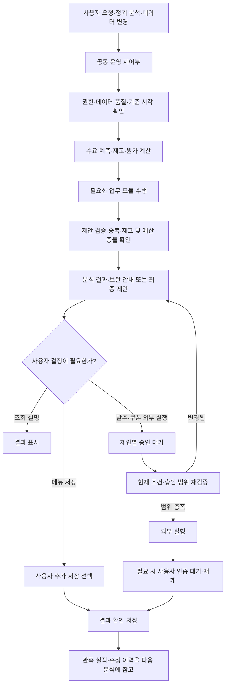

# 유저 플로우 1.04

**소상공인 맞춤형 AI 매장 운영 에이전트 — 사용자 흐름 정리**

작성 기준: 제공된 통합 BPM, 요구사항 명세서 64개 항목, 사용자 행동/시스템 응답 표 예시 및 팀이 확정한 수정사항.

수정 기준: 2026-11-19 첨부 수정본과 후속 팀 주석. 주석으로 확정한 변경사항을 관련 사용자 흐름·공통 처리·마지막 적용 기준표에 함께 반영했다.

1.02 수정 (2026-11-23): UF-12에 외부 쇼핑몰 가격 비교를, UF-13에 쇼핑몰 AI 대신 주문(2C)을 추가했다.

과거 검증 기록 (2026-11-23): 쿠팡에서 검색·상품 선택·장바구니 담기까지 확인했다. 당시 로그인과 결제는 사장님이 직접 수행하는 범위였으며, 이 기록은 자동 주문·결제 전체의 검증 완료를 의미하지 않는다. 1.04의 목표 흐름과 사이트별 실제 지원 여부는 별도로 검증한다.

1.03 수정 (2026-11-24): 운영 캘린더에 사장님이 일정을 직접 추가·수정·숨기는 흐름(UF-05A)을 추가했다. 외부 일정(행사 API)은 자동으로 받아오지만, 사장님이 일정을 등록하는 흐름이 없었기 때문이다. 1.04에서도 이 일정 관리 흐름을 유지한다.

1.04 수정 (2026-11-24): 1.03을 기준으로 전체 AI 운영 오케스트레이션, 운영 분석·재고/발주·쿠폰·메뉴/레시피 업무 흐름, 주 거래처 우선 발주, 개별 주문 승인, 브라우저 로그인·결제 인증 전환, 중단·재개·결과 확인을 반영했다. 아래 변경 요약과 관련 UF의 본문을 함께 갱신했다.

| 1.04 변경 영역 | 관련 흐름 |
|---|---|
| 공통 운영 제어·업무 모듈·데이터 품질·제안 충돌 검증 | 전체 AI 운영 흐름, UF-04·05·06 |
| 쿠폰 검증·실행·성과 해석, 메뉴·레시피 확인 후 저장 | UF-07·08·15·16·17·18 |
| 주 거래처 우선·조건부 대안 탐색·승인된 주문 실행 | UF-03·09·12·13 |
| 제안 버전·승인·인증 대기·재개·중복 실행 방지 | UF-19·20 |
| 현재 SQL 지원 범위와 후속 보완·구현 범위 구분 | 시스템 내부 처리, 확정한 적용 기준과 남은 논의 항목 |

## 읽는 방법

- 주 사용자는 매장 사장님이다. 고객용 앱이나 별도 관리자·직원 화면은 추가하지 않는다.
- 표의 한 행은 사용자 행동과 그에 대한 시스템 응답이다. 사용자 조작 없이 발생하는 처리는 `—`로 표시한다.
- 화면 이름은 흐름 설명용 가칭이다. 하단 탭은 명세서에 명시된 `홈·재고·메뉴·매출`을 따른다. 설정 화면의 위치와 버튼 문구는 설계 제안이다.
- 적용 우선순위는 팀이 확정한 수정사항 → 쿠폰·신규 판매처 탐색의 BPM → 그 외 기존 문서의 처리 기준이다.
- 초기 재고 수량·기준 일시는 사용자가 입력한다. 재고 확보·발주 운영 기준은 매출·판매 예측을 바탕으로 에이전트가 산정한다.
- UF 번호는 이 문서에서 추적을 위해 임시 부여했다. 원본 요구사항의 공식 ID가 아니다.
- 각 부 제목 옆 이름은 그 부의 플로우 작성자다. 구현 진행 · 담당은 GitHub Issue로 관리한다.
- 민감 정보 잠금: 매출 등 민감 정보가 있는 화면은 비밀번호를 입력해야 보이게 하는 옵션을 둔다. 기존 문서 수준을 유지하며 이번 수정에서 세부 흐름을 추가하지 않는다.
- 쿠폰 역동기화는 사장님이 승인한 쿠폰 정보를 앱에서 POS로 전달·등록하는 처리다. 쿠폰 사용 내역은 POS에서 수집하며, 승인·POS 반영·사용 실적을 구분한다.
- 기능 흐름의 확정과 외부 서비스의 실제 지원 여부는 구분한다. POS·금융·브라우저 주문의 지원 범위와 데이터 항목은 상세 설계·연동 검증에서 확정한다.
- 본문은 전체 목표 흐름이다. 운영 일정·알림 설정·사업자 진위확인·콤보/세트 등 기존 후속 개발 항목은 그대로 후속 범위이며, 이 문서 수정만으로 초기 구현 범위에 포함하지 않는다. 관련 절의 기능 설명은 유지하되 개발 순서는 구현 계획에 따른다.
- 화면의 한국어 상태와 실제 DB 코드는 구분한다. 미구현 상태·기능은 구현 완료로 표시하지 않으며, DB 보완 사항은 문서 끝의 적용 범위에 별도로 명시한다.

## 전체 흐름

회원가입·로그인 → 매장 등록·연동 → 초기 재고 입력·메뉴/레시피 관리·POS 메뉴 연결 → 홈 → 기능별 조회/운영 제안 확인.

이후 공통 운영 제어부가 필요한 업무를 연결한다. 발주는 주 거래처 확인 → 필요한 경우에만 대안 탐색 → 최종 제안 승인 → 주문 실행 → 주문·결제 결과 확인 → 실제 입고 확인으로 진행한다. 쿠폰은 조건 추천·손익 검증 → 사장님 승인 → 지원되는 POS에 등록 → 사용 실적 분석으로 진행한다. 메뉴·레시피는 추천과 계산 결과를 검토한 뒤 사용자가 ‘메뉴 추가하기’ 또는 저장을 선택하면 앱에 반영한다. 운영 분석은 조회 결과와 확인할 일을 제공한다. 입고 정정 요청의 외부 자동 전송은 지원 범위 확정 후 적용할 확장 흐름으로 구분한다.

| 구분 | 사용자 흐름 |
|---|---|
| 1부. 계정·초기 설정 | UF-01 계정, UF-02 회원·매장 정보, UF-03 연동, UF-04 초기 운영 설정 |
| 2부. 홈·쿠폰 | UF-05 홈·일정, UF-05A 운영 일정 추가·관리, UF-06 운영 제안, UF-07 쿠폰 추천·승인·POS 역동기화, UF-08 쿠폰 사용 현황 |
| 3부. 재고·발주·입고 | UF-09 재고 설정, UF-10 재고 조회, UF-11 실사·폐기, UF-12 발주 추천, UF-13 발주 실행, UF-14 입고·정정 |
| 4부. 메뉴 | UF-15 메뉴·레시피 관리, UF-16 메뉴 분석·추천·바로 추가 |
| 5부. 매출 | UF-17 매출·입출금 조회, UF-18 비용·예상 이익 |
| 6부. 공통 처리 | UF-19 승인·재승인, UF-20 실행 결과·이력·성과 |

## 전체 AI 운영 흐름과 오케스트레이션

사용자에게는 하나의 매장 운영 에이전트로 제공하고, 내부에서는 공통 운영 제어부와 네 가지 업무 모듈로 나눈다. 공통 운영 제어부는 서버 코드로 업무 선택·순서·진행 상태·중단·재개를 관리한다. 업무가 정해진 버튼·이벤트는 해당 흐름으로 바로 연결하며, 자연어 요청을 제공하는 경우에만 요청 해석에 LLM을 활용한다. 별도 채팅 화면을 필수로 추가하는 것은 아니다.

| 구성 | 하는 일 | 사용자에게 제공하는 결과 |
|---|---|---|
| 공통 운영 제어부 | 권한·데이터 기준 시각 확인, 필요한 모듈 선택, 의존 순서와 제안 충돌 관리 | 업무별 진행 상태, 우선순위, 필요한 사용자 행동 |
| 운영 분석 모듈 | 매출·비용·재고 지표 해석, 제안 통합, 실행 후 관측 결과 분석 | 오늘의 요약, 변화 설명, 데이터 보완 안내 |
| 재고·발주 모듈 | 예측 기반 재고 검토, 주 거래처 확인, 조건부 대안 탐색, 승인 후 주문 작업 | 재고 알림, 구체적인 발주안, 주문·결제 결과 |
| 쿠폰 모듈 | 목적·조건 후보 생성, 손익 검증 결과에 따른 수정, 사용 실적 해석 | 검증된 쿠폰안, POS 반영 결과, 성과 요약 |
| 메뉴·레시피 모듈 | 초기 레시피 초안, 기존 재료를 활용한 메뉴 개선·신메뉴 추천 | 재료·사용량 초안, 계산된 원가·마진, 앱 등록 안내 |
| 공통 예측·계산 서비스 | 메뉴별 수요 예측, 재료 소모량·발주량·원가·마진·예산 계산 | 예측·산식·입력 기준이 있는 수치 |

### 공통 처리 순서

1. 시작: 사용자 요청, 정기 분석 또는 판매·재고 등 데이터 변경으로 작업을 시작한다. 같은 업무에 대한 중복 시작을 확인하고 필요한 업무만 호출한다. 다른 업무가 대기 중이라고 매번 모든 모듈을 다시 실행하지 않는다.
2. 상황 확인: 매장·분석 기간·데이터 기준 시각·사용자 조건을 고정한다. 동기화 실패·미수신·실제 0을 구분하고, 필요한 데이터가 없으면 해당 업무의 보완 경로를 제공한다.
3. 예측·계산: 예측 모델의 결과를 서버 계산에 연결한다. LLM이 수량·금액·마진을 임의로 확정하지 않는다. 예측·단가 등이 부족한 경우 추정 근거를 밝히거나 계산 불가로 표시한다.
4. 업무 수행: 모듈별로 필요한 정보와 조회·탐색 도구만 제공한다. 주 거래처 우선·예산·제외 조건·승인 필요 여부는 서버 규칙으로 통제한다. 외부 페이지의 문구를 사용자 승인이나 시스템 지시로 취급하지 않는다.
5. 공통 검증: 대상·옵션·단위·수량·총비용·기간·출처·조회 시각을 확인한다. 부족 재료를 더 소모하는 쿠폰 등 상충하는 제안은 조건을 조정하거나 보류한다. 미승인 쿠폰·메뉴의 판매 증가 예상은 별도 시나리오로 다루며 확정 수요나 구매 허가로 사용하지 않는다.
6. 사용자 판단: 발주·쿠폰은 구체적인 최종 제안별 승인을 받는다. 조회·분석에는 구매 승인을 요구하지 않는다. 메뉴는 사용자의 추가·저장 선택으로 반영하며 별도 승인 대기를 두지 않는다.
7. 실행·재개: 승인·인증을 기다릴 때 진행 상태를 저장하고 작업을 중단한다. 재개 시 현재 조건과 기존 결과를 확인한다. 외부 요청 결과가 불명확하면 조회·대조부터 수행하며 같은 작업을 다시 보내지 않는다.
8. 후속 분석: 실제 결과·데이터 품질·사용자 수정 이력을 다음 제안에 참고한다. 이것만으로 모델이 자동 재학습되거나 관측된 변화의 인과관계가 입증된 것으로 표현하지 않는다.

### 공통 실행·운영 기준

- 업무별 실패를 분리한다. 한 업무의 생성 실패로 다른 업무의 정상 결과를 숨기거나 앱 전체를 차단하지 않는다. 수동 처리·기본 조회는 유지하되 실패 시 만들어 낸 수치나 검증되지 않은 계획으로 외부 작업을 실행하지 않는다.
- 탐색·재조정·재시도에는 횟수·시간·비용 한도를 두고, 한도 초과 시 사유와 후속 행동을 안내한다. 구체적인 한도는 운영 설정에서 정한다.
- 승인한 제안은 원문과 버전을 보존한다. 변경 시 새 버전을 만들고 기존 승인 범위를 확대하지 않는다. 업무 상태는 DB가 기준이며 장시간 DB 트랜잭션이나 LLM 호출을 열어 둔 채 사용자 응답을 기다리지 않는다.
- 동일 매장·업무의 실행을 원자적으로 선점하고 중복 이벤트를 방지한다. 내부 중복 방지 키만으로 쇼핑몰 주문 중복까지 보장된다고 간주하지 않는다.
- 상위 분석은 초기에는 재실행 가능한 흐름으로 두고, 지속적인 상태가 필요한 개별 제안·외부 실행은 기존 저장 구조를 활용한다. 모든 단계를 위한 별도 테이블 추가를 전제로 하지 않는다.
- Spring Boot는 오케스트레이션·도메인 규칙·상태를, Spring AI와 Claude는 해석·계획·도구 요청을, Python·LightGBM은 수요 예측을 담당한다. 브라우저 실행기는 실제 웹 조작을 담당한다. 별도 서버 분리나 LangChain·LangGraph 도입은 필수로 두지 않는다.
- LangSmith에는 민감정보를 제외한 AI 호출·도구 결과·오류·사용량 등 품질 확인 정보를 연결한다. 업무 원본과 승인 기록은 DB에 보관하며, Spring 측 계측·연결 설정은 별도 구현한다.
- n8n 도입은 미확정이다. 도입 시 정기 실행·외부 이벤트·알림·보고 연결에 활용할 수 있으나 핵심 승인·권한·중복 실행 검증은 서버에서 유지한다.

## 1부. 계정과 초기 설정 - 소정

### UF-01. 회원가입·로그인·로그아웃

진입: 앱 접속. 목표: 본인 계정으로 매장 서비스를 이용한다.

| 단계 | 사용자 행동 | 시스템 응답 |
|---|---|---|
| 1 | 앱에 접속한다. | 로그인 및 회원가입 진입 화면을 표시한다. |
| 2 | 처음 이용하는 경우 회원가입을 선택한다. | 계정 정보와 필수 회원 정보 입력 화면을 표시한다. |
| 3 | 회원정보(id, pw, 이름, 전화번호)를 입력한다. | 입력값을 검증한다. |
| 4 | 사업자등록번호를 최소 1개 이상 입력한다. | 최소 1개의 사업자등록번호를 입력받아 검증하고 최종 가입 결과를 안내한다. |
| 5 | 등록한 계정으로 로그인을 요청한다. | 인증 후 매장 정보·연동·초기 설정 상태에 맞는 다음 화면을 안내한다. |
| 5A | 비밀번호를 잊은 경우 '비밀번호 찾기'를 선택한다. | 아이디와 가입 시 등록한 전화번호를 입력하도록 안내한다. |
| 5B | 본인 인증을 진행한다. | 인증번호를 발송하고 입력값을 검증한다. |
| 5C | 새 비밀번호를 입력한다. | 비밀번호를 변경하고 로그인 화면으로 이동하도록 안내한다. |
| 6 | 초기 설정이 완료된 상태로 서비스를 이용한다. | 홈과 하단 내비게이션을 제공한다. |
| 7 | 로그아웃을 선택한다. | 인증 세션을 종료하고 로그인 화면을 표시한다. |

예외: 입력값 오류는 해당 항목과 수정 방법을 안내한다. 인증 실패는 로그인 실패 사유와 가능한 후속 행동을 안내한다.

- 아이디, 비번 → 사업자 등록은 여러 개 추가할 수 있도록

### UF-02. 회원·매장정보 수정

진입: 첫 매장 설정 또는 회원/매장 설정 화면. 설정 진입 위치는 화면 설계 시 정한다.

| 단계 | 사용자 행동 | 시스템 응답 |
|---|---|---|
| 1 | 회원 정보 또는 매장 정보를 선택한다. | 기존 정보 또는 신규 등록 양식을 표시한다. |
| 2 | 본인 **회원 정보**를 수정하거나 매장정보를 수정한다 | 입력값과 필수값을 검증한다. |
| 3 | 저장을 선택한다. | 정보를 저장하고 반영 결과를 안내한다. |
| 4 | 홈으로 이동한다. | 등록한 매장 정보를 표시하고 위치·날짜에 해당하는 날씨와 기온을 제공한다. |

### UF-03. POS·외부 서비스 연결과 동기화 관리

진입: 초기 연동 안내 또는 연동 관리 화면(설정).

| 단계 | 사용자 행동 | 시스템 응답 |
|---|---|---|
| 1 | POS, 외부 서비스 또는 마이데이터 연동 서비스를 선택한다. | 연결에 필요한 인증·설정 항목과 제공 가능한 기능을 안내한다. |
| 2 | 필요한 정보를 입력하여 연결을 요청한다. | 연결을 확인하고 성공·실패 결과를 표시한다. |
| 3 | — | 연결된 서비스별 제공 범위에 맞춰 판매·메뉴·재고·공급처·쿠폰·금융 거래 등 초기 데이터를 요청한다. |
| 4 | — | POS의 주문·메뉴별 판매량·결제액·할인·취소·환불·메뉴/옵션·쿠폰 등록 결과·쿠폰 사용 내역을 수집한다. 외부 서비스의 재고·거래처·공급 품목·단가·주문 단위·배송 정보와 금융 연동의 입출금 내역·거래일·금액·거래 식별자 등 확보 가능한 항목을 수집한다. |
| 5 | — | 날짜·금액·수량·단위·식별자를 표준화하고 누락·중복·오류를 처리하여 통합 저장한다. 미제공·미수신 항목과 확인이 필요한 문제를 안내한다. POS 매출과 정산 입금은 서로 다른 지표로 구분한다. |
| 6 | 서비스별 연결·동기화 현황을 확인한다. | 연결 상태, 최근 동기화 시각, 실패 여부와 지원 기능을 표시한다. 쿠폰 정보의 POS 역동기화 지원 여부도 구분한다. |
| 7 | 실패한 연동의 정보를 보완하고 재동기화를 요청한다. | 필요한 데이터를 다시 요청·수신하고 처리 결과를 갱신한다. 쿠폰 역동기화 재시도는 UF-20의 중복 방지 절차를 따른다. |
| 8 | 필요한 경우 연결 해제를 선택한다. | 해당 서비스의 연결을 해제하고 변경된 상태를 표시한다. |

예외: 동기화 실패를 판매 없음·재고 0·쿠폰 사용 0·입출금 없음으로 표시하지 않는다. 연결 해제 후 기존 데이터 보존 범위는 별도 정책으로 정해야 한다. 금융 거래 데이터가 없는 경우 POS 매출 조회와 확보된 비용 정보 기반 분석은 제공하고, 금융 연동이 필요한 항목의 미제공 범위를 안내한다.

쿠폰 역동기화는 UF-07의 승인 절차를 거친다. 쿠폰과 주문의 연결 식별자, 데이터 수집 주기, 사용 확정·취소·환불 이벤트의 전달 방식은 POS 연동 상세 설계에서 정한다.

브라우저 주문 연결 (1.04):

| 단계 | 사용자 행동 | 시스템 응답 |
|---|---|---|
| B1 | 거래처·쇼핑몰 연결에서 브라우저 로그인을 선택한다. | 해당 매장·사용자에게 허용된 전용 브라우저 접속 화면을 제공한다. 휴대폰의 다른 앱·브라우저 로그인 상태가 자동 공유되는 것으로 안내하지 않는다. |
| B2 | 전용 브라우저에서 직접 로그인하고 필요한 추가 인증을 수행한다. | 인증 중 에이전트 조작과 민감 화면 수집·모델 전달을 중지한다. 로그인 확인 후 보호된 저장소에 세션을 보관하고 DB에는 참조만 둔다. |
| B3 | 연결 완료를 확인한다. | 실제 확인한 로그인 상태와 가능한 조회·주문 기능을 표시한다. 연결 자체는 구매 승인이 아니다. |
| B4 | 작업 중 재로그인 안내가 오면 인증한다. | 만료 상태와 대기 중인 업무를 연결하고, 인증 완료 후 기존 작업·주문 여부·현재 조건을 확인해 재개한다. |
| B5 | 연결 해제를 선택한다. | 신규 접근과 세션 재사용을 차단하고 진행 작업을 안전하게 정지한다. 이미 전송된 주문이 있다면 해제만으로 취소됐다고 표시하지 않고 결과 확인 경로를 제공한다. |

인증·결제 입력은 사이트에 직접 전달하며 원문 비밀번호·쿠키·인증번호·결제 비밀번호를 LLM, 일반 DB, 로그, LangSmith에 남기지 않는다. 원격 제어 접근은 소유자에게만 제한한다. 세션 보관·폐기 기한과 대기 만료 시간은 별도 설정으로 정한다. 전화기 결제 앱으로의 인증 연결 등 사이트별 호환성은 검증이 필요하다.

### UF-04. 초기 운영 데이터 설정과 POS 메뉴 연결

진입: 매장 등록 이후. 아래 순서는 데이터 의존성을 고려한 권장 순서이며 필수 온보딩 화면 구성을 확정한 것은 아니다.

| 단계 | 사용자 행동 | 시스템 응답 |
|---|---|---|
| 1 | 연동으로 확보한 재고 품목·단위·포장 규격·단가·공급처를 확인하고 누락·오류를 보완한다. | 확보한 정보를 미리 표시하고 사용자가 보완한 품목 정보를 저장한다. 상세 흐름은 UF-09를 따른다. |
| 2 | 품목별 초기 재고 수량과 기준 일시를 입력한다. | 입력한 초기 재고를 이후 재고 계산의 시작 기준으로 저장한다. |
| 3 | 메뉴별 AI 레시피 추천을 확인한다. | POS 메뉴 정보를 바탕으로 메뉴에 필요한 원재료·포장재와 재료별 예상 사용량을 AI 초안으로 제안한다. 사용자 확인 전에는 재고 차감용 운영 레시피로 적용하지 않는다. |
| 4 | AI가 추천한 재료 목록과 재료별 사용량을 각각 확인하고, 필요하면 추가·삭제·수정한다. | 수정한 재료와 사용량을 반영하여 메뉴별 레시피를 저장하고 예상 원가를 계산한다. |
| 5 | POS 판매 메뉴·옵션을 앱 메뉴·레시피에 연결한다. | 연결 상태와 미연결 항목을 표시한다. |
| 6 | 미연결 항목이나 단위 등 보완이 필요한 정보를 수정한다. | 연결과 계산 가능 여부를 다시 확인한다. |
| 7 | — | 매출·판매 예측을 메뉴별 예상 판매량과 재료별 예상 소모량으로 연결하고, 현재 재고·입고 예정량·배송 기간을 반영해 재고 확보·발주 운영 기준을 산정한다. |
| 8 | 설정 결과와 에이전트가 산정한 운영 기준을 확인하고 홈으로 이동한다. | 이후 판매 내역으로 재료 사용량·추정 재고·원가를 계산하고 운영 분석에 활용한다. |

분기: 데이터가 부족한 기능은 부족한 항목과 보완 경로를 안내한다. 설정 미완료를 이유로 앱 전체 접근을 차단하는 정책은 원문에 없으므로 추가하지 않는다.

AI 추천은 데이터 보완을 돕는 초안이다. 사용자가 재료 연결·단위·사용량을 확인하고 저장한 값으로 서버가 원가를 계산한다. 레시피·단가·판매 데이터가 부족하면 관련 분석만 보완 대기로 두고 다른 조회 기능은 제공한다.

## 2부. 홈과 쿠폰 - 예원

### UF-05. 홈 확인·업무 이동·운영 일정 관리

| 단계 | 사용자 행동 | 시스템 응답 |
|---|---|---|
| 1 | 홈에 진입한다. | 매장명·기준 날짜·날씨·기온, 오늘 매출·주문 건수·비교 기간 대비 증감과 운영 일정 캘린더를 기본 표시한다. |
| 2 | 오늘의 운영 제안 또는 승인·확인할 일을 확인한다. | 긴급 업무를 우선 표시하고, 발주 승인·쿠폰 승인·입고 확인 등 처리할 일을 안내한다. |
| 3 | 처리할 업무를 선택한다. | 해당 제안·발주·쿠폰·입고의 상세 화면으로 이동한다. |
| 4 | 최근 실행 결과를 선택한다. | 발주·정정 요청·쿠폰 POS 역동기화의 상태, 결과, 처리 시각을 표시한다. 쿠폰 사용 실적은 UF-08로 연결한다. |
| 5 | 홈에 표시된 운영 일정 캘린더를 확인한다. | 입고 예정일·쿠폰 시작/종료일 등 확보된 일정을 날짜별로 표시한다. 쿠폰 추천안의 예정 기간과 POS 반영이 확인된 쿠폰의 운영 기간을 구분한다. 행사 API로 자동 수집한 일정과 사장님이 직접 입력한 일정도 함께 표시하고, 출처를 구분해 보여준다. |
| 6 | 주변 행사나 시험·방학 등 관련 일정을 등록하거나 수정한다. | 수집된 외부 일정과 직접 입력한 일정을 관리하고 수요 분석에 활용한다. 상세 흐름은 UF-05A를 따른다. |
| 7 | 하단의 홈·재고·메뉴·매출 탭을 선택한다. | 선택한 화면으로 이동한다. |

운영 캘린더는 별도 선택 없이 홈에 표시된다. 개별 일정에서 관련 업무로 이동할 수 있다. 주변 일정 등록은 캘린더에서 진입하도록 묶으며 세부 배치는 화면 설계 시 정한다.

홈 표시 기준: 긴급 업무가 있으면 우선 표시하고, 긴급 업무가 없으면 일반 운영 제안을 최대 3줄로 요약한다. 제안할 내용도 없으면 현재 운영 상태를 요약하고, 데이터가 부족하면 보완 항목을 안내한다. 전체보기에서는 전체 제안과 분석에 활용한 정보·출처를 확인할 수 있다.

AI 진행 표시 (1.04): 분석 중·제안 준비 중·사용자 검토 대기·인증 필요·실행 중·결과 확인 중을 업무별로 표시한다. 생성 중이거나 실패한 초안에는 승인 버튼을 제공하지 않는다. 내부 모듈·도구 이름 대신 현재 업무와 사용자가 해야 할 행동을 안내한다. 한 업무의 대기로 다른 업무의 정상 결과를 가리지 않는다.

### UF-05A. 운영 일정 추가·수정·숨김

진입: 홈 운영 캘린더의 ‘일정 추가’ 버튼, 캘린더의 날짜 선택 또는 기존 일정 상세. 버튼 위치와 문구는 화면 설계 시 정한다. 목표: 사장님이 아는 주변 행사·시험·방학·임시휴무 등을 캘린더에 직접 남겨 수요 예측과 운영 제안에 반영한다.

| 단계 | 사용자 행동 | 시스템 응답 |
|---|---|---|
| 1 | 캘린더에서 ‘일정 추가’를 선택하거나 날짜를 선택한 뒤 일정 추가를 누른다. | 일정 입력 화면을 표시한다. 날짜를 선택해 들어온 경우 그 날짜를 시작일 기본값으로 채운다. |
| 2 | 일정 유형(지역행사·시험·방학·임시휴무·기타)을 고르고 일정명을 입력한다. | 필수값(유형·일정명)을 검증한다. |
| 3 | 시작·종료 일시와 종일 여부를 입력하고, 필요하면 장소를 입력한다. | 종일 일정을 기본값으로 둔다. 종료가 시작보다 앞서면 저장하지 않고 수정을 안내한다. |
| 4 | 이 일정이 매출에 줄 영향(증가·감소·모름)과 메모를 선택해서 입력한다. | 입력한 예상 영향과 메모를 수요 분석·운영 제안 생성(LLM 분석)의 참고 정보로 저장한다. 입력하지 않아도 저장할 수 있다. |
| 5 | 저장을 선택한다. | 직접 입력 일정으로 저장하고 캘린더에 표시한다. 같은 기간에 이름이 같은 일정이 이미 있으면 중복 여부를 확인한 뒤 저장한다. 임시휴무는 해당 기간을 영업하지 않는 날로 보고 판매 예측·발주 추천에 반영한다. |
| 6A | 직접 입력한 일정을 선택해 수정하거나 삭제한다. | 변경 내용을 저장하고 캘린더와 이후 분석에 반영한다. 삭제한 일정은 캘린더와 분석에서 뺀다. |
| 6B | 자동 수집한 일정을 선택해 예상 영향·메모를 입력하거나, 우리 매장과 관계없으면 ‘숨기기’를 선택한다. | 원본 정보(일정명·기간·장소)는 수정하지 않고 사장님 입력값만 저장한다. 숨긴 일정은 캘린더와 분석에서 빼고, 다음 수집 때도 숨김 상태와 사장님 입력값을 유지한다. |
| 7 | 필요하면 숨긴 일정 보기에서 일정을 다시 표시한다. | 숨김을 해제하고 캘린더와 분석에 다시 반영한다. |

6A·6B는 일정 출처에 따른 대안 경로다. 자동 수집 일정은 원본을 고치는 대신 숨기고 필요하면 같은 내용을 직접 입력 일정으로 새로 등록한다. 같은 행사가 다시 수집되어도 중복으로 생기지 않게 처리한다.

분기: 지난 날짜의 일정도 등록할 수 있다. 과거 행사·임시휴무를 기록하면 그 기간의 매출 변화를 설명하는 참고 자료로 쓴다. 입고 예정일·쿠폰 기간은 각각 UF-13·UF-07에서 만들어지므로 이 화면에서 추가하지 않는다. 예상 영향은 사장님의 판단을 참고하는 값이며, 실제 매출 변화를 일정의 효과로 단정하지 않는다.

데이터 연결: schedule의 출처·종일 여부·장소·예상 영향·숨김 상태를 사용한다. 실제 코드·컬럼은 저장소 SQL 설계를 따른다. 운영 일정은 기존 후속 개발 범위로 유지한다.

### UF-06. 오늘의 운영 제안 확인

| 단계 | 사용자 행동 | 시스템 응답 |
|---|---|---|
| 1 | 홈에서 오늘의 운영 제안 전체보기를 선택한다. | 재고 부족·발주·쿠폰·메뉴 개선 제안을 우선순위와 함께 표시하고 분석에 활용한 정보·출처를 제공한다. |
| 2 | 개별 제안을 선택한다. | 추천 근거·분석 기준·기대 효과를 표시하고, 발주·쿠폰은 검토에 필요한 대상·금액·조건도 제공한다. |
| 3 | 제안 내용을 검토한다. | 발주는 UF-12, 쿠폰은 UF-07, 메뉴는 UF-16의 상세 검토로 연결한다. |
| 4A | 발주 제안을 검토하고, 필요한 경우 조건을 수정하거나 재생성을 요청한다. | 최종 발주 계획과 근거를 제공하고 UF-19의 승인·보류·반려 절차로 연결한다. |
| 4B | 쿠폰 제안을 검토하고 필요 시 수정한 뒤 승인·보류·반려를 선택한다. | UF-07에 따라 결정과 최종 조건을 기록한다. 승인 시 해당 쿠폰 정보를 POS에 역동기화한다. |
| 4C | 메뉴 추천 내용과 근거를 확인하고, 원하면 ‘메뉴 추가하기’를 선택한다. | 추천 확인만으로 종료하거나 UF-16의 메뉴 등록 흐름에 따라 앱 메뉴·레시피에 저장한다. |

4A~4C는 제안 유형별 분기다. 수정·재생성은 필요한 경우에만 수행한다. 제안·데이터가 없는 경우의 안내는 UF-05의 홈 표시 기준을 따른다. 발주·쿠폰의 외부 실행은 개별 승인을 기준으로 하고, 앱 메뉴 추가는 별도의 승인 대기 없이 사용자의 ‘메뉴 추가하기’ 동작으로 저장한다.

제안 생성·통합 (1.04): 공통 운영 제어부가 최신 데이터와 업무 목적에 따라 필요한 모듈을 호출하고 결과를 검증한다. 조회 중에는 진행 상태를, 정보 부족 시에는 부족한 항목과 보완 경로를 제공한다. 동일 업무의 중복 제안과 재고·예산·기간 충돌을 확인한 뒤 검토 가능한 최종 제안을 노출한다. 사용자가 재생성을 요청하면 변경 조건과 기준 시각을 반영한 새 버전을 제공한다.

예: 우유 부족 발주안과 우유 소모가 큰 메뉴의 할인안이 함께 생성되면 확보 가능 재고·배송일·쿠폰 기간을 확인한다. 충족되지 않으면 쿠폰 대상·기간을 조정하거나 보류한다. 하나를 승인했다고 다른 제안까지 승인한 것으로 처리하지 않는다.

### UF-07. 쿠폰 추천 검토·수정·승인·POS 역동기화

진입: 쿠폰 최초 설정 또는 홈의 쿠폰 제안·승인할 일. 에이전트가 쿠폰을 추천하고 사장님이 검토·판단한다. 승인된 쿠폰 정보는 앱에서 POS로 역동기화하며, 이후 POS에 기록된 사용 내역을 UF-08에서 수집·분석한다.

| 단계 | 사용자 행동 | 시스템 응답 |
|---|---|---|
| 1 | 최초 이용 또는 설정 변경 시 목표·월 예산·제외 메뉴·제외 시간대를 입력한다. | 쿠폰 운영 설정을 저장한다. 기존 설정이 있으면 해당 설정을 활용한다. |
| 2 | — | 매출·원가·재고·리뷰·쿠폰 이력 등 확보한 데이터로 사전 점검을 수행한다. 통과하면 목적·형태·대상·조건을 선정하고 손익·마진을 검증해 추천안을 생성한다. |
| 3 | 홈에서 쿠폰 제안을 선택한다. | 적용 메뉴·할인액·사용 기간과 시간·발행 수량 또는 사용 한도·사용 제한·추천 근거와 쿠폰 적용 가격·최대 할인 부담을 표시한다. |
| 4 | 추천 내용과 부담을 검토하고, 필요하면 조건을 수정하거나 재생성을 요청한다. | 변경 조건으로 추천안·가격·할인 부담·손익을 다시 검토해 제공한다. 수정이 없으면 기존 추천안을 유지한다. |
| 5 | 최종 추천안을 확인하고 승인·보류·반려를 선택한다. | 결정과 최종 조건을 기록한다. 보류·반려 시 POS에 정보를 전송하지 않는다. |
| 6 | — | UF-19에 따라 승인 조건과 현재 실행 조건을 확인한다. 승인 범위 안이면 해당 쿠폰 정보를 연동된 POS에 역동기화하고 요청 상태를 기록한다. 조건이 달라졌으면 재승인을 요청한다. |
| 7 | POS 반영 결과를 확인한다. | POS 응답에 따라 반영 완료·실패·결과 확인 중 상태와 처리 시각을 표시한다. 반영 완료된 쿠폰은 사용 현황 조회로 연결한다. |
| 8 | 실패 사유를 보완하거나 재시도를 요청한다. | UF-20에 따라 기존 요청 결과와 중복 등록 여부를 확인한 뒤 재처리한다. 승인 조건 변경이 있으면 재승인을 받는다. |

분기:

- 사전 점검에서 데이터·원가·예산·기존 쿠폰 충돌 등에 문제가 있으면 보류 사유와 보완 항목을 안내한다. 보완 후 다시 점검한다.
- 손익·마진 검증을 통과하지 못하면 조건을 재조정한다. BPM의 재조정 한도를 넘으면 차순위 목적을 검토한다.
- 수정 요청은 추천안 재생성으로 돌아간다. 보류·반려는 POS 역동기화로 이어지지 않는다.
- POS가 해당 쿠폰 조건 또는 역동기화를 지원하지 않거나 연결되지 않은 경우 사유와 보완 경로를 안내한다. 추천안은 확인할 수 있으나 POS 반영 완료로 표시하지 않는다.
- 외부 응답이 불명확하면 결과 확인 중으로 관리하고, 확인 없이 동일 쿠폰을 다시 등록하지 않는다.

상태 기준: 사장님의 승인, 쿠폰 정보의 POS 반영 완료, 실제 쿠폰 사용은 서로 다른 상태다. 승인만으로 POS 반영이나 사용을 완료 처리하지 않는다. 이 문서의 역동기화는 POS에 쿠폰 조건을 등록하는 범위이며, 별도 고객 채널 배포까지 완료했다는 의미로 사용하지 않는다.

상세 설계 항목: 설정값의 자동 불러오기 가능 여부, 추천 노출 빈도·위치, POS가 지원하는 쿠폰 조건과 등록 결과 항목.

AI·서버 역할 (1.04): AI는 쿠폰 목적·대상·조건 후보를 생성하고, 서버는 적용 가격·할인 부담·예산·마진·제외 조건·기존 쿠폰 및 재고 충돌을 검증한다. 실패한 조건은 한도 내에서 재조정하고, 한도 초과 시 사유를 안내한다. 부족한 원가·예산을 임의의 값으로 채워 승인 가능한 제안으로 표시하지 않는다. 실행 직전에는 사용자가 승인한 버전과 현재 조건을 다시 대조한다.

### UF-08. POS 쿠폰 사용 현황·효과 측정

진입: 매출 탭의 쿠폰 사용 현황 또는 쿠폰 상세. 승인된 쿠폰 정보의 POS 역동기화 후, POS에 기록된 쿠폰 사용 내역을 수집하여 사용 현황과 효과를 분석한다. 이 기능 흐름은 확정하며, 쿠폰·주문 연결 식별자, 사용 확정·취소·환불 이벤트의 전달 방식, 수집 주기 및 세부 제공 항목은 POS 연동 상세 설계에서 정한다.

| 단계 | 사용자 행동 | 시스템 응답 |
|---|---|---|
| 1 | 쿠폰 사용 현황을 연다. | 쿠폰별 승인 상태·POS 반영 상태·운영 기간·사용 건수·누적 할인액·쿠폰 적용 매출을 확보된 데이터 범위에서 표시한다. 발행량·사용률은 계산에 필요한 데이터와 기준이 확보된 경우 제공한다. |
| 2 | 특정 쿠폰을 선택한다. | POS에 기록된 사용 내역과 연결 가능한 주문·메뉴·할인 내역을 제공하고 최근 수집 시각을 표시한다. |
| 3 | 분석 기간과 비교 기간을 선택하여 쿠폰 효과를 확인한다. | 사용 실적·대상 메뉴 판매 변화와 추천 시 예상 효과를 비교한다. 분석 기간·비교 기준·반영한 취소/환불·데이터 누락 여부를 함께 표시한다. |

계산 기준: 사용률은 분모가 발행량인지 사용 한도인지 구분하며, 발행량 미확보를 사용 한도로 대체해 표시하지 않는다. 동일 주문의 쿠폰 사용·취소·환불을 중복 집계하지 않도록 처리한다. 구체적인 산식은 확보 가능한 데이터에 맞춰 상세 설계에서 정한다.

분기: 미수신·미지원 항목은 0으로 표시하지 않고 ‘확인 불가’ 또는 ‘데이터 부족’으로 구분한다. 분석에 필요한 데이터가 부족하면 수집 상태를 안내한다. 비교 기간의 판매 변화는 관측 결과로 제공하며, 그 변화 전체를 쿠폰만의 효과로 단정하지 않는다.

성과 해석 (1.04): 사용 실적과 비교 지표는 서버가 계산하고 AI는 확인 가능한 변화·한계·다음 검토 방향을 설명한다. 미승인 추천, 승인된 쿠폰, POS 반영된 쿠폰, 실제 사용 내역을 섞어 집계하지 않는다.

## 3부. 재고·발주·입고 - 후상

### UF-09. 재고 품목·초기 수량·운영 기준 설정

진입: 재고 탭의 품목 관리 또는 초기 설정.

| 단계 | 사용자 행동 | 시스템 응답 |
|---|---|---|
| 1 | 품목 추가 또는 기존 품목 수정을 선택한다. | 연동으로 확보한 품목명·분류·관리 단위·포장 규격·단가·공급처를 표시하고 미확보 정보는 입력할 수 있게 한다. |
| 2 | 정보를 입력하고 저장한다. | 입력 정보를 검증하고 품목 정보를 저장한다. |
| 3 | 품목별 초기 재고 수량과 기준 일시를 입력한다. | 이후 재고 계산에 사용할 시작 기준을 저장한다. |
| 4 | — | 매출·판매 예측에서 메뉴별 예상 판매량과 재료별 예상 소모량을 산출한다. 현재 재고·입고 예정량·배송 기간을 반영하여 여유 재고·목표 확보 기간 및 수량 등 재고 확보·발주 운영 기준을 산정한다. |
| 5 | 필요 시 입고분별 소비기한과 잔량을 등록한다. | 입고분별 재고와 소비기한을 관리하고 예상 소모량과 함께 소비기한 임박·소진 위험 안내에 반영한다. |
| 6 | 에이전트가 산정한 운영 기준과 근거를 확인한다. | 재고 현황·발주 추천에 적용할 기준과 예측 근거를 표시한다. |

초기 재고 수량·기준 일시는 사용자가 입력하고, 재고 확보·발주 운영 기준은 에이전트가 산정한다. 예측에 필요한 데이터가 부족하면 보완 항목을 안내한다. 초기 재고 입력과 이후 실사 보정은 별도 동작이며, 운영 중 실제 수량을 수정하려는 경우 UF-11로 연결한다. 초기 재고 기준을 다시 설정할 수 있는 조건과 이력 처리 정책은 추가 정의 대상이다.

구매 조건 설정 (1.04): 품목별 주 거래처, 해당 거래처의 지정 상품 코드·URL·옵션, 허용 가격 기준, 대체 가능한 브랜드·용량·보관 방식 등을 입력·확인한다. 가격 상승률을 사용하면 비교 기간과 동일 거래처의 비교 가능한 상품 단가 기준을 정한다. 다른 거래처 구매로 바뀔 수 있는 현재 원가를 무조건 비교 기준으로 쓰지 않는다. 주 거래처나 필수 조건이 없으면 먼저 보완 경로를 제공한다. 설정 저장은 주문 승인과 별개다.

예측값은 공통 예측 서비스에서 제공하고, 목표 재고·필요 수량·포장 단위 올림·단위 환산·금액은 서버가 계산한다. 미입고 발주를 반영해 같은 부족분을 중복 구매하지 않도록 한다. 가격 임계값·허용 규격은 사용자 설정으로 정하며 문서의 예시 숫자를 공통 기본값으로 적용하지 않는다.

### UF-10. 재고 현황·부족·소비기한 확인

| 단계 | 사용자 행동 | 시스템 응답 |
|---|---|---|
| 1 | 재고 탭에 진입한다. | 품목별 추정 재고·부족 여부·소비기한·최근 실사/갱신 시점을 표시한다. |
| 2 | 품목을 검색하거나 조건별 필터를 선택한다. | 조건에 해당하는 품목을 표시한다. |
| 3 | 품목 또는 부족·소비기한 알림을 선택한다. | 입고분별 잔량·소비기한, 예상 소진 시점과 확인이 필요한 내용을 표시한다. |
| 4 | 상황에 따라 실사·폐기 등록 또는 발주 추천 검토로 이동한다. | UF-11 또는 UF-12로 연결한다. |

시스템 처리: 연결된 POS 판매 메뉴·옵션과 레시피를 이용해 원재료·포장재 사용량을 계산하고 추정 재고에 반영한다. 실제 입고 확인 및 실사·폐기 등 변동 내역도 반영한다. 추정 재고가 실제 실사 수량인 것처럼 표시하지 않는다.

시점 처리 기준: 재고와 원가는 판매·입고·실사·폐기 등 각 사건의 발생 시점을 기준으로 계산한다. 초기 재고와 실사에 이미 포함된 변동을 다시 반영하지 않으며, 늦게 수신한 데이터와 중복 수신 데이터의 처리 기준을 정의한다. 레시피·단가 변경은 적용 시점을 관리하여 과거 계산 결과가 의도치 않게 변경되지 않도록 한다. 취소·환불에 따른 재고 복원은 실제 재료 사용 여부에 따라 처리한다. 구체적인 재계산·보정 규칙은 상세 설계에서 정한다.

분기: 발주가 불필요하면 재고 현황 확인으로 종료한다. 재고 정보·레시피·연동 데이터 등이 부족하면 확인 요청과 보완 항목을 제공한다.

### UF-11. 실사·폐기·손실 등록과 재고 보정

| 단계 | 사용자 행동 | 시스템 응답 |
|---|---|---|
| 1 | — | 일주일 단위로 재고 실사·주간 정비 알림을 제공한다. |
| 2 | 알림 또는 재고 품목의 실사·조정을 선택한다. | 현재 추정 재고와 입력 항목을 표시한다. |
| 3A | 실사라면 실제 확인 수량·실사 일시를 입력한다. | 해당 실사 시점의 추정 재고와 실제 수량의 차이를 표시한다. |
| 3B | 폐기·손실이라면 변동 유형·수량·발생 시점을 입력한다. | 반영할 변동 내용과 보정 결과를 표시한다. |
| 4 | 입력 내용을 확인하고 저장한다. | 실사 또는 변동 내역을 기록하고 UF-10의 시점 처리 기준에 따라 추정 재고를 보정한다. |
| 5 | 갱신된 재고 현황을 확인한다. | 재고·최근 실사/갱신 시점과 부족·소진 안내를 갱신한다. |

알림을 기다리지 않고 직접 2단계로 진입할 수 있다. 3A·3B는 선택한 조정 유형에 따른 대안 경로다.

### UF-12. 주 거래처 우선 발주 추천·대안 검토

진입: 홈의 발주 제안·재고 부족 알림 또는 사용자의 발주 검토 요청.

| 단계 | 사용자 행동 | 시스템 응답 |
|---|---|---|
| 1 | 발주 검토를 요청하거나 생성된 추천을 연다. | 재고·판매 예측·예상 소모량·미입고 수량·배송 기간·구매 조건을 확인하고 필요한 구매 수량을 서버에서 계산한다. 진행 중이면 현재 단계를 표시한다. |
| 2 | — | 품목별 주 거래처의 지정 상품·옵션·재고·주문 수량·가격·배송비·납기를 먼저 확인한다. |
| 3A | — | 주 거래처가 조건을 충족하면 다른 후보를 검색하지 않고 해당 거래처 발주안을 생성한다. |
| 3B | — | 확인된 품절·필요일 배송 불가·거래 중단·설정 가격 기준 초과 등이 있을 때만 다른 거래처·쿠팡·네이버쇼핑 등에서 허용 조건에 맞는 대안을 탐색한다. 사유와 확인 시각을 기록한다. |
| 4 | 제안과 선정 근거를 확인한다. | 구매처·실제 판매자·상품·옵션·묶음 구성·주문 수량·총용량·상품 금액·배송비·총액·배송지·배송 예정일·조회 시각을 표시한다. 대안이면 주 거래처를 사용하지 못한 사유도 제공한다. |
| 5 | 필요한 경우 조건을 수정하거나 재생성을 요청한다. | 변경 조건을 검증하고 수량·비용·근거를 재계산해 새 제안 버전을 제공한다. 기존 승인 내용을 덮어쓰지 않는다. |
| 6 | 최종 제안을 승인·보류·반려한다. | UF-19에 따라 결정과 제안 버전·승인 범위를 저장한다. 승인된 구체적인 주문만 UF-13으로 연결한다. |

후보 선정 기준:

- 기본 거래처가 적합하면 더 싼 상품이 있는지 확인하기 위한 비교 탐색도 하지 않는다. 대안 구매 후 주 거래처 설정을 자동 변경하지 않는다.
- 대안은 허용 브랜드·보관 방식·규격·배송 조건을 충족해야 한다. 포장 수량·용량을 관리 단위로 환산하고 필요한 수량을 채우는 실제 구매 총비용을 비교한다. 표시 가격만으로 최적이라고 판단하지 않는다.
- 검색·쇼핑 플랫폼과 실제 판매자를 구분한다. 조회 가능한 API 또는 브라우저 어댑터를 사용하며 특정 검색 API의 제공이나 구매자용 주문 기능을 전제로 하지 않는다. 제휴 링크를 사용하는 경우 필요한 고지를 별도로 표시한다.
- 검색 결과는 후보 정보다. 최종 상품 상세·옵션·배송비·납기를 확인하고 조회 시각과 불확실한 항목을 표시한다. 필수 주문 조건이 미확정이면 보완 후 승인 가능한 제안을 제공한다.
- 승인 전에는 조회·분석·탐색을 수행한다. 상품 선택·금액이 확정되지 않은 상태에서 포괄적으로 먼저 승인받고 나중에 임의의 상품을 주문하지 않는다.

예외:

- 로그인 만료·사이트 오류·조회 시간 초과는 품절이나 거래 불가로 단정하지 않는다. 재인증·한도 내 재시도 후 확인하며 필요하면 사용자의 확인을 요청한다.
- 주 거래처 또는 필수 구매 조건이 없으면 설정·보완을 안내한다. 사용자가 별도 구매처를 지정하는 변경 요청은 명시적으로 기록하고 새 제안을 검토한다.
- 발주가 불필요하면 재고 현황으로 종료한다. 적합한 후보가 없으면 조건 변경을 안내하고 보류한다.
- 같은 부족분에 대한 주문 결과가 불명확하면 기존 결과를 확인하기 전 다른 거래처로 대체 주문하지 않는다.

### UF-13. 승인된 API·브라우저 주문 실행·상태 확인

| 단계 | 사용자 행동 | 시스템 응답 |
|---|---|---|
| 1 | — | 승인된 제안 버전과 대상 상품·옵션·수량·판매자·금액·배송 조건을 재확인한다. 기존 실행·외부 주문 여부를 확인해 중복을 방지한다. |
| 2A | — | API 주문이 지원되면 승인 범위 내 요청을 전송하고 응답·외부 주문 결과를 확인한다. |
| 2B | — | 브라우저 주문이 지원되면 연결된 전용 브라우저에서 승인된 상품·옵션·수량·배송지·결제수단을 확인하고 주문 절차를 수행한다. |
| 2C | 자동 주문이 지원되지 않으면 내용을 확인하고 직접 주문한다. | 직접 주문에 필요한 확정 내용을 제공한다. 이미 자동 요청이 전송됐을 가능성이 있으면 결과 확인 후 직접 주문으로 전환한다. |
| 3 | 추가 인증 안내가 있으면 직접 로그인·결제 인증을 한다. | 에이전트를 중단하고 사용자 입력으로 전환한다. 인증 완료 뒤 실제 진행 상태와 승인 조건을 재확인해 남은 절차를 이어간다. |
| 4 | 직접 주문한 경우 실제 주문 결과를 등록한다. | 확인된 주문 내용·출처를 저장하고 동일 외부 주문이 중복 등록되지 않도록 확인한다. |
| 5 | 주문 결과와 진행 상태를 확인한다. | 외부 주문번호·실제 상품·수량·금액·접수 여부를 확인하고 주문 상태와 결제 상태를 별도로 표시한다. 불명확하면 결과 확인 중으로 관리한다. |
| 6 | 배송·입고 상태를 확인하고, 물품 도착 후 입고 확인을 선택한다. | 배송·부분 입고·입고 완료 상태를 표시하고 UF-14로 연결한다. 주문 완료만으로 재고를 증가시키지 않는다. |

2A~2C는 대안 경로다. 3단계는 추가 인증이 필요한 경우, 4단계는 직접 주문한 경우에 적용한다. 자동 실행은 건별 최종 주문 승인 후 수행하며 소액·반복 품목이라는 이유로 승인을 생략하지 않는다.

브라우저 주문 기준:

- 사장님이 UF-03에서 직접 로그인한 전용 브라우저 세션을 사용한다. 자체 실행 환경 또는 외부 호스팅 선택은 별도 운영 결정이며, 로그인·결제 호환성은 사이트별로 검증한다.
- 승인된 상품 페이지로 이동해 해당 옵션과 수량을 처리한다. 승인 후 새 상품을 임의로 검색·선정해 대체하지 않는다. 기존 장바구니에 있는 무관한 상품까지 함께 결제하지 않는다.
- 쇼핑몰 계정에 이미 등록된 결제수단을 활용한다. 초기 구성에서 자체 카드번호·비밀번호 보관 기능을 추가하지 않는다. 결제 인증이 필요하면 사장님이 직접 수행한다.
- 주문 승인과 사이트 인증은 별개다. 인증만 필요하고 주문 조건이 그대로이면 같은 주문을 다시 승인받지 않는다. 인증 대기 중에는 에이전트 조작과 민감 화면·입력의 모델 전달·추적을 중지한다.
- 실행 중 승인 범위를 벗어나는 상품·옵션·수량·판매자·최종 금액·배송 조건 변경이 있으면 멈추고 새 제안으로 UF-19의 재승인을 받는다. 특정 가격 상승률까지 임의로 허용하지 않는다.
- 주문 버튼 클릭이나 주문번호 발급만으로 결제 완료를 단정하지 않는다. 결제 완료가 확인된 경우에만 금액·시각을 저장한다. 외상·후불 등 선결제 불필요 거래는 별도로 표시한다.
- 주문·결제·금융 출금·비용 인식을 구분한다. 주문번호만으로 비용 장부를 자동 확정하지 않고, 금융 거래와 수동 기록이 중복 집계되지 않도록 기존 비용 처리 기준을 따른다.
- 자동 취소·반품은 이번 초기 실행 범위에 포함하지 않는다. 후속 지원 여부·승인·환불 대사 정책을 별도로 정의한다.

예외:

- 인증 대기 만료·연결 해제: 진행을 중지하고 사유와 재연결·결과 확인 경로를 제공한다. 이미 전송된 주문이 자동 취소된 것으로 표시하지 않는다.
- 주문 직후 통신 단절·화면 오류: 기존 주문 내역과 결제 결과부터 조회한다. 실패로 단정해 재주문하거나 다른 거래처로 전환하지 않는다.
- 명확한 실패: 실패 원인을 보완하고 현재 승인 범위·기존 실행 결과를 확인한 뒤 재시도 여부를 결정한다. 일반 조회 재시도와 실제 주문 재전송은 구분한다.
- 자동 진행 불가: 실제 주문 여부를 확인하고 중복 위험이 해소된 후 직접 처리 경로를 제공한다.

### UF-14. 실제 입고 확인·부분 입고·정정 요청

진입: 홈의 입고 확인 업무, 운영 캘린더, 알림 또는 주문 상세.

| 단계 | 사용자 행동 | 시스템 응답 |
|---|---|---|
| 1 | 도착한 주문의 입고 확인을 선택한다. | 주문 품목·주문 수량·기존 정상 입고 수량·미입고 수량과 보류 내역을 표시한다. |
| 2 | 도착 수량을 확인하고 정상·파손·오배송 수량과 소비기한을 구분해 입력한다. | 주문 대비 차이를 표시하고, 사용 가능한 정상 수량과 확인이 필요한 수량을 분리한다. |
| 3 | 사용 가능한 입고 수량을 확인하고 확정한다. | 정상으로 확정된 수량만 가용 재고에 반영한다. 파손·오배송 수량은 별도 보류 내역으로 관리하며, 정상 입고가 남아 있으면 부분 입고 또는 확인 필요 상태로 표시한다. |
| 4 | 부족·오배송·파손에 대한 정정 요청 내용과 필요한 증빙을 입력한다. | 대상 주문·품목·차이와 보류 내역을 연결한 정정 요청 초안을 표시한다. |
| 5 | 정정 요청 내용을 검토·수정하고 승인한다. | 최종 조건과 승인을 기록한다. 전송 연동 여부에 따라 6A 또는 6B로 연결한다. |
| 6A | — | 정정 요청 전송이 가능한 거래처에는 UF-19에 따라 승인된 요청을 전달하고 처리 상태를 관리한다. |
| 6B | 연동이 불가능하면 안내된 요청 내용과 증빙을 거래처에 직접 전달하고 전달 여부를 등록한다. | 직접 전달에 필요한 내용을 제공하고 사용자가 등록한 전달 내역을 저장한다. |
| 7 | 정정 요청 진행 상황을 확인하고, 직접 처리한 경우 확인한 결과를 등록한다. | 연동 응답 또는 사용자 등록에 따른 접수·처리 결과를 표시하고 정보 출처와 후속 확인 사항을 안내한다. |
| 8 | 추가 배송·반품·보류 수량의 사용 가능 판정 등 실제 후속 결과를 확인한다. | 확인된 수량 변동만 반영한다. 보류 수량을 가용 재고로 전환할 때 중복 반영을 방지하고, 가용 재고에 반영하지 않은 물품의 반품은 가용 재고에서 다시 차감하지 않는다. |

분기: 정상 입고로 주문이 모두 충족되고 문제가 없으면 3단계에서 완료한다. 부분 입고는 남은 수량을 관리하고 파손·오배송 보류 내역과 구분한다. 보류·반려 시 요청을 전달하지 않는다. 시스템 전송 실패·결과 확인 중 상태는 UF-20을 따른다. 직접 전달에는 시스템 자동 전송·재시도를 적용하지 않는다.

핵심 기준: 발주 승인·주문 접수·배송 상태 갱신·정정 요청 승인만으로 가용 재고를 증가시키지 않는다. 실제 사용 가능한 것으로 확인된 수량만 반영하고 이미 확정한 입고를 반복 반영하지 않는다. 파손·오배송의 별도 보관·반품 세부 절차와 주문 종결 조건은 상세 설계에서 정한다.

적용 범위 (1.04): 정상 입고·부분 입고·파손·오배송 확인과 사용자가 전달할 정정 요청 초안은 유지한다. 4~8단계의 외부 정정 요청 자동 전송·처리 이력·보류 수량 후속 전환은 지원 범위와 저장 계약 확정 후 구현할 확장 흐름이다. 현재 execution의 작업 코드는 발주·쿠폰만 지원하므로 이 흐름 전체가 구현된 것으로 표시하지 않는다. 초기에는 실제 제공되는 확인·메모·직접 전달 경로를 안내하며 자동 반품·취소를 약속하지 않는다.

## 4부. 메뉴 관리와 개선 - 경모

### UF-15. 메뉴·옵션·레시피·원가 관리

| 단계 | 사용자 행동 | 시스템 응답 |
|---|---|---|
| 1 | 메뉴 탭에서 메뉴 추가 또는 기존 메뉴 수정을 선택한다. | 메뉴명·카테고리·판매가·규격·판매 상태를 표시한다. UF-16에서 바로 추가한 메뉴도 이 화면에서 관리할 수 있다. |
| 2 | 메뉴 기본 정보를 입력하거나 수정한다. | 입력값을 검증한다. |
| 3 | 메뉴·옵션별 원재료·포장재와 사용량·단위를 등록한다. | 레시피에 연결된 품목과 단가를 확인한다. 신규 재료는 기존 품목과의 연결 또는 신규 품목 등록을 안내한다. |
| 4 | 메뉴·레시피를 저장한다. | 앱 메뉴·레시피에 저장하고 메뉴별 원가·원가율·단위당 예상 매출총이익을 계산해 표시한다. 레시피·단가 변경은 UF-10의 적용 시점 기준을 따른다. |
| 5 | 필요하면 판매 상태를 변경하거나 메뉴를 비활성화한다. | 앱의 메뉴 상태를 갱신한다. |
| 6 | POS 메뉴 연결을 확인한다. | 앱 등록 상태와 POS 연결 상태를 구분하고 미연결 항목을 안내한다. 연결할 POS 메뉴가 있으면 UF-04의 메뉴 연결 흐름으로 안내한다. |

분기: 메뉴 등록에 필요한 필수 정보가 빠졌으면 해당 항목만 보완하도록 안내한다. 단가 등 계산에 필요한 값이 부족한 경우 계산 불가·추정 상태와 보완 항목을 표시한다. 메뉴를 추가했다는 이유만으로 신규 재료의 재고 수량을 생성하지 않으며, 신규 품목의 초기 재고와 입고는 UF-09·UF-14를 따른다.

범위: 추천 화면의 ‘메뉴 추가하기’는 앱 메뉴·레시피에 직접 등록하는 동작이다. 앱 등록과 POS 반영은 별도 상태로 구분하며, POS 메뉴 생성·변경의 자동 반영 범위는 상세 설계에서 정한다. 쿠폰의 POS 역동기화와 메뉴의 POS 연결은 별개의 기능이다.

AI 초안 처리 (1.04): AI가 생성·수정한 재료와 사용량은 사용자가 확인하고 저장한 뒤 운영 레시피로 적용한다. 서버는 품목 연결·단위·양수 수량·적용 시점을 검증하고 원가를 계산한다. 추천 생성만으로 판매가·기존 레시피·재고를 변경하지 않는다.

### UF-16. 메뉴 판매 분석·AI 메뉴 추천·바로 추가

| 단계 | 사용자 행동 | 시스템 응답 |
|---|---|---|
| 1 | 메뉴 분석에서 조회 기간을 선택한다. | 메뉴별 판매량·매출·증감, 인기·부진 메뉴를 표시한다. |
| 2 | AI 메뉴 추천을 확인한다. | 판매 추이·등록된 레시피·재고·원가·확보한 트렌드 데이터를 바탕으로 메뉴 개선 방향·세트 구성·신메뉴를 추천한다. 기존 재료를 우선 활용하고 필요한 경우 신규 재료 1~2개를 포함한다. |
| 3 | 개별 추천의 내용과 근거를 확인하고 필요하면 내용을 수정한다. | 추천 근거·출처 링크, AI 표준 레시피 초안, 재료별 사용량·단위, 예상 원가·마진을 제공한다. 메뉴 등록에 필요한 기본 정보와 재료 연결 상태를 함께 표시하여 같은 화면에서 확인·보완할 수 있게 한다. |
| 4 | 도입할 메뉴의 ‘메뉴 추가하기’를 선택한다. | 필수 정보와 재료 연결을 검증하고, 확인된 추천 내용을 앱 메뉴·레시피에 바로 저장한다. 보완할 정보가 있으면 해당 항목을 안내하고, 보완 후 같은 버튼으로 등록한다. 별도의 승인 대기 절차를 두지 않는다. |
| 5 | 추가 결과를 확인한다. | 등록된 메뉴와 원가 계산 상태, POS 연결 상태를 표시하고 UF-15의 메뉴 관리로 연결한다. 반복 클릭으로 동일 등록 요청이 중복 저장되지 않도록 처리한다. |

분기: 추천만 확인하고 추가하지 않으면 3단계에서 종료한다. AI 레시피는 추천 단계에서는 초안이며, 사용자가 확인하고 ‘메뉴 추가하기’를 선택하면 운영에 사용할 앱 레시피로 저장된다. 신규 재료 단가나 판매가 등 계산값이 부족하면 예상 마진의 계산 불가 또는 추정 여부를 표시한다.

트렌드 근거는 확보한 네이버·구글 검색량 등 실제 이용한 데이터의 출처·기간을 표시한다. 메뉴 등록 완료는 실제 POS 판매 개시와 구분한다. 등록 이후 판매 변화는 POS 메뉴 연결과 판매 데이터 확보 후 조회하며, 추천이 매출 변화를 일으켰다고 자동으로 단정하지 않는다.

모듈 처리 (1.04): 메뉴·레시피 모듈이 후보와 초안을 생성하고 서버가 재료 연결·단위·사용량·원가·마진을 검증한다. 보유 재료와 재고 확보 가능성을 함께 확인하며, 부족한 단가·판매가를 AI가 만들어 계산하지 않는다. 추천 메뉴의 예상 판매량은 도입 전 시나리오로 구분하고 자동 발주로 연결하지 않는다. 콤보·세트는 기존 후속 개발 범위로 유지한다.

## 5부. 매출과 비용 분석 - 준표

### UF-17. 기간별 매출·입출금·캘린더·일별 상세·기간 비교

매출 탭 안에서 ‘매출’과 ‘입출금’ 보기를 구분한다. 하단 탭은 홈·재고·메뉴·매출을 유지한다.

| 보기 | 주요 내용 | 날짜 기준 |
|---|---|---|
| 매출 | 매출액·주문 건수·객단가·매출 추이·기간 비교 | POS 판매 발생일 |
| 입출금 | 입금·출금·일별 순입출금과 금융 거래 내역 | 금융 거래일 |
| 비용·예상 이익(UF-18) | 원가·운영 비용·비용 구성·예상 이익 | 선택한 분석 기간과 비용 배분 기준 |

| 단계 | 사용자 행동 | 시스템 응답 |
|---|---|---|
| 1 | 매출 탭에 진입한다. | 매출 보기를 기본으로 선택 일자의 매출·주문 건수·객단가와 매출 추이를 표시한다. |
| 2 | 일·주·월·연간 또는 직접 지정한 기간을 선택한다. | 해당 기간의 매출 집계와 그래프를 갱신한다. |
| 3 | 비교 기간을 선택한다. | 기준 기간과 비교 기간의 매출 변화·증감을 표시한다. |
| 4 | 매출 캘린더에서 월이나 특정 날짜를 선택한다. | 날짜별 매출·월 누적 매출과 선택일의 매출액·주문 건수·객단가, 전일·전주 동일 요일 대비 증감을 표시한다. |
| 5 | 입출금 보기로 전환하고 조회 기간을 선택한다. | 금융 연동으로 확보한 입금·출금·순입출금과 추이를 금융 거래일 기준으로 표시한다. |
| 6 | 입출금 캘린더에서 특정 날짜를 선택한다. | 해당 날짜의 입금·출금을 +/−로 구분하고 정산 입금·인건비·임대료·공과금·거래처 대금 등 확인 가능한 거래 내역을 제공한다. 분류가 불명확한 거래는 확인 필요로 표시한다. |
| 7 | 비용 관리 또는 관련 운영 제안을 선택한다. | 비용·예상 이익은 UF-18, 매출 분석에 따른 운영 제안은 UF-06으로 연결한다. |

집계 기준: 매출 보기는 POS 판매 내역, 입출금 보기는 금융 거래 내역을 기준으로 한다. 동일 거래의 매출과 정산 입금은 각각의 보기에서 제공하며 합산하여 매출로 계산하지 않는다. 입출금의 차액은 순입출금으로 표시하고 예상 이익과 구분한다.

분기: 조회 중·조회 실패·데이터 없음·연동 미지원 상태를 구분한다. 금융 데이터가 확보되지 않으면 연결 상태와 미제공 범위를 안내한다. 운영 일정 캘린더는 일정·업무 확인용, 매출 캘린더는 판매 발생일별 매출 확인용, 입출금 캘린더는 금융 거래일별 자금 흐름 확인용이다.

AI 분석 연결 (1.04): 매출·입출금·기간 비교 수치는 서버 집계 결과를 사용하고 운영 분석 모듈은 확인된 변화와 보완할 데이터를 설명한다. 날씨·행사·쿠폰과 함께 나타난 변화를 단일 원인의 효과로 단정하지 않는다. 데이터 기준 시각·비교 기간·누락 상태를 함께 제공한다.

### UF-18. 비용 등록·원가율·예상 이익 확인

| 단계 | 사용자 행동 | 시스템 응답 |
|---|---|---|
| 1 | 매출 화면에서 비용 관리를 연다. | 비용 항목·금액·적용 기간과 수동 입력·금융 연동 등 정보 출처를 표시한다. 금융 거래 중 비용 분류가 확인된 항목과 확인이 필요한 항목을 구분한다. |
| 2 | 임대료·인건비·수수료·공과금 등 비용을 추가·수정하거나 연동된 거래의 분류를 확인한다. | 항목·금액·적용 기간을 검증한다. 동일 비용의 중복 후보가 있으면 연결·확인을 거쳐 중복 반영을 방지한다. |
| 3 | 분석 기간을 선택한다. | 동일 기간의 매장 전체 원가율·총비용·항목별 금액과 비중을 표시한다. |
| 4 | 예상 이익을 확인한다. | 동일 기간의 매출에서 추정 원가와 운영 비용을 차감한 예상 이익을 표시한다. 반영된 항목·누락된 항목·추정 가정과 적용 기준을 함께 제공한다. |
| 5 | 비용 정보를 수정하고 다시 확인한다. | 해당 기간의 비용 구성과 예상 이익을 다시 계산한다. |

계산·표시 기준:

- 예상 이익은 확보한 매출·추정 원가·운영 비용을 기준으로 계산한 추정값이다. 계산 정확성과 비용 중복 반영 여부를 검증한다.
- 동일한 비용이 금융 거래 연동과 수동 입력으로 중복 등록되지 않도록 연결·확인한다. 입출금 거래 전체를 자동으로 매출 또는 비용으로 간주하지 않는다.
- 재료 구매 대금 전체를 판매분의 재료 원가와 별도로 다시 차감하지 않도록 계산 기준을 정한다. 재료 구매에 따른 실제 출금은 UF-17의 입출금 보기에 표시한다.
- 레시피·단가의 적용 시점은 UF-10의 시점 처리 기준을 따른다. 과거 비용 정정으로 결과를 다시 계산하면 적용 내역과 기준을 확인할 수 있게 한다.
- 화면의 값은 ‘예상 이익’으로 표시하며, 비용 정보가 부족하면 그 상태와 추정 가정을 함께 안내한다.

상세 설계 항목: 월 비용의 기간 배분 방식, 원가 산정 세부 기준, 누락 판정 기준, 거래·비용 중복 식별 및 연결 방식.

AI 비용 해석 (1.04): 원가율·비용 비중·예상 이익은 서버 계산 결과로 제공하고 AI는 부담이 큰 항목과 검토 방향을 설명한다. 데이터 누락·추정 가정은 설명에서 숨기지 않는다. 분석이나 권고만으로 비용 내역·판매가·발주·쿠폰 조건을 자동 변경하지 않는다.

## 6부. 공통 승인·실행·성과 확인

### UF-19. 실행 계획 승인·보류·반려·수정·재승인

적용 대상: 발주 전송·정정 요청 전송·쿠폰 POS 역동기화 등 시스템이 수행하는 외부 업무 실행. 직접 주문·직접 정정 요청 전달에는 시스템 자동 실행을 적용하지 않는다. 메뉴 추천 확인 후 ‘메뉴 추가하기’는 UF-16의 앱 저장 흐름을 따르며 별도의 승인 대기 절차를 두지 않는다.

| 단계 | 사용자 행동 | 시스템 응답 |
|---|---|---|
| 1 | 제안 또는 승인 대기 업무를 선택한다. | 실행 유형·대상·수량·금액·기간·조건과 근거를 포함한 최종 계획을 표시한다. |
| 2A | 조건을 직접 수정한다. | 변경 이유 입력을 요청하고 변경된 계획을 재검토·재계산하여 최종 내용을 다시 확인하도록 한다. |
| 2B | 보류를 선택한다. | 실행하지 않고 보류 상태로 관리한다. 이후 다시 검토할 수 있게 한다. |
| 2C | 반려를 선택한다. | 해당 계획을 실행하지 않고 이유 입력을 요청하며 반려 상태와 결정 이력을 기록한다. |
| 2D | 최종 계획을 승인한다. | 승인한 계획·조건과 결정을 기록하고 실행 조건 확인 단계로 진행한다. |
| 3 | — | 승인 직후 현재 조건이 승인한 대상·수량·금액·공급처·기간·쿠폰 할인/사용 제한 등의 범위 안인지 확인한다. 범위 안이면 해당 업무의 실행 단계로 연결하고, 범위를 벗어나면 실행하지 않고 4단계로 연결한다. |
| 4 | 승인 범위를 벗어나는 변경이 안내되면 수정된 내용을 검토한다. | 기존 승인으로 실행하지 않고 변경된 계획을 재승인 대상으로 제공한다. |
| 5 | 변경된 계획을 승인·보류·반려한다. | 새로운 결정에 따라 실행 여부와 계획 상태를 갱신한다. 승인 시 다시 현재 실행 조건을 확인한다. |

2A~2D는 서로 다른 선택지다. 수정 요청을 반려와 같은 동작으로 처리하지 않는다. 입력값 검증은 승인 전에도 수행하며, 실행 직전에는 입력 유효성뿐 아니라 승인한 조건과 현재 조건의 일치 여부를 확인한다. 보류·반려 사유 입력의 필수 여부와 반려 후 재제안 방식은 상세 설계 대상이다.

실행 연결: 발주는 UF-13, 정정 요청 전송은 UF-14, 쿠폰 POS 역동기화는 UF-07을 따른다. 결과·실패·재시도는 UF-20으로 연결하며 같은 업무를 공통 흐름과 개별 흐름에서 각각 중복 실행하지 않는다.

| 구분 | 상태 예시 | 해석 |
|---|---|---|
| 계획·의사결정 | 검토 대기, 보류, 반려, 승인 | 사용자가 어떤 계획의 어떤 조건을 허용했는지 나타낸다. |
| 제안 준비 | 생성 중, 생성 실패, 데이터 보완 필요 | 승인 가능한 최종 제안과 구분한다. 생성 상태의 DB 반영은 별도 보완 사항이다. |
| 외부 실행 | 대기, 실행 중, 인증 대기, 성공, 실패, 결과 확인 중, 부분 성공 | 외부 서비스 요청의 실제 처리 상태를 나타낸다. |
| 결제 | 대기, 완료, 실패, 확인 필요, 선결제 불필요 | 주문 접수와 결제 확인을 구분한다. |
| 발주 이행 | 접수, 배송, 부분 입고, 확인 필요, 입고 완료 | 주문과 실제 물품 확인 과정을 나타낸다. |
| 쿠폰 POS 반영 | 반영 대기, 반영 완료, 실패, 결과 확인 중 | 승인된 쿠폰 정보가 POS에 반영되었는지 나타낸다. |

화면용 상태명은 설계 제안이다. 발주 전송 성공과 입고 완료를 구분하고, 쿠폰 승인·POS 반영·운영 기간·사용 실적도 각각 구분한다.

승인·버전 규칙 (1.04):

- 승인 대상은 최종 제안의 특정 버전이다. 발주는 판매자·상품·옵션·수량·총액·배송 조건을, 쿠폰은 메뉴·할인·기간·예산/한도·사용 조건을 포함한다. 주문은 건별 승인을 받는다.
- 생성 중·생성 실패·필수 정보 미확정 제안은 승인할 수 없다. 검증된 최종 제안으로 전환된 뒤 승인 선택을 제공한다.
- 다른 매장·다른 버전·보류·반려 결정으로 실행하지 않는다. 권한과 유효한 승인 여부는 실행 직전 서버가 확인한다.
- 사용자가 수정하거나 실행 조건이 승인 범위를 벗어나면 새 버전으로 재검토한다. 승인된 payload와 승인 범위를 덮어쓰지 않는다. 같은 업무의 이전 실행 결과도 확인해 재승인이 중복 실행으로 이어지지 않도록 한다.
- 조회·분석·탐색에는 구매 승인을 요구하지 않는다. 메뉴의 앱 저장은 UF-16의 선택으로 처리하고, 쇼핑몰 추가 인증은 UF-13의 인증 대기로 구분한다.
- 정정 요청의 외부 전송에 대한 승인은 UF-14의 확장 범위가 구현된 경우에 적용한다.

### UF-20. 실행 결과·실패 처리·이력·운영 성과

1~4단계의 실행·실패·재시도는 발주 전송·정정 요청 전송·쿠폰 POS 역동기화 등 시스템이 외부 요청을 수행한 업무에 적용한다. 사장님의 직접 주문·정정 요청 직접 전달과 앱 메뉴 추가에는 외부 요청의 자동 재시도 절차를 적용하지 않는다.

| 단계 | 사용자 행동 | 시스템 응답 |
|---|---|---|
| 1 | 홈의 최근 실행 결과 또는 업무 상세를 연다. | 처리 상태·결과·처리 시각을 표시한다. |
| 2 | 실패하거나 일부만 처리된 업무를 선택한다. | 실패 사유, 성공·실패한 범위와 가능한 후속 행동을 안내한다. |
| 3 | 정보를 보완하거나 재시도를 요청한다. | 기존 요청의 상태와 중복 실행 여부를 확인하고 재처리 가능 범위에 한해 처리한다. 승인 범위 변경이 있으면 UF-19로 돌아간다. |
| 4 | 결과 확인 중인 업무의 상태를 확인한다. | 기존 외부 요청의 상태를 조회한다. 결과를 확인하기 전 동일 요청을 중복 전송하지 않는다. |
| 5 | 업무의 상세 이력을 연다. | 발주·정정 요청·쿠폰은 제안 근거 → 계획 수정 → 승인/보류/반려 → 실행 결과를 연결해 표시한다. 쿠폰의 POS 반영 결과와 실제 사용 내역은 구분한다. |
| 6 | 실행 후 데이터가 축적된 시점에 성과를 확인한다. | 재고 상태 등 확인 가능한 실적을 예상 효과와 비교한다. 쿠폰은 UF-08에 따라 POS 사용 내역·할인액·쿠폰 적용 매출·대상 메뉴 판매 변화를 분석한다. |
| 7 | 이후 운영 제안을 확인한다. | 확인 가능한 실행 결과·쿠폰 사용 실적·최신 판매/재고 데이터·사용자의 수정 이력을 다음 운영 제안의 참고 자료로 활용한다. |

분기: 처리 결과가 불명확한 업무는 일반 실패와 구분한다. 부분 성공에서는 성공한 범위가 중복 실행되지 않게 한다. 관측 데이터가 부족하면 수집 상태를 안내한다. 메뉴 추천에서 추가한 메뉴의 앱 등록 시점과 실제 POS 판매 개시 시점은 구분하며, 일반 판매 변화를 특정 추천의 효과로 자동 연결하지 않는다.

중단·재개와 진행 표시 (1.04):

| 상황 | 사용자에게 보이는 내용 | 시스템 처리 |
|---|---|---|
| 제안 생성 실패·데이터 부족 | 실패 사유·부족한 항목·다시 확인 경로 | 검토 가능한 제안으로 노출하지 않고 보완 또는 제한된 재생성 수행 |
| 승인 대기 | 검토할 최종 제안 | 진행 상태 저장 후 중단. 승인 이벤트가 오면 해당 업무만 재개 |
| 로그인·결제 인증 대기 | 인증이 필요한 이유와 인증 화면 진입 | 세션·작업 소유자 확인, 인증 후 현재 조건·외부 결과 재확인 |
| 실행 결과 불명확 | 결과 확인 중과 중복 주문 금지 안내 | 외부 주문·쿠폰 내역 대조 후 확정. 무조건 재전송하지 않음 |
| 서버 재시작·작업 중단 | 마지막 확인 상태와 재개 진행 | DB에 저장한 단계·승인·외부 결과를 확인하고 남은 작업만 재개 |
| 부분 성공 | 완료된 범위와 남은 범위 | 성공한 작업을 다시 실행하지 않고 미확정·실패 범위만 확인 |

사용자 대기와 외부 결과 확인을 일반 실패로 처리하지 않는다. 앱을 닫거나 요청 연결이 끊겨도 승인·실행 기록은 유지한다. 재개 시 새로운 조건이 확인되면 재승인하고, 다른 업무의 정상 결과는 유지한다. 세부 단계 이력은 민감정보를 제외해 추적하되 사용자에게 필요한 업무 상태와 결과의 기준은 DB에 둔다.

## 시스템 내부 처리와 공통 품질 조건

다음 항목은 별도 사용자 화면을 한 단계씩 추가하는 대신 관련 흐름의 시스템 응답으로 반영한다.

| 내부 처리·공통 조건 | 연결되는 사용자 흐름 |
|---|---|
| 서비스별 초기 데이터 및 후속 변경 데이터 수집·표준화·통합 | UF-03의 POS·공급처·쿠폰 사용 내역·금융 거래 동기화, UF-04의 확보한 메뉴·품목 정보 확인 |
| 날씨·주변 일정 수집 | UF-05의 홈·일정 확인 및 직접 일정 관리, UF-05A의 일정 추가·수정·숨김. 행사 API 재수집 시 중복 방지와 숨김·사장님 입력값 유지 |
| 판매·요일·시간대·날씨 기반 메뉴별 수요 예측 | UF-06 운영 제안, UF-12 발주 근거, UF-16 메뉴 추천. 사장님이 입력한 일정·예상 영향·임시휴무도 참고 |
| 매출·판매 예측 → 메뉴별 예상 판매량 → 재료별 예상 소모량과 현재 재고·입고 예정량·배송 기간에 따른 운영 기준 및 발주 수량·시점 산출 | UF-04·UF-09의 운영 기준 산정, UF-12의 발주안 검토 |
| 주 거래처 지정 상품 확인 → 적합하면 바로 제안 → 확인된 불가·가격 기준 초과 시에만 대안 탐색·검증 | UF-12. 로그인·조회 오류와 실제 거래 불가를 구분하며, 적합 후보가 없으면 보완 요청·보류 |
| 분석·예측 결과를 LLM에 제공하여 근거·예상 비용·기대 효과를 포함한 제안 생성 | UF-06 및 기능별 제안 상세 |
| 쿠폰 사전 점검·손익 검증 → 추천 → 사장님 승인 → POS 역동기화 → POS 사용 내역 수집·효과 측정 | UF-07·UF-08. 승인·POS 반영·사용 실적을 구분 |
| 메뉴 추천의 기본 정보·표준 레시피 초안·예상 마진 제공과 사용자 선택에 따른 앱 메뉴 등록 | UF-16의 ‘메뉴 추가하기’, 이후 UF-15에서 관리. POS 메뉴 자동 반영 범위는 상세 설계 |
| 실행 대상·수량·금액·조건·도구를 포함한 구조화된 계획과 승인 조건 확인 | 발주·정정 요청 전송·쿠폰 역동기화의 UF-19. 내부 도구 정보는 사용자 판단에 필요한 수준으로만 표시 |
| 권한 내 조회·분석 도구와 승인 후 변경 도구 분리 | UF-12 승인 전 탐색, UF-13 승인 후 주문, UF-07 승인 후 쿠폰 POS 등록. UF-14 정정 자동 전송은 확장 범위 |
| 판매·입고·실사·폐기의 발생 시점과 레시피·단가 적용 시점 관리, 늦은 수신·중복 반영 처리 | UF-10·UF-11·UF-14·UF-15·UF-18 |
| 판매 발생일 기준 매출과 금융 거래일 기준 입출금의 분리, 비용 중복 방지 | UF-03·UF-17·UF-18 |
| 권한별 데이터 접근 제한·비밀번호와 연동 인증 정보 보호 | 모든 조회·변경·승인·실행 흐름. 별도 역할 관리 UI는 추가하지 않음 |
| 입력 검증·오류 원인과 후속 행동 안내 | 모든 입력·저장·실행 흐름 |
| 모바일 사용성·조회/분석/실행 진행 상태 표시 | 모든 화면 |
| 수요 예측 성능 검증 | 개발팀 검증 업무. 학습에 사용하지 않은 데이터로 평가하고 기준 방식과 비교 |
| 원가·예상 이익 계산 정확성 및 누락·중복 반영 검증 | UF-18의 계산 기준 및 개발팀 검증 업무 |

## 확정한 적용 기준과 남은 논의 항목

‘확정’은 팀이 합의한 기능 흐름을 뜻한다. 외부 서비스의 실제 지원 여부와 구체적인 연동 구현이 검증되었다는 뜻은 아니다.

| 항목 | 상태 | 이 문서의 처리 |
|---|---|---|
| 초기 재고·운영 기준 | 확정 | 초기 수량·기준 일시는 사용자 입력, 재고 확보·발주 운영 기준은 예측 기반 에이전트 산정 |
| 쿠폰 추천·승인·역동기화 | 기능 흐름 확정·연동 검증 필요 | 에이전트 추천 → 사장님 검토·판단 → 승인된 쿠폰 정보의 POS 역동기화. POS 지원 범위는 검증 |
| 쿠폰 설정·사전 점검·손익 검증 | 확정 | 목표·월 예산·제외 메뉴/시간대 설정과 점검·검증을 UF-07에 반영 |
| 쿠폰 효과 측정 | 기능 흐름 확정·세부 연동 설계 필요 | POS에 기록된 쿠폰 사용 내역으로 현황·효과 측정. 식별자·사용 확정/취소/환불 이벤트·수집 주기·지표 산식은 상세 설계 |
| 주 거래처 우선·조건부 대안 탐색 | 확정 | 주 거래처가 적합하면 다른 후보를 탐색하지 않음. 확인된 품절·배송 불가·설정 가격 기준 초과 등이 있을 때만 대안 탐색·검증·제안 |
| 메뉴 추천·바로 추가 | 확정 | 기존 재료를 우선 활용하고 필요 시 신규 재료 1~2개 포함. 근거·표준 레시피 초안·예상 마진 확인 후 ‘메뉴 추가하기’로 앱 메뉴·레시피에 저장 |
| 메뉴 POS 반영 | 상세 설계 필요 | 앱 메뉴 추가와 POS 연결 상태를 구분. POS 메뉴 생성·변경의 자동 반영 범위는 별도로 결정 |
| 매출·입출금 보기 | 기능 흐름 확정·금융 연동 검증 필요 | 매출 탭 안에서 판매 발생일 기준 매출과 금융 거래일 기준 입출금을 구분하고 중복 합산 방지 |
| 원가·비용·예상 이익 | 일부 확정 | 추정값 표시·계산 검증·비용 중복 방지는 확정. 기간 배분·원가 산정·거래 연결 세부 기준은 상세 설계 |
| 입고·정정 요청 | 입고 원칙 확정·정정 자동 전송 범위 미정 | 정상 확인 수량만 가용 재고 반영. 정정 요청 초안·직접 전달을 안내하고 자동 전송·후속 처리 이력은 저장 계약과 지원 범위 확정 후 구현 |
| 재고·원가 시점 처리 | 원칙 확정·세부 규칙 설계 필요 | 발생 시점·실사 기준·레시피/단가 적용 시점 관리, 늦은 데이터·중복·취소/환불 반영 규칙 정의 |
| 홈·알림·수정 이력 | 확정 | 긴급 업무 우선, 없으면 최대 3줄 일반 제안, 제안이 없으면 상태 요약. 알림 발송과 사유 요청은 시스템 동작이며 수정 이력은 후속 추천에 참고 |
| 운영 일정 직접 추가 | 확정 | 캘린더에서 사장님이 일정 유형·기간·장소·예상 영향을 입력해 추가·수정·삭제. 자동 수집 일정은 원본을 고치지 않고 예상 영향·메모 입력과 숨기기만 허용. 임시휴무는 판매 예측·발주 추천에 반영 |
| 설정·이력·성과 화면 위치 | 일부 확정 | 하단 4개 탭·홈 운영 캘린더는 확정. 설정 진입 위치와 세부 배치는 설계 예정 |
| 여러 사업자·매장 및 민감 정보 잠금 | 기존 문서 유지 | UF-01·UF-02와 문서 상단의 기존 수준을 유지하며 이번 수정에서 매장 전환·잠금 세부 흐름을 추가하지 않음 |

## 1.04 적용 범위와 저장 계약 확인

이 절은 목표 흐름과 현재 저장 구조의 차이를 표시한다. 본 문서 작성으로 SQL·마이그레이션·애플리케이션 코드가 바뀌지는 않았다.

| 항목 | 현재 확인 내용 | 1.04에서의 처리 |
|---|---|---|
| 오케스트레이션 | 별도 실행 엔진 도입을 전제로 하지 않음 | 공통 운영 제어부와 네 업무 모듈, 예측·계산·실행기의 책임을 분리 |
| 조회·분석 결과 | 모든 결과가 승인 대상은 아님 | 홈 요약·조회는 승인 없이 표시. 장기 작업 상태가 필요한 제안만 기존 제안 구조에 저장 |
| 발주 추가 컬럼 | item.purchase_config, supplier.order_channel, suggestion.generation_context, execution.runtime_context, purchase_order.payment_status/paid_amount/paid_at, purchase_order_item.product_options가 SQL·Flyway 파일에 존재 | 기존 컬럼을 활용. 실행 DB 적용 여부는 별도 확인 |
| 상태 코드 | integration의 EXPIRED, execution의 WAITING_AUTH·CHECKING이 존재 | 재인증·결과 확인 화면에 연결. 이전 논의의 임의 코드명으로 대체하지 않음 |
| 제안 생성 상태 | suggestion.status에는 생성 중·생성 실패 코드가 없음. payload·evidence는 NOT NULL | 생성 중 상태·초안 DTO와 완료 DTO의 검증·노출 조건을 정의하고 필요한 CHECK 변경을 별도 마이그레이션으로 검토. 검토 대기를 생성 중으로 혼용하지 않음 |
| 승인 전 탐색과 승인 후 실행 | execution.approval_id는 필수 | 승인 전은 generation_context, 승인 후 외부 실행은 runtime_context를 활용. 가짜 승인을 만들어 생성 작업을 execution에 넣지 않음 |
| 공통 JSON 구조 | 두 context의 현재 설명은 발주 중심 | 업무 유형·현재 단계·작업 ID·기준 시각·재시도·만료·재개 정보 등의 공통 계약과 업무별 확장을 정의. 키는 camelCase, 비밀값은 참조만 저장 |
| 최종 제안·승인·결과 | suggestion의 workflow_key·version·payload·evidence, approval.approved_scope, execution의 scope_check·idempotency_key·result_summary 활용 가능 | 제안 버전과 승인 범위를 보존하고 결과 확인·중복 방지에 연결 |
| 결제 제약 | 현재 CHECK는 미결제 상태에서 금액·시각 중 한 값만 있는 경우를 허용 | 목표 규칙은 PAID일 때 둘 다 존재, 그 외에는 둘 다 NULL. SQL 제약 보완을 별도 변경으로 처리 |
| 정정 요청 자동 전송 | execution.operation은 발주 전송·쿠폰 등록/변경만 지원 | 지원 결정과 작업 코드·저장 계약 보완 전까지 초기 자동화 완료로 표시하지 않음 |
| 여러 워커·장애 인계 | lease 전용 컬럼은 현재 없음 | 초기에는 중복 선점 방지·재개 규칙부터 구현. 여러 워커 도입 시 잠금·소유권·만료 필드를 별도 검토 |
| 실제 사이트 연동 | 지원 여부는 사이트·계정·인증 방식에 따라 검증 필요 | 검색·주문·추가 인증의 검증 범위와 미지원 경로 표시. 특정 API 사용 가능이나 완전 자동 결제를 보장하지 않음 |
| 후속 개발 항목 | 운영 일정·알림 설정·사업자 진위확인·콤보/세트 등 | 기존 후속 범위 유지. 자동 취소·반품과 정정 자동 전송 범위는 별도 결정 |

저장소 배치 시 현재 SQL 기준 파일은 `store-agent-db.sql`, 적용용 파일은 `backend/src/main/resources/db/migration/V202611241000__create_store_agent_schema.sql`이다. 이전 MySQL 설명 문서의 상태·명칭과 혼동하지 않는다. DB 구조 보완은 새 마이그레이션과 SQL 설계에 함께 반영할 별도 작업이다.

### 문서 기준 검증 시나리오

| 시나리오 | 기대 흐름 |
|---|---|
| 주 거래처 상품이 모든 조건 충족 | 다른 후보 검색 없이 제안 → 개별 승인 → 재검증 → 주문 |
| 주 거래처 품절·가격 기준 초과 확인 | 사유 기록 → 허용 대안 탐색 → 새 제안 → 승인 → 실행 |
| 주 거래처 로그인 만료 | 재인증 요청. 품절로 단정하거나 자동으로 대안 주문하지 않음 |
| 제안 생성 실패·정보 누락 | 승인 불가 초안으로 구분하고 보완·재생성 안내 |
| 승인 후 상품·가격·배송 조건 변경 | 기존 승인으로 실행하지 않고 새 버전 재승인 |
| 브라우저 추가 인증 | 에이전트 중단 → 사용자 인증 → 실제 결과·조건 확인 → 남은 절차 재개 |
| 주문 직후 응답 유실 | 기존 주문·결제 조회. 중복 주문·다른 거래처 대체 주문 금지 |
| 부족 재료를 사용하는 쿠폰안 | 재고·배송·기간 충돌 검증 후 수정·보류. 발주 승인과 쿠폰 승인 분리 |
| 쿠폰 조건 검증·POS 등록 | 손익 검증 → 승인 → POS 등록 → 실제 사용 실적을 별도 집계 |
| 메뉴 추천 추가 | 초안 검토·필수값 검증 → 사용자 추가 선택 → 앱 저장. 자동 POS 반영·발주 없음 |
| 정상·파손 혼합 입고 | 사용자 확인 후 정상 수량만 재고 반영 |
| 서버 재시작·중복 이벤트 | 저장된 업무 상태·승인·외부 결과 확인 후 미완료 작업만 재개 |

위 표는 요구사항 검토 기준이며 실제 서비스 테스트 통과 기록이 아니다.
